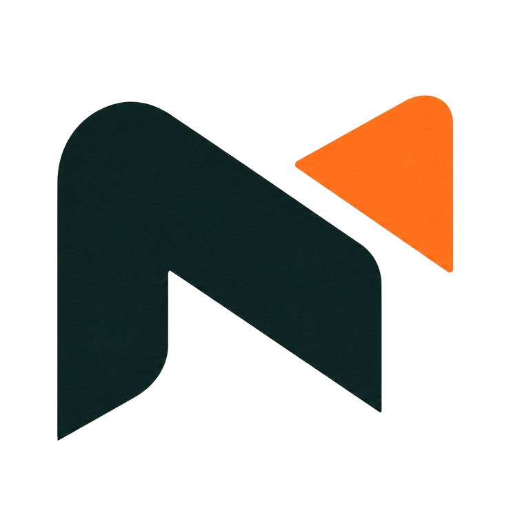
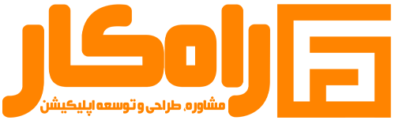
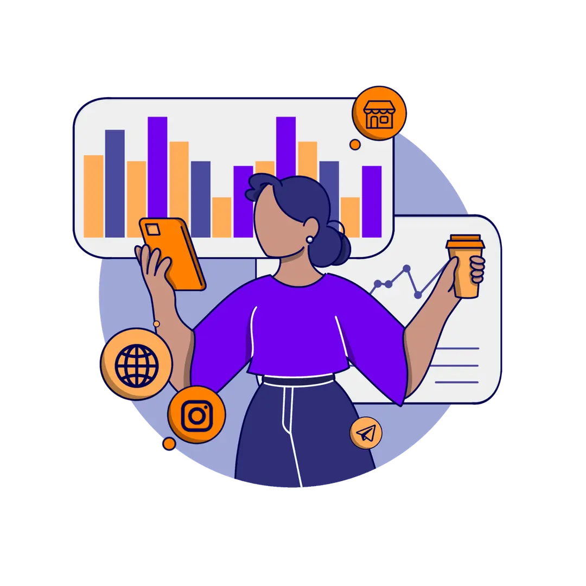
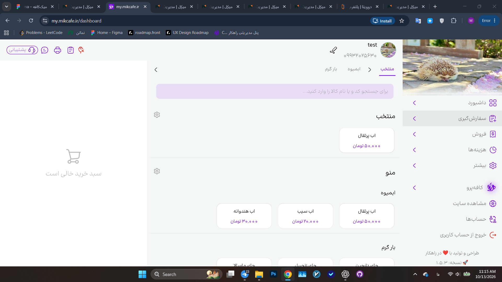

# دیزاین سیستم میکل

> استخراج اولیه: ۲۰ اکتبر ۲۰۲۶ — آخرین همگام‌سازی: ۲۱ اکتبر ۲۰۲۶ (۱۴۰۵/۰۷/۲۹). این سند وضعیت پیاده‌سازی فعلی هر ۱۱ صفحه، فایل‌های مشترک CSS و JavaScript و پوشه assets/ را ثبت می‌کند.

## ۱. نحوه استفاده و اولویت منابع

- این فایل مرجع مشترک طراحی پروژه است. پیش از تغییر ظاهر سایت، این سند و `AGENTS.md` را بخوانید.
- دستور جدید و صریح کاربر اولویت دارد. پس از تغییر تأییدشده، این سند را نیز به‌روز کنید.
- «مقیاس تایپوگرافی» مجموعه توکن‌هاست؛ همه کامپوننت‌ها عملاً از همان مقیاس استفاده نمی‌کنند. اندازه نهایی کامپوننت و override صفحه تعیین‌کننده است.
- همه ۱۱ صفحه از `assets/design-system.css` برای فونت، توکن‌ها، چیدمان، هدر، دکمه‌ها و فوتر مشترک استفاده می‌کنند. `assets/page-base.css` اندازه‌ها و چیدمان فشرده صفحات داخلی را تعیین می‌کند؛ `assets/site-interactions.css` و `assets/site-interactions.js` منوی ابزارها، پاپ‌اور و سوالات متداول را کنترل می‌کنند. `assets/testimonials.js` کاروسل واکنش‌گرای نظرات را فقط در صفحه اصلی کنترل می‌کند. استایل inline صفحه‌ای وجود ندارد؛ کپی‌های HTML هدر و فوتر باید هنگام تغییر هماهنگ شوند.
- ترتیب cascade مشترک است: design-system.css، سپس page-base.css در صفحه‌های داخلی، و در پایان site-interactions.css. پیوست CSS ترتیب هر فایل را عیناً حفظ می‌کند.
- CSSهای باقی‌مانده از قسمت‌های حذف‌شده را خودکار به رابط کاربری برنگردانید. وجود selector به‌تنهایی به معنی استفاده آن در صفحه نیست.

## ۲. هویت و اصول ظاهری

نام محصول «میکل» است؛ شکل اعراب‌دار «میکِل» نیز در کد وجود دارد. نام قدیمی «میک‌کافه» در متن‌های سایت با «میکل» جایگزین شده است. زبان فارسی، جهت کلی راست‌به‌چپ، پس‌زمینه گرم و روشن، سطوح سفید، سبز تیره برند، تأکید نارنجی، گوشه‌های گرد و سایه‌های نرم مبنای ظاهرند.

فایل‌ها UTF-8 هستند، با `<html lang="fa" dir="rtl">` و `<meta charset="utf-8">`. هنگام ویرایش، خواندن و نوشتن UTF-8 را صریح تعیین کنید. اسکریپت PowerShell دارای متن فارسی را با کدگذاری مناسب اجرا کنید؛ در این پروژه کدگذاری اشتباه قبلاً متن نظرات را خراب کرده است. صحت حروف فارسی را از خود فایل نهایی کنترل کنید.

## ۳. رنگ‌ها و توکن‌های معنایی

| نقش | مقدار | کاربرد |
| --- | --- | --- |
| پس‌زمینه برند | `#F3F1ED` | بدنه و اکثر سکشن‌ها |
| نارنجی برند | `#F17938` | دکمه‌ها، قیمت، عدد تأکیدی، نقاط و نقل‌قول |
| سبز اصلی برند | `#192827` | فوتر، خلاصه خرید، بخش‌هایی از عنوان‌ها و CTA |
| نارنجی تیره | `#cf5d25` | hover لینک و متن تأکیدی |
| hover دکمه اصلی | `#f58a4f` | زمینه دکمه در hover |
| سبز مکمل | `#087f7a` | حالت انتخاب افزونه، گرادیان CTA و حاشیه دکمه |
| سبز مکمل CTA | `#0b6b63` | انتهای گرادیان |
| سطح اصلی | `#fff` | کارت‌ها و پنل‌ها |
| متن بدنه صفحه اصلی / `--ink` | `#1e293b` | مقدار توکن فعلی؛ با سبز برند یکسان نیست |
| متن ثانویه صفحه اصلی / `--muted` | `#64748b` | توضیحات و جزئیات |
| متن صفحات فرعی / `--ink` | `#192827` | override درباره و تاریخچه |
| متن ثانویه صفحات فرعی / `--muted` | `#586966` | override درباره و تاریخچه |
| مرز پایه / `--line` | `#e2e8f0` | حاشیه کارت، پنل و دکمه |
| موفقیت / `--green` | `#15803d` | تیک و تغییر مثبت |
| خطا / `--red` | `#dc2626` | توکن وضعیت خطا |
| نارنجی لطیف | `rgba(241,121,56,.12)` | مربع نقل‌قول و حلقه نقاط |
| سطح انتخاب‌شده | `#f7fbf9` | کارت افزونه فعال |
| متن روی سطح تیره | `#fff`، `#e7ecea` | خلاصه خرید و فوتر |
| متن ثانویه روی تیره | `#b8c4c1`، `#c3d2ce` | توضیح و برچسب خلاصه خرید |
| focus عمومی | `#f59e0b` | outline سه پیکسلی با فاصله سه پیکسل |

توکن‌های آبی `--blue:#2563eb`، `--blue-dark:#1d4ed8` و `--blue-soft:#eff6ff` هنوز در CSS وجود دارند. برخی نمودارها، هاله‌ها، focus ورودی و زمینه آیکون‌ها از آن‌ها استفاده می‌کنند. این‌ها را رنگ اصلی برند جدید تلقی نکنید. گرادیان متحرک دکمه هدر نیز عمداً یک بخش `#3B82F6` دارد. فهرست کامل مقادیر رنگ و CSS در پیوست آمده است.

گرادیان‌های اصلی:

```css
/* CTA سبز */
linear-gradient(120deg,#192827 0%,#087f7a 58%,#0b6b63 100%)
/* قاب انتخاب افزونه */
linear-gradient(125deg,#192827 0%,#087f7a 48%,#f17938 100%)
/* زمینه تصویر بلاگ */
linear-gradient(135deg,#e8eef8,#fff1e9)
```

## ۴. تایپوگرافی

فونت مشترک IRANSansFaNum از assets/IRANSans-FaNum-Medium.ttf است. @font-face در design-system.css مسیر نسبی url("IRANSans-FaNum-Medium.ttf")، وزن ۵۰۰، font-display:swap و fallback برابر Tahoma, sans-serif دارد. فایل مستقل Regular/Bold وجود ندارد؛ درخواست وزن‌های ۴۰۰، ۷۰۰ و ۸۰۰ بر مبنای همان فایل موجود است.

کوچک‌تر شدن متن‌ها فقط در موبایل با عرض حداکثر ۷۲۰px اعمال می‌شود. از ۷۲۱px به بالا اندازه‌های تأییدشده قبلی دسکتاپ و تبلت برقرارند. بدنه دسکتاپ ۱۶px و موبایل ۱۴px است؛ وزن ۵۰۰ و line-height برابر ۱٫۸ حفظ شده‌اند. اندازه ریشه و مقیاس فاصله‌ها تغییر نکرده‌اند؛ rem با ریشه پیش‌فرض ۱۶px محاسبه می‌شود.

### مقیاس توکن‌ها

| توکن | دسکتاپ / تبلت ≥721px | موبایل ≤720px |
| --- | --- | --- |
| `--type-heading-1` | 64px | 56px |
| `--type-heading-2` | 56px | 48px |
| `--type-heading-3` | 48px | 40px |
| `--type-heading-4` | 40px | 36px |
| `--type-heading-5` | 32px | 28px |
| `--type-heading-6` | 24px | 22px |
| `--type-body-1` | 24px | 22px |
| `--type-body-2` | 22px | 20px |
| `--type-button-xl` | 32px | 28px |
| `--type-button-lg` | 28px | 24px |
| `--type-button-md` | 24px | 22px |
| `--type-button-sm` | 20px | 18px |
| `--type-button-xs` | 16px | 14px |

### اندازه‌های نهایی مهم

| المان | دسکتاپ ۱۴۴۰px | موبایل ۴۰۰px |
| --- | --- | --- |
| تیتر هیرو | 56px | 28px |
| توضیح هیرو | 17.28px | 14px |
| عنوان تعرفه | 32px | 28px |
| نام کارت خرید | 13.76px | 11px |
| نام نویسنده نظر | 14.72px | 13px |
| متن نظر | 14.4px | 13px |
| دکمه هدر | 16px | 11px |
| منوی اصلی | 14.08px | 13px |
| عنوان شبکه‌های اجتماعی | 24px | 22px |
| کپی‌رایت | 10px | 9px |
| عنوان درباره ما | 40px | 24px |
| معرفی درباره ما | 18px | 14px |
| تیتر کارت ارزش‌ها | 20px | 16px |
| متن کارت ارزش‌ها | 16px | 14px |
| دعوت پایانی درباره ما | 28px | 22px |
| عنوان تاریخچه | 40px | 24px |
| معرفی تاریخچه | 18px | 14px |
| تیتر کارت تاریخچه | 20px | 16px |
| متن کارت تاریخچه | 16px | 14px |
| برچسب نسخه | 14px | 12px |

تیتر اصلی دسکتاپ ۵۶px و موبایل ۲۸px است. عنوان صفحات داخلی در دسکتاپ ۴۰px، تبلت ۳۶px و موبایل ۲۴px است. عنوان عمومی h2 در دسکتاپ ۴۰px و موبایل ۲۸px است. عنوان ویدیوی دسکتاپ clamp(12px,2.2vw,34px) و موبایل clamp(11px,3.15vw,18px) است. تصویر همچنان قبل از عنوان موبایل می‌آید و نام کارت‌های خرید موبایل با فونت ۱۱px در ستون جدا از علامت توضیح قرار دارد. قواعد بازیابی اندازه‌های قبلی با @media(min-width:721px) محدود شده‌اند؛ اصلاح بعدی موبایل نباید اندازه دسکتاپ را تغییر دهد.

## ۵. چیدمان، فاصله و ابعاد

| الگو | مقدار فعلی |
| --- | --- |
| کانتینر دسکتاپ | `min(1160px,calc(100% - 48px))`؛ وسط‌چین |
| کانتینر ≤720px | `min(100% - 32px,560px)` |
| ارتفاع هدر | 78px؛ موبایل 68px |
| scroll offset | `scroll-padding-top:88px` |
| هیرو | `min-height:calc(100svh - 78px)`؛ padding `34px 0 42px` |
| ستون‌های هیرو | `.92fr 1.08fr`؛ gap 42px |
| سکشن محتوایی | padding عمودی 92px؛ موبایل 68px |
| عنوان سکشن | max-width 650px؛ فاصله پایین 42px |
| سکشن ویدیو | `112px 0 34px`؛ موبایل `58px 0 28px` |
| تصویر ویدیو | max-width 860px؛ نسبت 16/9 |
| workflow | ستون‌های `.9fr 1.1fr`؛ gap 55px |
| تایم‌لاین قابلیت | حلقه ۳۰۰ درجه با شش گره، بخش چسبان و توضیح مرکزی؛ موبایل بازچینی عمودی |
| module grid | 4 ستون / gap 14px |
| blog grid | 3 ستون / gap 16px |
| تعرفه | padding `34px 0 38px`؛ عنوان با margin-bottom 18px |
| نظرات | padding عمودی 82px؛ موبایل 58px |
| صفحات فرعی | padding `64px 0 80px`؛ موبایل `40px 0 56px` |

فواصل رایج واقعی: ۴، ۶، ۸، ۹، ۱۰، ۱۲، ۱۴، ۱۶، ۱۸، ۲۰، ۲۲، ۲۴، ۲۸، ۳۰، ۳۲، ۳۶، ۴۰، ۴۲، ۴۸، ۵۵، ۶۴، ۶۸، ۸۰، ۸۲، ۸۸ و ۹۲px. یک مقیاس spacing توکنی مستقل در کد تعریف نشده؛ این اعداد مقادیر مصرف‌شده‌اند، نه ادعای یک سیستم مضارب هشت.

توکن‌های مشترک جدید: `--brand-primary:#192827`، `--brand-secondary:#087f7a` و `--header-height:78px` (موبایل ۶۸px). در page-base.css توکن‌های `--page-heading`، `--page-lead`، `--page-card-heading`، `--page-copy` و padding صفحه، همان اندازه‌های فشرده جدول تایپوگرافی را اعمال می‌کنند. محتوای خالی صفحه‌های ابزار و وبلاگ نیز min-height برابر `calc(100svh - var(--header-height))` دارد.

## ۶. سطوح، گوشه‌ها، سایه و لایه‌بندی

- شعاع پایه `--radius:20px`؛ دکمه ۱۲px؛ FAQ و workflow ۱۴px؛ کارت بلاگ و نظر ۱۸px؛ ویدیو و CTA ۲۶px؛ قاب بیرونی پلن ۲۸px؛ badge کپسولی `999px` یا `50%`.
- سایه پایه: `0 20px 50px rgba(30,41,59,.10)`؛ سایه نرم: `0 8px 24px rgba(30,41,59,.07)`.
- blur هدر: `blur(20px) saturate(145%)`؛ زمینه `rgba(243,241,237,.52)` و border با alpha .10.
- کارت‌ها غالباً مرز ۱px و سطح سفید دارند. قاب پلن با padding دو پیکسل، مرز گرادیانی می‌سازد.
- z-index هدر ۲۰؛ skip-link برابر ۱۰۰؛ کارت افزونه عادی صفر و با `.period-open` برابر ۲۰؛ منوی دوره ۳۰ درون همان کارت؛ کارت وسط نظرات ۱؛ برچسب workflow برابر ۲.
- برای dropdown فقط z-index خود منو کافی نیست: کارت والد باید در stacking context بالاتری از کارت‌های همسایه قرار گیرد. حالت `.period-open` را حفظ کنید؛ منو نباید توسط overflow والد بریده شود.

## ۷. کامپوننت‌ها و حالت‌ها

### هدر و ناوبری

`.topbar` sticky در بالای صفحه، دارای backdrop blur. لوگو در `.brand-mark` با ابعاد ۴۶×۴۶ و `object-fit:contain`؛ در ≤420 ابعاد ۳۸×۳۸. نام برند در دسکتاپ 1.25rem و در موبایل ≤420 برابر 1rem است. ترتیب لینک‌ها: خانه، ابزارها، تعرفه‌ها، بلاگ، تاریخچه به‌روزرسانی، درباره ما. ابزارها با hover، کلیک و کیبورد باز می‌شود؛ پنج لینک فعال و دو گزینه غیرفعال برای انبار و رسپی و باشگاه مشتریان دارد. لوگو لینک صفحه اصلی است. در صفحات فرعی anchorها به `index.html#…` اشاره می‌کنند و لینک صفحه جاری `aria-current="page"` دارد.

در ≤720 منو به پنل کناری مات از لبه چپ تبدیل می‌شود؛ عرض min(56vw,220px) و فاصله داخلی افقی ۶px، ارتفاع 100dvh و زمینه #F3F1ED دارد. باز و بسته شدن افقی ۳۶۰ms است. لایه پشت پنل با rgba(25,40,39,.58) و blur(6px) کل صفحه را می‌پوشاند. هدر موبایل نیز مات است. پنل خارج هدر در body قرار می‌گیرد؛ z-index پوشش ۱۰۰۰ و پنل ۱۰۰۱ است. دکمه بستن، کلیک بیرون، Escape و انتخاب لینک منو را می‌بندند؛ قفل اسکرول و مدیریت فوکوس فعال‌اند. در دسکتاپ منو به هدر بازمی‌گردد و چیدمان قبلی حفظ می‌شود. رفتار مشترک در site-interactions.js است.

زیرمنوی ابزارها در موبایل در هر بار کلیک با انیمیشن ارتفاع ۳۲۰ms باز و بسته می‌شود؛ کلیک سریع حرکت را از ارتفاع فعلی برمی‌گرداند. گزینه‌های بسته از فوکوس خارج‌اند و در حالت کاهش حرکت، تغییر فوری است.

### تایم‌لاین قابلیت‌ها

کارت‌های شش‌گانه قابلیت در سکشن صندوق با تایم‌لاین حلقه‌ای جایگزین شده‌اند. حلقه در پیمایش صفحه تا ۳۰۰ درجه می‌چرخد؛ گره فعال به بالا می‌آید و توضیح مرکزی بدون کادر، با محوشدن کوتاه عوض می‌شود. گره‌ها با حروف فارسی و دکمه‌های قابل کلیک‌اند. رنگ‌ها سبز اصلی `#192827`، سبز مکمل `#087f7a` و نارنجی برند `#f17938` هستند. تایپوگرافی از فونت مشترک IRANSansFaNum و اندازه تیتر/متن کارت قابلیت (۱۶٫۸/۱۴٫۵۶px دسکتاپ و ۱۴/۱۲px موبایل) پیروی می‌کند. در موبایل حلقه متناسب با قاب بازچینی می‌شود. در prefers-reduced-motion حلقه حذف و فهرست متنی ساده هر شش قابلیت نمایش داده می‌شود.

### دکمه‌ها

`.button`: min-height ۴۸px، padding `10px 20px`، gap ۹px، border یک پیکسل، radius ۱۲px، متن دسکتاپ ۱۶px و موبایل ۱۴px با وزن ۴۰۰. آیکون ۱۸×۱۸. hover: `translateY(-2px)` طی .22s.

`.button-primary`: نارنجی و متن سفید؛ `.button-quiet`: سفید با مرز و متن ink. کلاس قدیمی `.button-blue` در پیاده‌سازی فعلی نارنجی است. دکمه هدر «رایگان شروع کنید» min-height ۴۴px و padding `8px 15px` دارد؛ در ≤420 متن .6875rem، ارتفاع ۳۸px و padding `6px 8px` می‌شود.

دکمه هدر LightBeam با CSS خالص پیاده شده: `@property --lightbeam-angle`، گرادیان مخروطی، دور کامل ۳٫۲ ثانیه خطی، درخشش داخلی و shine در hover با مدت .45s. این پروژه برای این دکمه به React، framer-motion یا Tailwind وابسته نیست.

### هیرو و کلمات چرخان

تیتر سه خط ثابت دارد: «دخل و خرج»، خط متغیر، «رو مدیریت کن». ترتیب کلمات: «کافی شاپت»، «رستورانت»، «آبمیوه بستنیت»، «فست فودیت». ساختار چهار وجهی 3D با preserve-3d، perspective برابر ۷۰۰px، ارتفاع 1.25em و عمق وجه .625em است. هر گام rotateX برابر منفی ۹۰ درجه است و در برگشت لوپ هم جهت عوض نمی‌شود. انیمیشن transform مدت .68s و easing برابر `cubic-bezier(.65,0,.35,1)` دارد؛ interval کد ۱۶۸۰ms است. یک متن نامرئی اندازه ظرف را ثابت نگه می‌دارد. واژه‌ها تایپ نمی‌شوند.

رسانه فعلی هیرو تصویر `assets/mikel-hero.webp` است. کلاس `.hero-illustration` عرض حداکثر ۵۴۰px، نسبت ۱:۱ و object-fit contain دارد. در موبایل ظرف آن حداکثر ۲۸۰px و پیش از عنوان است. وجود فایل mikel-hero-loop.mp4 در assets به معنی نمایش فعلی ویدیو نیست.

### پیش‌نمایش ویدیو

قاب ۱۶:۹ با radius ۲۶px، پس‌زمینه سبز تیره، تصویر cover و max-width ۸۶۰px. play دایره‌ای ۸۲px با blur و مرکز مطلق؛ موبایل ۶۲px. این بخش فعلاً تصویر جایگزین ویدیو دارد؛ ظاهر play به‌تنهایی اثبات پخش ویدیو نیست. عنوان یک‌خطی و اعداد ۳ نارنجی و بزرگ‌تر با `.result-number` هستند: اندازه 1.28em، وزن ۸۰۰.

### workflow و آکاردئون

تصویر داشبورد با Screenshot (123).png، تصویر سفارش‌گیری با Screenshot (126).png، تصویر فروش با Screenshot (128).png و تصویر هزینه‌ها با Screenshot (131).png جایگزین شده‌اند. برای هر چهار تصویر، crop قبلی غیرفعال است: top و left صفر، width و height صد درصد و object-fit برابر contain؛ بنابراین تصویر کامل داخل همان قاب ثابت دیده می‌شود.

چهار بخش سفارش‌گیری، داشبورد، فروش و هزینه‌ها با `details/summary`، ابتدا بسته. هنگام بازشدن یک مورد، بقیه بسته می‌شوند. علامت + به − تبدیل می‌شود. قاب تصویر نسبت ۱٫۹ دارد و ثابت می‌ماند؛ عکس با opacity .24s محو می‌شود، src پس از ۲۴۰ms تغییر می‌کند و بعد از load تصویر جدید نمایان می‌شود. top عکس منفی ۱۰٪، left منفی ۱۲٫۵٪ و width برابر ۱۲۵٪ است؛ این crop عمدی است. بسته‌شدن همه پنل‌ها آخرین تصویر را پاک نمی‌کند.

### CTA سبز

`.cta-panel` با گرادیان سبز، padding `52px 50px`، radius ۲۶px، gap ۳۰px و نقش‌های دایره‌ای تزئینی؛ متن سفید و توضیح `#d6eee7`. موبایل block، متن وسط، padding `32px 24px` و دکمه تمام‌عرض. این بخش قبلاً آبی بود؛ رنگ فعلی سبز است.

### دکمه‌های نارنجی

دکمه‌های نارنجی (`.button-primary`، `.button-blue`، دکمه CTA و دکمه خرید) از پس‌زمینه نارنجی، حاشیه نورانی چرخان، درخشش و برق گذرای دکمه هدر استفاده می‌کنند؛ در کاهش حرکت، انیمیشن و برق خاموش می‌شوند.

### انتخاب افزونه و خلاصه خرید

- پوسته گرادیانی، پنل راست سفید برای انتخاب و پنل چپ `#192827` برای خلاصه. ستون‌ها `minmax(0,1.15fr) minmax(290px,.85fr)`، gap ۷px و padding ۷px؛ موبایل یک ستون.
- پنل داخلی padding ۱۸px و radius ۲۰px. افزونه‌ها در grid دو ستونه با gap ۸px؛ کارت min-height برابر ۱۱۶px و padding ۹px.
- نام افزونه راست‌چین و قابل شکستن به خط دوم است؛ کنترل دوره بالای چپ و انتخاب وضعیت بالای راست است. در موبایل کارت سه ردیف `31px auto auto` دارد: جای کنترل‌ها، نام و راهنما، سپس قیمت. عنوان ۱۱px و علامت توضیح در ستون ثابت ۱۸px است؛ آیکون قابلیت ۲۴px است. قیمت در جریان چیدمان و با margin-top برابر ۱۰px قرار می‌گیرد تا زیر متن‌های چندخطی نیفتد. کنترل انتخاب مستقل و روی سطح کارت گسترده است.
- آیکون افزونه ۳۲×۳۲ با radius ۱۰px. انتخاب: مرز سبز مکمل، زمینه `#f7fbf9` و آیکون با زمینه سبز اصلی و متن سفید. hover کارت حرکت منفی ۲px دارد.
- انتخاب با `aria-pressed` و `.is-selected`؛ دوره با `aria-expanded`، `.period-menu.open` و `aria-checked` کنترل می‌شود. یک منوی دوره در لحظه باز است و کلیک بیرون کارت منو را می‌بندد.
- دوره‌ها: یک‌ماهه، سه‌ماهه و یک‌ساله؛ مقدار اولیه سه‌ماهه است. کارت‌ها قیمت را به‌هزار تومان نمایش می‌دهند و جمع خرید با تومان کامل محاسبه می‌شود. مقادیر ماهانه/سه‌ماهه/یک‌ساله به‌ترتیب: منو آنلاین ۳۰۹٬۰۰۰/۸۳۴٬۰۰۰/۲٬۹۶۶٬۰۰۰؛ تخفیف ۱۵۵٬۰۰۰/۴۱۸٬۰۰۰/۱٬۴۸۸٬۰۰۰؛ پرسنل ۱۱۲٬۰۰۰/۳۰۲٬۰۰۰/۱٬۰۷۵٬۰۰۰؛ میز ۲۴۳٬۰۰۰/۶۵۶٬۰۰۰/۲٬۳۳۲٬۰۰۰؛ فیش‌پرینتر ۳۷۰٬۰۰۰/۹۹۹٬۰۰۰/۳٬۵۵۲٬۰۰۰ تومان است.
- برچسب «قیمت کل» روی یک سطر و عدد روی سطر بعدی است. عدد کل `1.55rem / 800`، واحد `.85rem / 700`؛ `direction:ltr` فقط برای چینش رقم‌هاست و قالب‌بندی `Intl.NumberFormat('fa-IR')` است.
- هر رقم کل روی نوار عمودی ارقام ۰ تا ۹ می‌چرخد: ارتفاع 1.1em، عرض .66em، transition برابر .75s با `cubic-bezier(.22,.8,.25,1)`؛ جداکننده عرض .28em دارد.
- صرفه‌جویی در حالت بدون انتخاب صفر است. برای انتخاب ماهانه، صرفه‌جویی صفر است؛ برای سه‌ماهه، سه برابر قیمت ماهانه منهای قیمت سه‌ماهه؛ و برای یک‌ساله، دوازده برابر قیمت ماهانه منهای قیمت سالانه جمع می‌شود. نتیجه منفی به صفر محدود می‌شود.
- قیمت پنج قابلیت طبق مقادیر کاربر در داده ثبت شده‌اند؛ مبلغ کارت‌ها به هزار تومان و جمع خرید به تومان کامل است.
- دکمه نهایی «خرید» است. ظاهر این بخش به معنی وجود پرداخت واقعی یا اتصال سرور نیست.

### سؤالات متداول

حداکثر عرض ۷۸۰px، فاصله آیتم ۱۰px، radius ۱۴px، padding افقی ۱۸px. summary دارای padding عمودی ۱۷px و وزن ۷۰۰ است. باز و بسته شدن پاسخ‌ها در هر بار کلیک با Web Animations API و زمان ۴۸۰ms اجرا می‌شود؛ هنگام بستن، ویژگی open تا پایان انیمیشن نگه داشته می‌شود. کلیک سریع حین حرکت انیمیشن جاری را از ارتفاع فعلی برمی‌گرداند. در حالت کاهش حرکت پاسخ‌ها فوری باز و بسته می‌شوند.

### راهنمای ابزارها و صفحه‌های پایه

کنار نام هر پنج قابلیت خرید، دکمه علامت تعجب با سبز اصلی قرار دارد؛ hover و focus آن نارنجی می‌شود. پاپ‌اور سبز اصلی با سه خط لورم ایپسوم و لینک «مشاهده بیشتر...» در پایین چپ، خارج از stacking context کارت و با position:fixed نمایش داده می‌شود. کنترل توضیح مستقل از دکمه انتخاب قابلیت است؛ کیبورد، Escape و لمس پشتیبانی می‌شوند. صفحه‌های هر هفت ابزار و blog.html هدر و فوتر مشترک و main خالی دارند. پایین چپ کارت سوم وبلاگ، لینک «بیشتر بخوانید...» به blog.html است.

### نظرات کاربران

در دسکتاپ سه کارت هم‌زمان دیده می‌شود؛ کارت وسط scale برابر 1.045 و دو کارت کناری scale برابر .93 دارند. در موبایل فقط یک کارت افقی با عرض کامل قاب دیده می‌شود و بقیه خارج از قاب و بریده‌اند؛ scale موبایل یک و opacity همه کارت‌ها یک است. track برای translate افقی LTR و خود کارت RTL است. حرکت خودکار از راست به چپ است و با cloneهای ابتدا/انتها لوپ می‌شود. محاسبه عرض و جابه‌جایی در `assets/testimonials.js` بسته به نمایش یک یا سه کارت تغییر می‌کند.

مکث فعلی پس از رسیدن کارت به مرکز **۱۵۰۰ms** و مدت حرکت **۷۲۰ms** است؛ بنابراین فاصله شروع دو حرکت عادی تقریباً ۲۲۲۰ms است. hover کل کاروسل یا focus داخلی autoplay را متوقف می‌کند. فلش‌های دو طرف حرکت دستی دارند. کلیک‌های حین حرکت با قفل animating نادیده گرفته می‌شوند.

فلش دسکتاپ ۴۴×۴۴ و موبایل ۳۶×۳۶ است. فلش‌های موبایل زیر کارت قرار دارند؛ فضای کنترل‌ها ۵۲px است. کارت min-height برابر ۲۰۵px و موبایل ۱۷۶px دارد؛ padding دسکتاپ ۲۲px و موبایل ۲۰px است. نام کافه و مربع نقل‌قول کنار هم‌اند. مربع ۳۸×۳۸، radius ۱۲px، پس‌زمینه نارنجی با alpha .12 و علامت نارنجی SVG دقیقاً وسط است؛ موبایل ۲۸×۲۸ و radius ۹px. متن‌ها همان پنج نظر اصلی کاربر هستند و نباید دوباره تولید یا بازنویسی شوند.

### بلاگ و فوتر

بلاگ آخرین سکشن محتوایی پیش از فوتر است. کارت با radius ۱۸px، مرز و سطح سفید؛ ناحیه تصویر ۱۲۸px با آیکون ۴۲px؛ padding متن ۱۸px؛ تیتر 1rem و توضیح .82rem. در موبایل تک‌ستونه است.

فوتر همه صفحه‌ها از یک markup هماهنگ استفاده می‌کند: اطلاعات برند، آدرس و سه نشان در سمت راست و سه ستون لینک در سمت چپ. ستون‌ها به ترتیب راست‌به‌چپ شامل «درباره میکل»، «راهنما» و «قوانین و اطلاعات» هستند. آدرس زیر عنوان برند است. زمینه اصلی #192827 و متن‌ها روشن‌اند؛ کپی‌رایت وسط‌چین است و به https://rahkarapp.ir/ پیوند دارد. پشتیبانی، قوانین و حریم خصوصی بدون لینک‌اند.

پنل شبکه‌های اجتماعی در `.footer-social-zone` و در جریان عادی چیدمان قرار دارد؛ پس‌زمینه این ناحیه در نیمه بالا رنگ سایت و در نیمه پایین سبز اصلی است تا ظاهر پنل نیمه‌بیرون فوتر حفظ شود. این روش مستقل از ارتفاع متن است و مانع افتادن پنل روی لینک‌ها می‌شود. پنل همان گرادیان CTA، سایه برجسته، نقش حلقه‌ای، radius ۲۶px و حداقل ارتفاع ۱۳۶px دسکتاپ را دارد. عنوان Body Regular در دسکتاپ ۲۴px و موبایل ۲۲px است و لوگو پیش از آن می‌آید. در موبایل، ردیف عنوان و لوگو بالای آیکن‌های وسط‌چین قرار می‌گیرد؛ padding پنل ۲۰px، فاصله ردیف‌ها ۱۸px و ارتفاع تابع محتواست. محتوای فوتر با فاصله ۳۲px در دسکتاپ و ۲۸px در موبایل زیر پنل می‌آید.

### درباره ما

عرض کانتینر همان صفحه اصلی است. هیرو سفید، grid برابر `1.15fr .85fr`، gap ۳۶px، padding ۴۰px و radius ۲۰px؛ لوگو داخل قاب روشن min-height برابر ۲۸۰px و عرض حداکثر ۲۴۰px. کارت‌های ارزش سه ستون، gap ۲۰px، padding ۲۴px و فاصله بالای ۲۴px. موبایل هیرو و کارت‌ها یک‌ستونه، padding هیرو ۲۴px، قاب لوگو حداقل ۲۰۰px و لوگو حداکثر ۱۸۰px است. اندازه نهایی فونت‌ها در جدول تایپوگرافی ثبت شده است.

### تاریخچه به‌روزرسانی

عنوان و لیست حداکثر ۱۰۰۰px؛ فاصله کارت‌ها ۲۰px. کارت نسخه دو ستون `180px minmax(0,1fr)`، gap ۲۸px، padding ۲۸px، radius ۲۰px و سایه نرم دارد. در ≤980 ستون metadata برابر ۱۵۰px و gap برابر ۲۲px می‌شود؛ در ≤720 تک‌ستونه با gap ۱۴px، padding ۲۲px و فاصله کارت‌ها ۱۶px. برچسب نسخه با نقطه نارنجی ۸px و حلقه ۴px است. فونت‌های compact آخرین override معتبرند، نه قواعد بزرگ‌تر بالاتر در CSS.

## ۸. ریسپانسیو و کاهش حرکت
نمونه حرکت: Video_261021140708.mp4. خط پیشرفت SVG با ضخامت ثابت ۴px و انتهای گرد از ساعت ۱۲ در جهت عقربه‌های ساعت و هم‌زمان با حرکت خارجی پیش می‌رود؛ اسکرول معکوس خط را برمی‌گرداند. شروع و پایان پیشرفت با محدوده sticky زیر هدر هم‌تراز است. طول مسیر اسکرول دسکتاپ ۱۵۰۰px به‌علاوه ارتفاع هدر و موبایل ۱۱۰۰px به‌علاوه ارتفاع هدر است. فقط حلقه مرکزی خط پیشرفت دارد؛ حلقه خارجی طبق توضیح زیر با اسکرول می‌چرخد.


تایم‌لاین امکانات چهار حلقه دارد. هر شش آیکن فقط روی خارجی‌ترین حلقه با فاصله زاویه‌ای ۶۰ درجه قرار دارند؛ حلقه‌های داخلی بدون آیکن هستند. اسکرول، حلقه خارجی را در پنج گام ۶۰ درجه‌ای ساعت‌گرد حرکت می‌دهد. چرخش خارجی و کامل‌شدن خط داخلی از یک مقدار پیشرفت مشترک در requestAnimationFrame استفاده می‌کنند. هر گام طی ۵۲۰ms با easing مکعبی ease-out اجرا می‌شود؛ هر دو هم‌زمان شروع، توقف و معکوس می‌شوند و با رسیدن به قابلیت ششم، خط مرکزی کامل می‌شود. transition مستقل transform حذف شده است؛ آیکن‌ها با چرخش معکوس عمودی می‌مانند. پس از رسیدن آیکن به ساعت ۱۲، همان آیکن با زمینه سبز اصلی، نوشته سفید، scale برابر ۱٫۱۶ و سایه برجسته فعال می‌شود و متن فارسی مربوط به آن نمایش داده می‌شود. کلیک روی آیکن نیز به جایگاه اسکرول همان قابلیت می‌رود. اسکرول معکوس به قابلیت قبلی برمی‌گردد. فقط حلقه مرکزی خط پیشرفت نارنجی همگام با حرکت خارجی دارد؛ رنگ دیگر حلقه‌ها ثابت است. لوگو در مرکز و متن در سمت راست حفظ می‌شوند.


| شرط | اثر مهم |
| --- | --- |
| ≤980px | هیرو و workflow یک‌ستونه؛ حداقل ارتفاع هیرو حذف؛ module دو ستون |
| ≤720px | هدر ۶۸px، منوی موبایل، کانتینر ۵۶۰px، بلاگ و پلن تک‌ستونه؛ feature دو ستون |
| ≤420px | لوگو و CTA هدر کوچک‌تر؛ feature تک‌ستونه؛ ریزتنظیم داشبورد نمایشی |
| ≥721px و ارتفاع ≤760px | فاصله ویدیو `28px 0 22px` و عرض حداکثر ۷۶۰px |
| ≥721px و ارتفاع ≤650px | فاصله ویدیو `14px 0` و عرض حداکثر ۶۰۰px |
| `prefers-reduced-motion:reduce` | smooth scroll حذف؛ animation/transition به .01ms و یک تکرار محدود؛ LightBeam خاموش؛ autoplay نظرات و چرخش واژه‌ها با JS متوقف |

نکته پیاده‌سازی: CSS ارتفاع کوتاه دسکتاپ بر فاصله زیاد بالای ویدیو غلبه می‌کند. ثبت این رفتار به معنی تغییر آن نیست. کاروسل نظرات در موبایل یک کارت کامل نشان می‌دهد؛ عنوان کافه و متن نظر ۱۳px هستند. تغییر اندازه حین حرکت، چیدمان و زمان‌بندی را بازنشانی می‌کند تا کاروسل قفل نشود.

## ۹. دسترس‌پذیری و قراردادهای تعاملی

- المان‌های بومی `button`، `nav`، `main`، `section`، `details/summary` حفظ شوند. لینک برای پیمایش و button برای تغییر وضعیت است.
- active page با `aria-current`، منو با `aria-expanded` و انتخاب قابلیت با `aria-pressed` مشخص می‌شود؛ وضعیت‌ها همراه ظاهر تغییر کنند.
- cloneهای کاروسل `aria-hidden=true` دارند؛ متن معادل عدد کل از `aria-label` خوانده می‌شود و رقم‌های تزئینی aria-hidden هستند.
- focus عمومی outline ۳px با offset ۳px است. حرکت محدود ترجیح سیستم رعایت شود.
- تصاویر محتوایی alt و تصاویر تزئینی aria-hidden/alt خالی دارند. آیکون‌ها SVG inline و اندازه‌شان وابسته به کامپوننت است؛ فونت آیکون جداگانه وجود ندارد.
- آیکن‌های LinkedIn و Instagram و دو آیکن عمومی پخش در فوتر از فایل [10,000 Free Icons](https://www.figma.com/design/g9t9P84c1NVAvYvs0ePBQY/10-000-Free-Icons---Open-Source-Icon-set--Community-?node-id=1-3) برداشته شده‌اند؛ فایل‌های SVG محلی در `assets/` نگهداری می‌شوند. آیکن YouTube یا Aparat اختصاصی در صفحه انتخاب‌شده موجود نبود، بنابراین از آیکن عمومی Play و Broadcast استفاده شده است.

کد فعلی تضمین انطباق کامل WCAG، ناوبری کلیدی کامل dropdown یا آزمون کنتراست ندارد. این سند استخراج است و ادعای ممیزی دسترس‌پذیری نمی‌کند.

## ۱۰. دارایی‌ها و معماری پروژه

| فایل | نقش |
| --- | --- |
| `assets/IRANSans-FaNum-Medium.ttf` | فونت محلی فارسی با اعداد فارسی |
| `assets/mikel-logo.png` | لوگو و favicon |
| `assets/mikel-hero-loop.mp4` | ویدیوی loop هیرو |
| `assets/mikel-hero.webp` | تصویر هیرو موجود در assets |
| `assets/mikel-video-poster.png` | تصویر پیش‌نمایش بخش ویدیو |
| `assets/workflow-orders.png` | تصویر سفارش‌گیری |
| `assets/workflow-dashboard.png` | تصویر داشبورد |
| `assets/workflow-sales.png` | تصویر فروش |
| `assets/workflow-expenses.png` | تصویر هزینه‌ها |
| `assets/fani.png` | تصویر گواهی ارسالی برای فوتر |
| `assets/shahrak.png` | تصویر شهرک علمی و تحقیقاتی ارسالی برای فوتر |
| `assets/rahkar-logo1.png` | لوگوی شرکت راهکار در فوتر |


پروژه HTML/CSS/JavaScript بدون build است. فایل‌های صفحه و assets باید کنار هم حفظ شوند. مسیرهای رسانه relative هستند. `mikel-site-html.zip` بسته تحویلی است، نه منبع اصلی طراحی. `README.md` و `AGENTS.md` به این فایل ارجاع می‌دهند. این سند خودکار در زمان اجرا خوانده نمی‌شود؛ مرجع انسانی و عامل‌های پروژه است.

## ۱۱. راهنمای نگهداری برای همه چت‌های پروژه

۱. قبل از تغییر، فایل HTML مرتبط و override نهایی آن را بخوانید؛ سند جای مشاهده نسخه جاری کد را نمی‌گیرد.
۲. هنگام افزودن کامپوننت از رنگ‌ها، فونت، container و radius موجود استفاده کنید؛ صرفاً به دلیل نام قدیمی یک کلاس، رنگ آن را آبی نکنید.
۳. اندازه‌های صفحات فرعی، مکث نظرات ۱٫۵ ثانیه، مربع نقل‌قول کم‌رنگ، ترتیب سکشن‌ها، لینک جداگانه درباره/تاریخچه و جهت ثابت مکعب را حفظ کنید مگر کاربر تغییر بخواهد.
۴. متن‌های کاربر را با UTF-8 سالم حفظ کنید. از بازنویسی کل HTML با encoding پیش‌فرض محیط خودداری کنید.
۵. تغییرات واقعی طراحی را در بخش توضیحی، توکن‌ها و پیوست snapshot هماهنگ کنید. snapshot را با CSS قدیمی جایگزین نکنید.
۶. `AGENTS.md` راه کشف خودکار این مرجع برای چت‌هایی است که همین پوشه پروژه را باز می‌کنند. این فایل مجوز سیستم‌عامل یا sandbox چت‌های دیگر را تغییر نمی‌دهد؛ چت باید دسترسی موجود پروژه را داشته باشد.

## ۱۲. پیوست استخراج مستقیم از سورس

پیوست زیر از نسخه نهایی منابع ساخته شده است: fingerprint همه صفحه‌ها و فایل‌های مشترک، موجودی assets، CSS/JavaScript مشترک و HTML کامل هر صفحه. بنابراین padding، selectorهای حالت، داده قیمت‌ها، انیمیشن‌ها و media queryها بدون snapshot قدیمی یا مسیر فونت نادرست ثبت شده‌اند.

### Source snapshot / 2026-10-21 (updated) (updated) (updated)

| File | Bytes | SHA-256 |
| --- | --- | --- |
| about.html | 8776 | c8e7b4113322261c6d9e929f71b68bcb5408d0fc581163c2f4f05fc3698d8064 |
| blog.html | 6966 | a21bf2b5213da584731aa4abfca480011774e5aa96865948453b8fdaf1a9fbc1 |
| index.html | 47030 | 2ED818EE8132E3F6AD8C17B95AB9D124E6CBAD2E020CF2C54921A6E1B46CB94F |
| tool-discounts.html | 7005 | 00fec1bc9164aa44bf541adb2d99391a0a1a77fe628cead040f4009c9a12c0a7 |
| tool-inventory.html | 7021 | c9474f76b363944095dc5c67f4763062150f4834943c3cb0acfd6ca6a494cd38 |
| tool-loyalty.html | 6997 | 931a030269e7fb78d5dd2740d6c82e17a11e260d7642ef24009a09dee7ede4e6 |
| tool-online-menu.html | 6993 | 46af0931bbdbe134c746eac8d18a489b783ddf99f02b2a3d8195d8e59a66ebac |
| tool-printer.html | 7032 | d8eb36332105ba9d0661790bb0a94d0bebcaa7187645b2676dc839e4df8601dc |
| tool-staff.html | 7074 | 7a84b493d76d8c8de950de69383b08bce18cdc21a464c758c69a41fd4b44bd0f |
| tool-tables.html | 6993 | c71ff22265c61c55f86cd47939c62f01ffe9c973ad0b371e3a73eefad412df35 |
| updates.html | 8187 | 75956363e1d7d3b8f8f123cca286c0b4525a1abab94a8ad9a5369abb07148cac |
| assets/design-system.css | 56419 | 0ba0364b387f336bf44a344b6281fd3d3b6ec64d276f3768cc4f4e9ac8df5ced |
| assets/page-base.css | 4749 | 26a0a08a2e3d644808e92c582bc0138d29a21ce4151f82a4006a46fbdb01a541 |
| assets/site-interactions.css | 13177 | C14BFBB3FBC77B3C633DE09EF418F66FB59ED6E11C9891B475177C780206A4C1 |
| assets/features-timeline.js | 5087 | 24E2A21CD3116FF6D3A570212050239D40F2F7867EB61C9127EE432233AE3B14 |
| assets/site-interactions.js | 11268 | 530e87c191df313befd696c40d585f426e7fcb19d5b2c3b70a46e644ffc75a03 |
| assets/testimonials.js | 3319 | 4786be0566bd3d6cadd60630e5f6c9087eff5e34a064b17baea3d1e8b204ce28 |

### Asset inventory

- `assets/design-system.css`
- `assets/fani.png`
- `assets/figma-broadcast.svg`
- `assets/figma-instagram.svg`
- `assets/figma-linkedin.svg`
- `assets/figma-play.svg`
- `assets/IRANSans-FaNum-Medium.ttf`
- `assets/mikel-hero-loop.mp4`
- `assets/mikel-hero.webp`
- `assets/mikel-logo.png`
- `assets/mikel-video-poster.png`
- `assets/page-base.css`
- `assets/rahkar-logo1.png`
- `assets/shahrak.png`
- `assets/site-interactions.css`
- `assets/site-interactions.js`
- `assets/testimonials.js`
- `assets/features-timeline.js`
- `assets/workflow-dashboard.png`
- `assets/workflow-expenses.png`
- `assets/workflow-orders.png`
- `assets/workflow-sales.png`

<details>
<summary>Shared source: assets/design-system.css</summary>

```css
@property --lightbeam-angle {
      syntax: "<angle>";
      inherits: false;
      initial-value: 0deg;
    }
    @font-face { font-family: "IRANSansFaNum"; src: url("IRANSans-FaNum-Medium.ttf") format("truetype"); font-style: normal; font-weight: 500; font-display: swap; }
    :root {
      color-scheme: light;
      --blue: #2563eb;
      --blue-dark: #1d4ed8;
      --blue-soft: #eff6ff;
      --orange: #F17938;
      --orange-dark: #cf5d25;
      --ink: #1e293b;
      --muted: #64748b;
      --line: #e2e8f0;
      --paper: #F3F1ED;
      --white: #fff;
      --green: #15803d;
      --red: #dc2626;
      --shadow: 0 20px 50px rgba(30, 41, 59, .10);
      --soft-shadow: 0 8px 24px rgba(30, 41, 59, .07);
      --radius: 20px;
      /* Typography system — desktop reference scale */
      --type-heading-1: 56px;
      --type-heading-2: 48px;
      --type-heading-3: 40px;
      --type-heading-4: 36px;
      --type-heading-5: 28px;
      --type-heading-6: 22px;
      --type-body-1: 22px;
      --type-body-2: 20px;
      --type-button-xl: 28px;
      --type-button-lg: 24px;
      --type-button-md: 22px;
      --type-button-sm: 18px;
      --type-button-xs: 14px;
      --weight-regular: 400;
      --weight-bold: 700;
    }
    * { box-sizing: border-box; }
    html { scroll-behavior: smooth; scroll-padding-top: 88px; }
    body { margin: 0; background: #F3F1ED; color: var(--ink); font-family: "IRANSansFaNum", Tahoma, sans-serif; font-size: 14px; line-height: 1.8; font-weight: 500; }
    a { color: inherit; text-decoration: none; }
    button, input, textarea { font: inherit; }
    button, a, summary { -webkit-tap-highlight-color: transparent; }
    button, .button, summary { cursor: pointer; }
    :focus-visible { outline: 3px solid #f59e0b; outline-offset: 3px; }
    .container { width: min(1160px, calc(100% - 48px)); margin-inline: auto; }
    .skip-link { position: absolute; top: -60px; inset-inline-start: 16px; z-index: 100; padding: 10px 16px; background: var(--ink); color: #fff; border-radius: 8px; }
    .skip-link:focus { top: 12px; }
    .topbar { height: 78px; display: flex; align-items: center; border-bottom: 1px solid rgba(25,40,39,.10); background: rgba(243,241,237,.52); -webkit-backdrop-filter: blur(20px) saturate(145%); backdrop-filter: blur(20px) saturate(145%); position: sticky; top: 0; z-index: 20; }
    .nav { display: flex; align-items: center; justify-content: space-between; gap: 28px; }
    .brand { display: inline-flex; align-items: center; gap: 10px; font-size: 1.125rem; font-weight: 800; letter-spacing: -.04em; white-space: nowrap; }
    .brand-mark { width: 46px; height: 46px; display: grid; place-items: center; border-radius: 12px; background: transparent; flex:none; }
    .brand-mark img { width: 100%; height: 100%; object-fit: contain; }
    .nav-links { display: flex; align-items: center; gap: clamp(14px,2.1vw,28px); color: #334443; font-size: 0.8125rem; white-space: nowrap; }
    .nav-links a { transition: color .2s ease; }
    .nav-links a:hover { color: var(--orange-dark); }
    .nav-actions { display: flex; align-items: center; gap: 10px; }
    a.button.button-primary.header-cta { white-space: nowrap; min-height: 44px; padding: 8px 15px; position:relative; isolation:isolate; overflow:hidden; border:1px solid transparent; background:linear-gradient(var(--orange),var(--orange)) padding-box,conic-gradient(from var(--lightbeam-angle),#192827 0deg,#192827 238deg,#087F7A 270deg,#3B82F6 304deg,#192827 330deg,#192827 360deg) border-box; animation:lightbeam-rotate 3.2s linear infinite; box-shadow:0 0 18px rgba(8,127,122,.16),0 7px 16px rgba(241,121,56,.20); }
    a.button.button-primary.header-cta::before {content:"";position:absolute;inset:2px;border-radius:inherit;background:radial-gradient(ellipse at 50% 120%,rgba(255,255,255,.19),transparent 70%);z-index:-1;pointer-events:none;}
    a.button.button-primary.header-cta::after {content:"";position:absolute;top:0;bottom:0;left:-130%;width:55%;background:linear-gradient(100deg,transparent,rgba(255,255,255,.34),transparent);transform:skewX(-22deg);transition:left .45s ease;pointer-events:none;}
    a.button.button-primary.header-cta:hover::after {left:145%;}
    a.button.button-primary.header-cta:hover {box-shadow:0 0 25px rgba(8,127,122,.28),0 10px 22px rgba(241,121,56,.27);}
    @keyframes lightbeam-rotate {to {--lightbeam-angle:360deg;}}
    .login { font-size: 0.8125rem; font-weight: 600; color: #475569; padding: 8px 10px; }
    .button { display: inline-flex; align-items: center; justify-content: center; gap: 9px; min-height: 48px; padding: 10px 20px; border: 1px solid transparent; border-radius: 12px; font-size:var(--type-button-xs);font-weight:var(--weight-regular); transition: transform .22s ease, box-shadow .22s ease, background .22s ease; }
    .button-xl {font-size:var(--type-button-xl);font-weight:var(--weight-regular);}
    .button-lg {font-size:var(--type-button-lg);font-weight:var(--weight-regular);}
    .button-md {font-size:var(--type-button-md);font-weight:var(--weight-regular);}
    .button-sm {font-size:var(--type-button-sm);font-weight:var(--weight-regular);}
    .button-xs {font-size:var(--type-button-xs);font-weight:var(--weight-regular);}
    .button:hover { transform: translateY(-2px); }
    .button-primary { background: var(--orange); color: #fff; box-shadow: 0 7px 16px rgba(241,121,56,.20); }
    .button-primary:hover { background: #f58a4f; box-shadow: 0 10px 22px rgba(241,121,56,.27); }
    .button-blue { background: var(--orange); color: #fff; box-shadow: 0 8px 18px rgba(241,121,56,.2); }
    .button-blue:hover { background: #f58a4f; }
    .button-quiet { border-color: var(--line); color: var(--ink); background: white; }
    .button-quiet:hover { border-color: #bfdbfe; box-shadow: var(--soft-shadow); }
    .button svg { width: 18px; height: 18px; flex: none; }
    .menu-toggle { display: none; width: 44px; height: 44px; border: 1px solid var(--line); border-radius: 12px; background: white; color: var(--ink); }
    .menu-toggle svg { width: 21px; height: 21px; }

    .hero { position: relative; display:flex; align-items:center; min-height:calc(100svh - 78px); overflow:hidden; padding:34px 0 42px; background: radial-gradient(ellipse at 15% 12%, rgba(241,121,56,.10), transparent 35%), linear-gradient(180deg, #F3F1ED 0%, #F3F1ED 90%); }
    .hero::after { content: ""; position: absolute; width: 370px; height: 370px; border: 1px solid rgba(37,99,235,.08); border-radius: 50%; inset-inline-start: -170px; bottom: -220px; box-shadow: 0 0 0 42px rgba(37,99,235,.025), 0 0 0 86px rgba(37,99,235,.02); pointer-events: none; }
    .hero-grid { display: grid; grid-template-columns: .92fr 1.08fr; align-items: center; gap: 42px; position: relative; z-index: 1; }
    .eyebrow { display: inline-flex; align-items: center; gap: 8px; color: #192827; font-weight: 700; font-size: 0.75rem; }
    .eyebrow-dot { width: 8px; height: 8px; border-radius: 50%; background: var(--orange); box-shadow: 0 0 0 4px rgba(241,121,56,.1); }
    h1, h2, h3, p { margin-top: 0; }
    h1 { margin: 17px 0 18px; max-width: 600px; font-size: var(--type-heading-2); line-height: 1.25; letter-spacing: -.055em; font-weight: var(--weight-bold); text-align:start; }
    h2 { font-size:var(--type-heading-4);font-weight:var(--weight-bold); }
    .type-heading-1,.type-heading-2,.type-heading-3,.type-heading-4,.type-heading-5,.type-heading-6 {font-weight:var(--weight-bold);line-height:1.3;}
    .type-heading-1 {font-size:var(--type-heading-1);}
    .type-heading-2 {font-size:var(--type-heading-2);}
    .type-heading-3 {font-size:var(--type-heading-3);}
    .type-heading-4 {font-size:var(--type-heading-4);}
    .type-heading-5 {font-size:var(--type-heading-5);}
    .type-heading-6 {font-size:var(--type-heading-6);}
    .type-body-1 {font-size:var(--type-body-1);font-weight:var(--weight-regular);line-height:1.6;}
    .type-body-2 {font-size:var(--type-body-2);font-weight:var(--weight-regular);line-height:1.6;}
    .headline-line { display:block; }
    h1 .highlight { color: #192827; position: relative; white-space: nowrap; }
    h1 .highlight::after { content: ""; height: 9px; background: rgba(241,121,56,.23); border-radius: 8px; position: absolute; inset-inline: 0; bottom: 2px; z-index: -1; }
    .typing-word { display:inline-grid; grid-template:1fr / 1fr; min-height:1.4em; overflow:visible; perspective:700px; perspective-origin:center center; transform-style:preserve-3d; text-align:start; vertical-align:bottom; }
    .cube-measure,.word-cube { display:block; grid-area:1 / 1; white-space:nowrap; }
    .cube-measure { visibility:hidden; }
    .word-cube { position:relative; height:1.25em; transform:rotateX(var(--cube-turn,0deg)); transform-style:preserve-3d; transition:transform .68s cubic-bezier(.65,0,.35,1); will-change:transform; }
    .cube-face { position:absolute; inset:0; display:block; white-space:nowrap; backface-visibility:hidden; transform-style:preserve-3d; transform-origin:center center; }
    .cube-face:nth-child(1) { transform:translateZ(.625em); }
    .cube-face:nth-child(2) { transform:rotateX(90deg) translateZ(.625em); }
    .cube-face:nth-child(3) { transform:rotateX(180deg) translateZ(.625em); }
    .cube-face:nth-child(4) { transform:rotateX(270deg) translateZ(.625em); }
    @media (prefers-reduced-motion:reduce) { .word-cube { transition:none; } }
    .sr-only { position:absolute; width:1px; height:1px; padding:0; margin:-1px; overflow:hidden; clip:rect(0,0,0,0); white-space:nowrap; border:0; }
    .hero-copy { color: #526176; font-size: 1rem; max-width: 520px; margin-bottom: 25px; }
    .hero-buttons { display: flex; flex-wrap: wrap; gap: 12px; }
    .trust-row { display: flex; flex-wrap: wrap; gap: 20px; margin-top: 27px; color: #64748b; font-size: 0.75rem; }
    .trust-item { display: inline-flex; align-items: center; gap: 7px; }
    .trust-item svg { width: 17px; height: 17px; color: var(--green); }
    .product-wrap { position: relative; direction: rtl; }
    .product-glow { position: absolute; inset: 9% 5% -5% 4%; background: linear-gradient(135deg, rgba(37,99,235,.2), rgba(249,115,22,.12)); filter: blur(35px); border-radius: 40px; }
    .hero-illustration {display:block;position:relative;z-index:1;width:min(100%,540px);height:auto;aspect-ratio:1;object-fit:contain;margin-inline:auto;filter:drop-shadow(0 20px 28px rgba(25,40,39,.12));}
    .dashboard { position: relative; border: 1px solid rgba(255,255,255,.9); border-radius: 21px; background: rgba(255,255,255,.88); box-shadow: 0 26px 70px rgba(30,41,59,.16), 0 0 0 1px rgba(226,232,240,.65); overflow: hidden; backdrop-filter: blur(14px); transform: perspective(1100px) rotateY(-2deg) rotateX(1deg) scale(.88); }
    .dash-top { height: 48px; padding: 0 16px; display: flex; align-items: center; justify-content: space-between; border-bottom: 1px solid #edf1f6; background: rgba(255,255,255,.95); }
    .window-dots { display: flex; gap: 5px; direction: ltr; }
    .window-dots i { width: 7px; height: 7px; border-radius: 50%; background: #dbe2eb; }
    .dash-brand { display: flex; align-items: center; gap: 7px; font-weight: 800; font-size: 0.6875rem; }
    .dash-brand .mini-mark { display:grid;place-items:center;width:24px;height:24px;border-radius:7px;background:#F3F1ED;color:white;font-size:0.625rem;overflow:hidden; }
    .dash-brand .mini-mark img {width:100%;height:100%;object-fit:contain;}
    .dash-user { display:flex;align-items:center;gap:7px;color:#64748b;font-size:0.625rem; }
    .avatar { display:grid;place-items:center;width:25px;height:25px;border-radius:50%;background:#ffedd5;color:#9a3412;font-size:0.625rem;font-weight:700; }
    .dash-body { display: grid; grid-template-columns: 55px 1fr; min-height: 350px; }
    .dash-side { border-left: 1px solid #edf1f6; padding: 13px 9px; display:flex; flex-direction:column; align-items:center; gap:11px; background:#fbfcfe; }
    .side-icon { width:31px;height:31px;display:grid;place-items:center;border-radius:9px;color:#94a3b8; }
    .side-icon svg { width:16px;height:16px; }
    .side-icon.active { background:var(--blue-soft);color:#192827; }
    .dash-main { padding: 17px 18px; min-width:0; }
    .dash-heading { display:flex;align-items:center;justify-content:space-between;gap:10px;margin-bottom:14px; }
    .dash-heading strong { font-size:0.8125rem; }
    .dash-date { display:flex;align-items:center;gap:4px;color:#64748b;font-size:0.5625rem;border:1px solid var(--line);border-radius:7px;padding:4px 7px; }
    .dash-date svg { width:12px;height:12px; }
    .metrics { display:grid;grid-template-columns:repeat(3,1fr);gap:9px; }
    .metric { padding:10px 10px 9px;border:1px solid #edf1f6;border-radius:11px;background:#fff;min-width:0; }
    .metric-label { display:block;color:#64748b;font-size:0.5625rem;margin-bottom:4px;white-space:nowrap; }
    .metric-value { display:block;font-weight:800;font-size:0.875rem;letter-spacing:-.03em;white-space:nowrap; }
    .metric-change { display:inline-flex;align-items:center;gap:3px;margin-top:5px;color:var(--green);font-size:0.5rem; }
    .metric-change svg { width:11px;height:11px; }
    .dash-lower { display:grid;grid-template-columns:1.6fr .9fr;gap:9px;margin-top:10px; }
    .chart-card,.orders-card { border:1px solid #edf1f6;border-radius:11px;background:white;padding:10px;min-width:0; }
    .chart-head { display:flex;justify-content:space-between;gap:8px;align-items:center;font-size:0.5625rem;font-weight:700; }
    .chart-head span:last-child { font-weight:500;color:#94a3b8;font-size:0.5rem; }
    .chart { width:100%;height:104px;margin-top:6px;overflow:visible; }
    .chart-grid { stroke:#eef2f7;stroke-width:1; }
    .chart-line { fill:none;stroke:var(--blue);stroke-width:2.4;stroke-linecap:round;stroke-linejoin:round; }
    .chart-fill { fill:url(#area); }
    .orders-card h3 {font-size:0.625rem;margin:0 0 9px;}
    .order-line {display:flex;justify-content:space-between;gap:4px;font-size:0.5rem;color:#64748b;padding:5px 0;border-top:1px solid #f1f5f9;}
    .order-line b {color:var(--ink);font-size:0.5rem;white-space:nowrap;}
    .status {color:var(--green);background:#f0fdf4;border-radius:20px;padding:0 5px;font-size:0.4375rem;white-space:nowrap;}
    .dash-tabs { display:flex;align-items:center;gap:8px;margin-top:10px; }
    .dash-tab { border:1px solid var(--line);border-radius:7px;padding:5px 8px;background:white;color:#64748b;font-size:0.5rem;cursor:pointer;transition:all .2s ease; }
    .dash-tab[aria-pressed="true"] { background:var(--blue);border-color:var(--blue);color:white; }
    .dash-caption { color:#94a3b8;font-size:0.5rem;margin-inline-start:auto; }

    .logo-strip { padding: 22px 0 26px; border-bottom:1px solid #f1f5f9; }
    .logo-strip p { text-align:center;color:#94a3b8;font-size:0.75rem;margin:0 0 15px; }
    .logos { display:flex;justify-content:center;align-items:center;flex-wrap:wrap;gap:clamp(22px,5vw,66px);color:#64748b;font-weight:700; }
    .logo-word {display:inline-flex;align-items:center;gap:7px;font-size:0.8125rem;opacity:.82;}
    .logo-word svg {width:18px;height:18px;color:#94a3b8;}

    section.content-section { padding: 92px 0; }
    .video-section {padding:112px 0 34px;background:#F3F1ED;}
    .video-section .section-head {max-width:1100px;margin-bottom:15px;}
    .video-section .section-kicker {color:#192827;}
    .video-section h2 {color:#192827;margin-bottom:6px;font-size:clamp(11px,1.98vw,32px);line-height:1.35;white-space:nowrap;}
    .video-section .section-head p {color:var(--muted);}
    .video-preview {position:relative;width:min(100%,860px);aspect-ratio:16/9;margin-inline:auto;overflow:hidden;border:1px solid rgba(25,40,39,.18);border-radius:26px;background:#192827;box-shadow:0 24px 60px rgba(25,40,39,.16);isolation:isolate;}
    .video-preview::after {content:"";position:absolute;inset:35% 0 0;background:linear-gradient(180deg,transparent,rgba(25,40,39,.24));pointer-events:none;}
    .video-preview img {display:block;width:100%;height:100%;object-fit:cover;}
    .video-play {position:absolute;z-index:1;top:50%;left:50%;width:82px;height:82px;display:grid;place-items:center;transform:translate(-50%,-50%);border:1px solid rgba(255,255,255,.7);border-radius:50%;background:rgba(25,40,39,.7);box-shadow:0 8px 28px rgba(0,0,0,.22);backdrop-filter:blur(8px);}
    .video-play svg {width:27px;height:27px;margin-inline-start:4px;fill:#fff;color:#fff;}
    .video-label {position:absolute;z-index:1;inset-inline-start:18px;top:18px;padding:7px 12px;border:1px solid rgba(255,255,255,.38);border-radius:999px;background:rgba(25,40,39,.62);color:#fff;font-size:0.6875rem;backdrop-filter:blur(8px);}
    .section-head { max-width: 650px; margin: 0 auto 42px; text-align:center; }
    .section-kicker { color:#192827;font-size:0.75rem;font-weight:800;margin-bottom:8px; }
    h2 { font-size:var(--type-heading-4);line-height:1.3;letter-spacing:-.045em;margin-bottom:12px; }
    .section-head p { color:var(--muted);margin:0; }
    .feature-grid { display:grid;grid-template-columns:repeat(3,1fr);gap:18px; }
    .feature-card { padding:24px 22px 23px;border:1px solid var(--line);border-radius:var(--radius);background:white;transition:transform .22s ease,box-shadow .22s ease,border-color .22s ease; }
    .feature-card:hover { transform:translateY(-4px);box-shadow:var(--shadow);border-color:#bfdbfe; }
    .feature-icon { width:46px;height:46px;display:grid;place-items:center;border-radius:14px;background:var(--blue-soft);color:#192827;margin-bottom:17px; }
    .feature-card:nth-child(2) .feature-icon,.feature-card:nth-child(5) .feature-icon {background:#fff7ed;color:var(--orange-dark);}
    .feature-card:nth-child(3) .feature-icon {background:#f0fdf4;color:#15803d;}
    .feature-icon svg { width:23px;height:23px; }
    .feature-card h3 {font-size:0.875rem;margin:0 0 8px;}
    .feature-card p {color:var(--muted);font-size:0.8125rem;margin:0;}

    .workflow { background:var(--paper); }
    .workflow-grid {display:grid;grid-template-columns:.9fr 1.1fr;align-items:center;gap:55px;}
    .workflow-copy h2 {margin:12px 0;}
    .workflow-faq {display:grid;gap:10px;margin-top:24px;}
    .workflow-faq-item {border:1px solid var(--line);border-radius:14px;background:#fff;padding:0 16px;transition:border-color .2s ease,box-shadow .2s ease;}
    .workflow-faq-item[open] {border-color:rgba(241,121,56,.48);box-shadow:0 8px 22px rgba(25,40,39,.06);}
    .workflow-faq-item summary {position:relative;list-style:none;padding:14px 0;font-weight:700;display:flex;align-items:center;justify-content:space-between;gap:12px;cursor:pointer;}
    .workflow-faq-item summary::-webkit-details-marker {display:none;}
    .workflow-faq-item summary::after {content:"+";font-size:1.25rem;font-weight:500;color:var(--orange);line-height:1;}
    .workflow-faq-item[open] summary::after {content:"−";}
    .workflow-faq-item p {color:var(--muted);font-size:0.8125rem;line-height:1.8;margin:0;padding:0 0 15px;}
    .ledger-card {position:relative;border:1px solid #e6edf5;border-radius:22px;padding:20px;background:white;box-shadow:var(--shadow);overflow:hidden;}
    .workflow-visual {aspect-ratio:1.9;padding:0;isolation:isolate;background:#192827;}
    .workflow-visual::before {display:none;}
    .workflow-shot {position:absolute;top:-10%;left:-12.5%;width:125%;max-width:none;height:auto;transition:opacity .24s ease;}
    .workflow-shot[src$="workflow-dashboard.png"],.workflow-shot[src$="workflow-orders.png"],.workflow-shot[src$="workflow-sales.png"],.workflow-shot[src$="workflow-expenses.png"] {top:0;left:0;width:100%;height:100%;object-fit:contain;}
    .workflow-visual.is-changing .workflow-shot {opacity:0;}
    .workflow-visual-label {position:absolute;z-index:2;right:14px;top:14px;padding:6px 11px;border:1px solid rgba(255,255,255,.4);border-radius:999px;background:rgba(25,40,39,.68);color:#fff;font-size:0.6875rem;backdrop-filter:blur(8px);}
    .ledger-card::before {content:"";position:absolute;width:200px;height:200px;background:rgba(219,234,254,.55);border-radius:50%;top:-120px;left:-70px;}
    .ledger-title {position:relative;display:flex;align-items:center;justify-content:space-between;gap:14px;margin-bottom:14px;}
    .ledger-title strong {font-size:0.875rem;}
    .ledger-title span {font-size:0.625rem;color:var(--muted);}
    .ledger-table {position:relative;width:100%;border-collapse:collapse;text-align:right;font-size:0.6875rem;}
    .ledger-table th {font-size:0.625rem;color:#64748b;font-weight:600;background:#f8fafc;}
    .ledger-table th,.ledger-table td {padding:11px 10px;border-bottom:1px solid #eef2f7;}
    .ledger-table tr:last-child td {border:0;}
    .ledger-table td:last-child {font-weight:700;white-space:nowrap;}
    .ledger-foot {position:relative;display:flex;align-items:center;justify-content:space-between;margin-top:13px;padding:11px 12px;border-radius:12px;background:#f0fdf4;color:#166534;font-size:0.75rem;font-weight:700;}
    .ledger-foot span:last-child {display:flex;align-items:center;gap:5px;}
    .ledger-foot svg {width:17px;height:17px;}

    .modules {padding:88px 0;background:#F3F1ED;}
    .result-head {max-width:1440px;margin-inline:auto;}
    .result-head h2 {font-size:var(--type-heading-3);line-height:1.45;letter-spacing:-.035em;}
    .result-head p {max-width:1380px;margin:0 auto;font-size:18px;line-height:1.8;}
    .result-number {display:inline-block;color:var(--orange);font-size:1.28em;font-weight:800;line-height:1;vertical-align:-.06em;}
    .module-grid {display:grid;grid-template-columns:repeat(4,1fr);gap:14px;}
    .module {padding:20px 18px;border:1px solid var(--line);border-radius:16px;background:#fff;}
    .module-icon {display:grid;place-items:center;width:38px;height:38px;border-radius:12px;background:#f1f5f9;color:#334155;margin-bottom:12px;}
    .module-icon svg {width:20px;height:20px;}
    .module h3 {font-size:0.875rem;margin:0 0 5px;}
    .module p {font-size:0.75rem;color:var(--muted);margin:0;}

    .cta-band {padding:20px 0 88px;}
    .cta-panel {position:relative;overflow:hidden;border-radius:26px;padding:52px 50px;background:linear-gradient(120deg,#192827 0%,#087f7a 58%,#0b6b63 100%);color:white;display:flex;align-items:center;justify-content:space-between;gap:30px;}
    .cta-panel::before,.cta-panel::after {content:"";position:absolute;border:1px solid rgba(255,255,255,.14);border-radius:50%;pointer-events:none;}
    .cta-panel::before {width:330px;height:330px;left:-115px;top:-210px;box-shadow:0 0 0 35px rgba(255,255,255,.04),0 0 0 75px rgba(255,255,255,.03);}
    .cta-panel::after {width:190px;height:190px;right:40%;bottom:-155px;}
    .cta-copy,.cta-action {position:relative;z-index:1;}
    .cta-copy h2 {font-size:clamp(1.5rem,2.7vw,2rem);margin:0 0 8px;}
    .cta-copy p {margin:0;color:#d6eee7;max-width:570px;}
    .cta-action .button {background:var(--orange);color:#fff;white-space:nowrap;}
    .cta-action small {display:block;color:#d6eee7;text-align:center;margin-top:9px;font-size:0.6875rem;}

    .faq {background:#F3F1ED;}
    .faq-list {max-width:780px;margin:0 auto;display:grid;gap:10px;}
    .faq-item {border:1px solid var(--line);border-radius:14px;background:white;padding:0 18px;}
    .faq-item summary {position:relative;list-style:none;padding:17px 0;font-weight:700;display:flex;align-items:center;justify-content:space-between;gap:12px;}
    .faq-item summary::-webkit-details-marker {display:none;}
    .faq-item summary::after {content:"+";font-size:1.25rem;font-weight:500;color:#192827;line-height:1;}
    .faq-item[open] summary::after {content:"−";}
    .faq-item .faq-answer {display:grid;grid-template-rows:0fr;opacity:0;transform:translateY(-8px);transition:grid-template-rows .55s ease,opacity .4s ease,transform .55s cubic-bezier(.22,.8,.25,1);}
    .faq-item[open] .faq-answer {grid-template-rows:1fr;opacity:1;transform:translateY(0);}
    .faq-answer-inner {min-height:0;overflow:hidden;}
    .faq-item p {color:var(--muted);font-size:0.8125rem;margin:0;padding:0 0 17px;}
    .testimonials-section {padding:82px 0;background:#F3F1ED;}
    .testimonials-carousel {display:grid;grid-template-columns:44px minmax(0,1fr) 44px;align-items:center;gap:12px;direction:ltr;}
    .testimonials-window {min-width:0;overflow:hidden;padding:12px 0 16px;margin:-12px 0 -16px;}
    .testimonials-track {display:flex;flex-direction:row;direction:ltr;align-items:stretch;gap:16px;will-change:transform;transition:transform .72s cubic-bezier(.22,.75,.2,1);}
    .testimonial-card {display:flex;flex:0 0 auto;flex-direction:column;align-items:flex-start;min-height:205px;padding:22px;border:1px solid var(--line);border-radius:18px;background:#fff;box-shadow:0 10px 28px rgba(25,40,39,.045);direction:rtl;text-align:right;opacity:.74;transform:scale(.93);transform-origin:center center;transition:transform .72s cubic-bezier(.22,.75,.2,1),opacity .72s ease,border-color .72s ease,box-shadow .72s ease;}
    .testimonial-card.is-center {position:relative;z-index:1;opacity:1;transform:scale(1.045);border-color:rgba(241,121,56,.48);box-shadow:0 16px 34px rgba(25,40,39,.11);}
    .testimonial-meta {display:flex;align-items:center;gap:12px;direction:rtl;margin-bottom:14px;max-width:100%;}
    .testimonial-mark {display:grid;place-items:center;flex:0 0 38px;width:38px;height:38px;border-radius:12px;background:rgba(241,121,56,.12);color:var(--orange);font-size:1.5rem;font-weight:700;line-height:1;}
    .testimonial-card p {margin:0;color:var(--muted);font-size:0.8125rem;line-height:1.9;}
    .testimonial-author {margin:0;padding:0;color:#192827;font-size:0.8125rem;font-weight:700;}
    .testimonial-arrow {display:grid;place-items:center;width:44px;height:44px;border:1px solid var(--line);border-radius:50%;background:#fff;color:#192827;font-size:1.375rem;line-height:1;cursor:pointer;box-shadow:0 6px 18px rgba(25,40,39,.07);transition:background .2s ease,color .2s ease,transform .2s ease;}
    .testimonial-arrow:hover {background:var(--orange);color:#fff;transform:scale(1.06);}
    .testimonial-arrow:focus-visible {outline:3px solid rgba(241,121,56,.4);outline-offset:3px;}
    @media (max-width:720px) {
      .testimonials-section {padding:58px 0;}
      .testimonials-carousel {grid-template-columns:32px minmax(0,1fr) 32px;gap:6px;}
      .testimonials-track {gap:8px;}
      .testimonial-card {min-height:230px;padding:12px 9px;}
      .testimonial-meta {gap:6px;margin-bottom:9px;}
      .testimonial-mark {flex-basis:28px;width:28px;height:28px;font-size:1.25rem;border-radius:9px;}
      .testimonial-card p {font-size:0.625rem;line-height:1.75;}
      .testimonial-author {font-size:0.625rem;}
      .testimonial-card.is-center {transform:scale(1.035);}
      .testimonial-arrow {width:32px;height:32px;font-size:1rem;}
    }
    .pricing-section,.blog-section,.updates-section,.about-section {padding:82px 0;background:#F3F1ED;}
    .blog-section {padding-bottom:132px;}
    .pricing-section {padding:34px 0 38px;}
    .pricing-section .section-head {margin-bottom:18px;}
    .pricing-section .section-head h2 {font-size:28px;margin-bottom:4px;}
    .pricing-section .section-head p {font-size:0.75rem;}
    .plan-builder-shell {padding:2px;border-radius:28px;background:linear-gradient(125deg,#192827 0%,#087f7a 48%,#f17938 100%);box-shadow:0 24px 60px rgba(25,40,39,.12);}
    .plan-builder {display:grid;grid-template-columns:minmax(0,1.15fr) minmax(290px,.85fr);gap:7px;padding:7px;border-radius:26px;background:#e9e7e1;}
    .plan-options,.plan-summary {padding:18px;border-radius:20px;background:#fff;}
    .plan-options {display:flex;flex-direction:column;}
    .plan-panel-kicker {display:flex;align-items:center;gap:9px;margin:0 0 4px;color:#192827;font-size:0.6875rem;font-weight:700;}
    .plan-panel-kicker::before {content:"";width:9px;height:9px;border-radius:50%;background:#f17938;box-shadow:0 0 0 5px rgba(241,121,56,.12);}
    .plan-options h3,.plan-summary h3 {margin:0;color:#192827;font-size:1rem;}
    .plan-intro {margin:4px 0 9px;color:var(--muted);font-size:0.6875rem;}
    .addon-grid {display:grid;grid-template-columns:repeat(2,minmax(0,1fr));gap:8px;}
    .addon-card {position:relative;z-index:0;min-height:116px;padding:9px;border:1px solid #e5e7e3;border-radius:14px;background:#fff;transition:border-color .2s ease,box-shadow .2s ease,transform .2s ease;}
    .addon-card.period-open {z-index:20;}
    .addon-card:hover {transform:translateY(-2px);border-color:#b9c9c4;box-shadow:0 9px 23px rgba(25,40,39,.07);}
    .addon-card.is-selected {border-color:#087f7a;background:#f7fbf9;box-shadow:0 0 0 2px rgba(8,127,122,.1);}
    .addon-select {display:flex;flex-direction:column;align-items:stretch;gap:6px;width:100%;height:100%;padding:31px 0 24px;border:0;background:transparent;color:#192827;text-align:right;font:inherit;cursor:pointer;}
    .addon-heading {display:flex;align-items:flex-start;justify-content:flex-start;gap:10px;width:100%;min-width:0;padding:0;direction:rtl;}
    .addon-icon {display:grid;place-items:center;flex:none;width:32px;height:32px;border-radius:10px;background:#f3f1ed;color:#192827;}
    .addon-card.is-selected .addon-icon {background:#192827;color:#fff;}
    .addon-icon svg {width:19px;height:19px;}
    .addon-title {min-width:0;max-width:calc(100% - 48px);font-size:0.8125rem;font-weight:700;line-height:1.7;text-align:right;white-space:normal;overflow-wrap:anywhere;}
    .addon-check {position:absolute;top:10px;right:10px;display:grid;place-items:center;width:17px;height:17px;border:1px solid #d7ddd9;border-radius:50%;color:transparent;font-size:0.5625rem;}
    .addon-card.is-selected .addon-check {border-color:#087f7a;background:#087f7a;color:#fff;}
    .period-trigger {position:absolute;top:7px;left:8px;display:flex;align-items:center;gap:4px;padding:3px 6px;border:1px solid #e6e9e6;border-radius:8px;background:#fbfcfa;color:#192827;font:inherit;font-size:0.5625rem;cursor:pointer;}
    .period-trigger svg {width:12px;height:12px;transition:transform .18s ease;}
    .period-trigger[aria-expanded="true"] svg {transform:rotate(180deg);}
    .period-menu {position:absolute;top:34px;left:8px;z-index:30;display:none;min-width:104px;padding:4px;border:1px solid #e6e9e6;border-radius:10px;background:#fff;box-shadow:0 12px 26px rgba(25,40,39,.14);}
    .period-menu.open {display:grid;gap:2px;}
    .period-option {padding:7px 8px;border:0;border-radius:7px;background:transparent;color:#192827;text-align:right;font:inherit;font-size:0.625rem;cursor:pointer;}
    .period-option:hover,.period-option[aria-checked="true"] {background:#f3f1ed;color:#087f7a;}
    .addon-price {position:absolute;right:10px;bottom:8px;display:flex;align-items:baseline;gap:3px;color:#f17938;}
    .addon-price strong {font-size:0.75rem;font-weight:800;}
    .addon-price small {font-size:0.5rem;color:#a85c31;}
    .plan-summary {display:flex;flex-direction:column;background:#192827;color:#e7ecea;}
    .plan-summary .plan-panel-kicker {color:#c3d2ce;}
    .plan-summary h3 {color:#fff;}
    .summary-caption {margin:4px 0 8px;color:#b8c4c1;font-size:0.6875rem;}
    .selected-list {display:grid;align-content:start;gap:6px;min-height:44px;margin:0;padding:0;list-style:none;}
    .selected-list li {display:flex;align-items:flex-start;gap:9px;color:#f1f5f3;font-size:0.6875rem;line-height:1.7;}
    .selected-list li::before {content:"✓";display:grid;place-items:center;flex:none;width:20px;height:20px;margin-top:2px;border-radius:50%;background:rgba(8,127,122,.35);color:#a7e5d9;font-size:0.6875rem;font-weight:800;}
    .summary-empty {color:#b8c4c1;font-size:0.75rem;}
    .summary-stats {display:flex;justify-content:space-between;gap:12px;margin:19px 0 16px;padding:15px 0;border-top:1px solid rgba(231,236,234,.15);border-bottom:1px solid rgba(231,236,234,.15);}
    .summary-stat span,.summary-stat strong {display:block;}
    .summary-stat span {color:#b8c4c1;font-size:0.625rem;}
    .summary-stat strong {margin-top:3px;color:#fff;font-size:0.8125rem;}
    .summary-total {display:grid;grid-template-columns:auto 1fr auto;align-items:baseline;gap:5px;margin-top:10px;padding:10px 0;border-top:1px solid rgba(231,236,234,.15);}
    .total-label {grid-column:1 / -1;color:#c3d2ce;font-size:0.875rem;font-weight:700;}
    .total-price {grid-column:1 / 3;display:flex;align-items:center;gap:0;color:#fff;font-size:1.375rem;font-weight:800;line-height:1.15;direction:ltr;font-variant-numeric:tabular-nums;white-space:nowrap;}
    .total-currency {grid-column:3;grid-row:2;color:#fff;font-size:0.8125rem;font-weight:700;}
    .rolling-digit {display:inline-block;width:.66em;height:1.1em;overflow:hidden;vertical-align:bottom;}
    .rolling-track {display:flex;flex-direction:column;transition:transform .75s cubic-bezier(.22,.8,.25,1);will-change:transform;}
    .rolling-track span {display:block;height:1.1em;line-height:1.1em;text-align:center;}
    .total-separator {display:inline-block;width:.28em;text-align:center;}
    .save-promise {display:flex;flex-direction:column;gap:1px;margin:0 0 10px;color:#fff;}
    .save-promise strong {font-size:1.375rem;font-weight:800;line-height:1.3;}
    .save-promise span {font-size:0.875rem;font-weight:500;line-height:1.4;}
    .plan-summary .button {width:100%;background:#f17938;color:white;}
    .summary-note {margin:6px 0 0;color:#b8c4c1;text-align:center;font-size:0.5625rem;}
    .blog-grid {display:grid;grid-template-columns:repeat(3,1fr);gap:16px;}
    .blog-card {overflow:hidden;border:1px solid var(--line);border-radius:18px;background:#fff;}
    .blog-art {height:128px;display:grid;place-items:center;background:linear-gradient(135deg,#e8eef8,#fff1e9);color:#192827;}
    .blog-art svg {width:42px;height:42px;}
    .blog-body {padding:18px;}
    .blog-meta {font-size:0.6875rem;color:var(--muted);margin-bottom:7px;}
    .blog-body h3 {font-size:0.875rem;line-height:1.6;margin:0 0 7px;}
    .blog-body p {font-size:0.75rem;color:var(--muted);margin:0 0 12px;}
    .blog-link {font-size:0.75rem;font-weight:700;color:#192827;}
    .update-list {max-width:760px;margin:0 auto;display:grid;gap:13px;}
    .update-item {display:grid;grid-template-columns:130px 1fr;gap:18px;padding:20px;border:1px solid var(--line);border-radius:16px;background:#fff;}
    .update-version {color:var(--orange-dark);font-size:0.75rem;font-weight:700;}
    .update-item h3 {font-size:0.875rem;margin:0 0 4px;}
    .update-item p {color:var(--muted);font-size:0.75rem;margin:0;}
    .about-panel {display:grid;grid-template-columns:1fr 1fr;align-items:center;gap:38px;padding:34px;border-radius:22px;background:#fff;border:1px solid var(--line);}
    .about-panel h2 {margin:8px 0;}
    .about-panel p {color:var(--muted);margin:0;}
    .about-points {display:grid;grid-template-columns:1fr 1fr;gap:12px;}
    .about-point {padding:14px;border:1px solid var(--line);border-radius:14px;background:#faf9f7;}
    .about-point strong {display:block;color:#192827;font-size:1rem;}
    .about-point span {color:var(--muted);font-size:0.6875rem;}
    .contact-grid {display:grid;grid-template-columns:.9fr 1.1fr;gap:45px;align-items:start;}
    .contact-copy h2 {margin:10px 0;}
    .contact-copy p {color:var(--muted);}
    .contact-note {display:flex;gap:10px;align-items:flex-start;color:#475569;font-size:0.8125rem;margin-top:20px;}
    .contact-note svg {width:19px;height:19px;color:#192827;flex:none;margin-top:3px;}
    .form-card {border:1px solid var(--line);border-radius:20px;padding:24px;background:#fff;box-shadow:var(--soft-shadow);}
    .form-row {display:grid;grid-template-columns:1fr 1fr;gap:13px;}
    .field {margin-bottom:14px;}
    .field label {display:block;font-weight:700;font-size:0.75rem;margin-bottom:6px;}
    .field input,.field textarea {width:100%;border:1px solid #cbd5e1;border-radius:10px;padding:11px 12px;background:#fff;color:var(--ink);transition:border-color .2s ease,box-shadow .2s ease;}
    .field input::placeholder,.field textarea::placeholder {color:#94a3b8;}
    .field input:focus,.field textarea:focus {outline:none;border-color:var(--blue);box-shadow:0 0 0 3px rgba(37,99,235,.12);}
    .field textarea {min-height:90px;resize:vertical;}
    .form-card .button {width:100%;}
    .site-footer {background:#192827;color:#f8fafc;padding:36px 0 18px;border-top:1px solid #29413e;}
    .footer-main {display:grid;grid-template-columns:minmax(300px,1.8fr) repeat(3,minmax(120px,1fr));align-items:start;gap:30px;direction:rtl;}
    .footer-brand {grid-column:1;grid-row:1;direction:rtl;text-align:right;}
    .footer-links-column:nth-of-type(1) {grid-column:2;grid-row:1;}
    .footer-links-column:nth-of-type(2) {grid-column:3;grid-row:1;}
    .footer-links-column:nth-of-type(3) {grid-column:4;grid-row:1;}
    .footer-brand h2 {margin:0 0 8px;color:#f8fafc;font-size:14px;font-weight:700;line-height:1.8;}
    .footer-address {margin:0;color:#cbd5d1;font-size:11px;font-style:normal;line-height:1.9;}
    .footer-logos {display:grid;grid-template-columns:repeat(3,minmax(0,1fr));justify-content:start;align-items:center;gap:8px;margin-top:16px;direction:ltr;}
    .footer-logo {display:flex;align-items:center;justify-content:center;min-width:0;height:66px;padding:7px;border:1px solid #e5e7eb;border-radius:9px;background:#fff;}
    .footer-logo img {display:block;width:100%;height:100%;object-fit:contain;}
    .footer-links-column {direction:rtl;text-align:right;}
    .footer-column-title {margin:0 0 10px;color:#f8fafc;font-size:12px;font-weight:700;line-height:1.8;}
    .footer-links-list {display:flex;flex-direction:column;gap:5px;margin:0;padding:0;list-style:none;}
    .footer-links-list a,.footer-links-list span {color:#cbd5d1;font-size:11px;font-weight:400;line-height:1.8;text-decoration:none;transition:color .2s ease;}
    .footer-links-list a:hover {color:#F17938;}
    .site-footer {position:relative;padding-top:82px;}
    .site-footer .container {position:relative;}
.footer-social-card {position:absolute;z-index:3;top:-82px;left:0;right:0;transform:translateY(-50%);display:flex;align-items:center;justify-content:space-between;gap:24px;min-height:136px;padding:24px 32px;overflow:hidden;border:1px solid rgba(255,255,255,.34);border-radius:26px;background:linear-gradient(120deg,#192827 0%,#087f7a 58%,#0b6b63 100%);box-shadow:0 22px 44px rgba(10,31,29,.28),0 7px 16px rgba(10,31,29,.18);direction:ltr;}
.footer-social-card::before,.footer-social-card::after {position:absolute;content:"";border:1px solid rgba(255,255,255,.14);border-radius:50%;pointer-events:none;}
.footer-social-card::before {width:330px;height:330px;left:-115px;top:-210px;box-shadow:0 0 0 35px rgba(255,255,255,.04),0 0 0 75px rgba(255,255,255,.03);}
.footer-social-card::after {width:190px;height:190px;right:40%;bottom:-155px;}
.footer-social-icons {position:relative;z-index:1;display:flex;align-items:center;gap:10px;flex:0 0 auto;}
.footer-social-icon {display:grid;place-items:center;width:42px;height:42px;border-radius:50%;background:rgba(255,255,255,.94);color:#087f7a;box-shadow:0 3px 8px rgba(6,45,41,.16);}
    .footer-social-icon img {display:block;width:22px;height:22px;object-fit:contain;}
.footer-social-copy {position:relative;z-index:1;display:flex;align-items:center;gap:14px;direction:rtl;text-align:right;}
    .footer-social-brand {display:block;width:52px;height:52px;flex:0 0 52px;object-fit:contain;filter:drop-shadow(0 4px 8px rgba(0,0,0,.14));}
.footer-social-title {margin:0;color:#fff;font-size:var(--type-body-1);font-weight:400;line-height:1.8;}
@media(max-width:720px){.site-footer {padding-top:70px;}.footer-social-card {top:-70px;min-height:106px;padding:16px 18px;gap:12px;border-radius:22px;}.footer-social-icons {gap:7px;}.footer-social-icon {width:36px;height:36px;}.footer-social-icon img {width:19px;height:19px;}.footer-social-copy {gap:10px;}.footer-social-brand {width:42px;height:42px;flex-basis:42px;}}
@media(max-width:420px){.site-footer {padding-top:62px;}.footer-social-card {top:-62px;padding:13px 10px;gap:9px;border-radius:18px;}.footer-social-icons {gap:6px;}.footer-social-icon {width:32px;height:32px;}.footer-social-icon img {width:17px;height:17px;}.footer-social-brand {width:36px;height:36px;flex-basis:36px;}}
    .footer-bottom {display:flex;align-items:center;justify-content:center;gap:24px;margin-top:24px;padding-top:15px;border-top:1px solid #35504c;direction:ltr;}
    .footer-copyright {max-width:100%;direction:rtl;text-align:center;}
    .footer-copyright p {margin:0;color:#cbd5d1;font-size:9px;line-height:1.8;}
    .footer-copyright a {color:#f8fafc;text-decoration:none;transition:color .2s ease;}
    .footer-copyright a:hover {color:#F17938;}
    @media(max-width:980px) {
      .footer-main {grid-template-columns:repeat(2,minmax(0,1fr));gap:24px;}
      .footer-brand {grid-column:1/-1;grid-row:1;}
      .footer-links-column {grid-row:auto;}
      .footer-links-column:nth-of-type(1) {grid-column:1;grid-row:2;}
      .footer-links-column:nth-of-type(2) {grid-column:2;grid-row:2;}
      .footer-links-column:nth-of-type(3) {grid-column:1;grid-row:3;}
      .footer-bottom {align-items:center;}
    }
    @media(max-width:720px) {
      .site-footer {padding:28px 0 16px;}
      .footer-main {grid-template-columns:repeat(2,minmax(0,1fr));gap:22px 18px;}
      .footer-brand {grid-column:1/-1;}
      .footer-links-column:nth-of-type(1),.footer-links-column:nth-of-type(2) {grid-row:2;}
      .footer-links-column:nth-of-type(3) {grid-column:1/-1;grid-row:3;}
      .footer-bottom {flex-direction:column;align-items:center;gap:12px;}
      .footer-copyright {max-width:100%;text-align:center;}
    }
    @media(max-width:420px) {
      .footer-main {grid-template-columns:1fr;gap:18px;}
      .footer-brand,.footer-links-column:nth-of-type(1),.footer-links-column:nth-of-type(2),.footer-links-column:nth-of-type(3) {grid-column:1;grid-row:auto;}
      .footer-logos {grid-template-columns:repeat(3,minmax(0,1fr));}
      .footer-bottom {align-items:center;}
      .footer-copyright {text-align:center;}
    }
    @media (max-width: 980px) {
      .hero {min-height:0;padding:38px 0 44px;}
      .hero-grid {grid-template-columns:1fr;gap:42px;}
      .hero-content {max-width:700px;margin-inline:auto;text-align:center;}
      .hero-copy {margin-inline:auto;}
      .hero-buttons,.trust-row {justify-content:center;}
      .product-wrap {width:min(540px,100%);margin:auto;}
      .workflow-grid {grid-template-columns:1fr;gap:35px;}
      .workflow-copy {max-width:700px;}
      .ledger-card {max-width:700px;width:100%;margin-inline:auto;}
      .module-grid {grid-template-columns:repeat(2,1fr);}
      .result-head h2 {font-size:var(--type-heading-4);}
      .result-head p {font-size:16px;}
      .contact-grid {grid-template-columns:1fr;gap:25px;}
    }
    @media (min-width: 721px) and (max-height: 760px) {
      .video-section {padding:28px 0 22px;}
      .video-section .section-head {margin-bottom:10px;}
      .video-preview {width:min(100%,760px);}
    }
    @media (min-width: 721px) and (max-height: 650px) {
      .video-section {padding:14px 0;}
      .video-preview {width:min(100%,600px);}
      .video-section .section-head p {font-size:0.75rem;}
    }
    @media (max-width: 720px) {
      .container {width:min(100% - 32px,560px);}
      .topbar {height:68px;}
      .menu-toggle {display:grid;place-items:center;}
      .nav-links {display:none;position:absolute;inset-inline:16px;top:60px;padding:12px;background:rgba(243,241,237,.92);-webkit-backdrop-filter:blur(20px);backdrop-filter:blur(20px);border:1px solid rgba(25,40,39,.12);border-radius:14px;box-shadow:var(--shadow);flex-direction:column;align-items:stretch;gap:0;white-space:normal;}
      .nav-links.open {display:flex;}
      .nav-links a {padding:10px 12px;border-radius:8px;}
      .nav-links a:hover {background:var(--paper);}
      .hero {padding:36px 0 42px;}
      h1 {font-size:var(--type-heading-2);}
      h2 {font-size:var(--type-heading-5);}
      .hero-copy {font-size:0.875rem;}
      .video-section {padding:58px 0 28px;}
      .video-section .section-head {max-width:100%;margin-bottom:12px;}
      .video-section h2 {font-size:clamp(11px,3.15vw,18px);}
      .video-section .section-head p {font-size:0.75rem;}
      .video-preview {border-radius:18px;}
      .video-play {width:62px;height:62px;}
      .video-play svg {width:21px;height:21px;}
      .video-label {top:10px;inset-inline-start:10px;font-size:0.625rem;}
      .hero-buttons .button {flex:1 1 180px;}
      .trust-row {gap:11px 17px;}
      .dashboard {transform:scale(.88);}
      .dash-body {grid-template-columns:42px 1fr;min-height:315px;}
      .dash-main {padding:12px 10px;}
      .dash-side {padding:12px 5px;}
      .side-icon {width:29px;height:29px;}
      .dash-lower {grid-template-columns:1.4fr .9fr;gap:6px;}
      .metric {padding:8px 6px;}
      .metric-value {font-size:0.6875rem;}
      .metric-label {font-size:0.5rem;}
      .chart-card,.orders-card {padding:8px 6px;}
      .chart {height:88px;}
      .order-line {font-size:0.4375rem;}
      .logos {gap:16px 25px;}
      .logo-word {font-size:0.6875rem;}
      section.content-section {padding:68px 0;}
      .feature-grid {grid-template-columns:1fr 1fr;gap:11px;}
      .feature-card {padding:17px 15px;}
      .feature-card p {font-size:0.75rem;}
      .feature-card h3 {font-size:0.875rem;}
      .module-grid {gap:10px;}
      .module {padding:15px 13px;}
      .plan-builder {grid-template-columns:1fr;}
      .addon-grid {grid-template-columns:repeat(2,minmax(0,1fr));}
      .blog-grid {grid-template-columns:1fr;}
      .about-panel {grid-template-columns:1fr;padding:22px;gap:22px;}
      .update-item {grid-template-columns:1fr;gap:4px;padding:16px;}
      .cta-band {padding-bottom:66px;}
      .cta-panel {padding:32px 24px;display:block;text-align:center;}
      .cta-action {margin-top:22px;}
      .cta-action .button {width:100%;}
      .form-row {grid-template-columns:1fr;gap:0;}
    }
    @media (max-width: 420px) {
      .brand {font-size:1rem;}
      .brand-mark {width:38px;height:38px;}
      a.button.button-primary.header-cta {font-size:0.6875rem;min-height:38px;padding:6px 8px;}
      .dash-top {padding-inline:10px;}
      .dash-user {font-size:0;}
      .metric-value {font-size:0.625rem;}
      .metric-change {font-size:0.4375rem;}
      .dash-heading strong {font-size:0.6875rem;}
      .dash-date {font-size:0.5rem;}
      .dash-tabs {gap:5px;}
      .dash-tab {padding:4px 6px;}
      .feature-grid {grid-template-columns:1fr;}
      .module-grid {grid-template-columns:1fr 1fr;}
      .result-head h2 {font-size:var(--type-heading-5);}
      .result-head p {font-size:14px;}
      .ledger-card {padding:14px 10px;}
      .ledger-table {font-size:0.625rem;}
      .ledger-table th,.ledger-table td {padding:9px 5px;}
    }
    @media (prefers-reduced-motion: reduce) {
      *,*::before,*::after {scroll-behavior:auto!important;animation-duration:.01ms!important;animation-iteration-count:1!important;transition-duration:.01ms!important;}
      a.button.button-primary.header-cta {animation:none;}
      a.button.button-primary.header-cta::after {display:none;}
    }
      .button-primary,.button-blue,.cta-action .button,.plan-summary .button {position:relative;isolation:isolate;overflow:hidden;border:1px solid transparent;background:linear-gradient(var(--orange),var(--orange)) padding-box,conic-gradient(from var(--lightbeam-angle),#192827 0deg,#192827 238deg,#087F7A 270deg,#3B82F6 304deg,#192827 330deg,#192827 360deg) border-box;animation:lightbeam-rotate 3.2s linear infinite;box-shadow:0 0 18px rgba(8,127,122,.16),0 7px 16px rgba(241,121,56,.20);color:#fff;}
    .button-primary::before,.button-blue::before,.cta-action .button::before,.plan-summary .button::before {content:"";position:absolute;inset:2px;border-radius:inherit;background:radial-gradient(ellipse at 50% 120%,rgba(255,255,255,.19),transparent 70%);z-index:-1;pointer-events:none;}
    .button-primary::after,.button-blue::after,.cta-action .button::after,.plan-summary .button::after {content:"";position:absolute;top:0;bottom:0;left:-130%;width:55%;background:linear-gradient(100deg,transparent,rgba(255,255,255,.34),transparent);transform:skewX(-22deg);transition:left .45s ease;pointer-events:none;}
    .button-primary:hover::after,.button-blue:hover::after,.cta-action .button:hover::after,.plan-summary .button:hover::after {left:145%;}
    .button-primary:hover,.button-blue:hover,.cta-action .button:hover,.plan-summary .button:hover {background:linear-gradient(#f58a4f,#f58a4f) padding-box,conic-gradient(from var(--lightbeam-angle),#192827 0deg,#192827 238deg,#087F7A 270deg,#3B82F6 304deg,#192827 330deg,#192827 360deg) border-box;box-shadow:0 0 25px rgba(8,127,122,.28),0 10px 22px rgba(241,121,56,.27);}
    @media (prefers-reduced-motion:reduce) {
      .button-primary,.button-blue,.cta-action .button,.plan-summary .button {animation:none!important;}
      .button-primary::after,.button-blue::after,.cta-action .button::after,.plan-summary .button::after {display:none!important;}
    }

/* Shared foundation and responsive footer used by every page. */
:root {--brand-primary:#192827;--brand-secondary:#087f7a;--header-height:78px;}
body {background:var(--paper);}
.site-footer {position:relative;padding:0;border-top:0;background:var(--brand-primary);}
.footer-social-zone {background:linear-gradient(to bottom,var(--paper) 50%,var(--brand-primary) 50%);}
.footer-social-card {position:relative;top:auto;right:auto;bottom:auto;left:auto;transform:none;margin:0;}
.footer-social-copy {flex:1;min-width:0;}
.footer-social-title {min-width:0;}
.footer-content {padding:32px 0 18px;}
.nav-links a[aria-current="page"],.nav-tools:has(a[aria-current="page"]) .nav-tools-trigger {color:var(--orange-dark);}
@media(max-width:720px) {
  :root {--header-height:68px;}
  .footer-social-card {flex-direction:column-reverse;align-items:stretch;gap:18px;min-height:0;padding:20px;}
  .footer-social-copy {justify-content:center;}
  .footer-social-title {font-size:var(--type-body-1);font-weight:var(--weight-regular);line-height:1.6;}
  .footer-social-icons {justify-content:center;flex-wrap:wrap;}
  .footer-content {padding:28px 0 16px;}
  .nav-links.open {max-height:calc(100svh - 88px);overflow-y:auto;overscroll-behavior:contain;}
}


/* Mobile presentation: media first and one horizontal testimonial. */
@media(max-width:720px) {
  .hero {padding:24px 0 32px;}
  .hero-grid {gap:24px;}
  .hero-grid .product-wrap {order:-1;width:min(100%,280px);}
  .hero h1 {font-size:var(--type-heading-5);text-align:center;}
  .testimonials-carousel {position:relative;display:block;padding-bottom:52px;}
  .testimonial-card {min-height:176px;padding:20px;opacity:1;transform:none;}
  .testimonial-card.is-center {transform:none;}
  .testimonial-meta {gap:10px;margin-bottom:12px;}
  .testimonial-author {font-size:13px;}
  .testimonial-card p {font-size:13px;line-height:1.9;}
  .testimonial-arrow {position:absolute;bottom:0;width:36px;height:36px;}
  .testimonial-arrow[data-testimonial-direction="-1"] {left:calc(50% - 44px);}
  .testimonial-arrow[data-testimonial-direction="1"] {right:calc(50% - 44px);}
}

/* Restore approved desktop typography; smaller type is mobile-only. */
@media(min-width:721px) {
:root {--type-heading-1: 64px;--type-heading-2: 56px;--type-heading-3: 48px;--type-heading-4: 40px;--type-heading-5: 32px;--type-heading-6: 24px;--type-body-1: 24px;--type-body-2: 22px;--type-button-xl: 32px;--type-button-lg: 28px;--type-button-md: 24px;--type-button-sm: 20px;--type-button-xs: 16px;}
body {font-size: 16px;}
.brand {font-size: 1.25rem;}
.nav-links {font-size: .88rem;}
.login {font-size: .9rem;}
.button {font-size:var(--type-button-xs);}
.button-xl {font-size:var(--type-button-xl);}
.button-lg {font-size:var(--type-button-lg);}
.button-md {font-size:var(--type-button-md);}
.button-sm {font-size:var(--type-button-sm);}
.button-xs {font-size:var(--type-button-xs);}
.eyebrow {font-size: .84rem;}
h1 {font-size: var(--type-heading-2);}
h2 {font-size:var(--type-heading-4);}
.type-heading-1 {font-size:var(--type-heading-1);}
.type-heading-2 {font-size:var(--type-heading-2);}
.type-heading-3 {font-size:var(--type-heading-3);}
.type-heading-4 {font-size:var(--type-heading-4);}
.type-heading-5 {font-size:var(--type-heading-5);}
.type-heading-6 {font-size:var(--type-heading-6);}
.type-body-1 {font-size:var(--type-body-1);}
.type-body-2 {font-size:var(--type-body-2);}
.hero-copy {font-size: 1.08rem;}
.trust-row {font-size: .84rem;}
.dash-brand {font-size: .76rem;}
.dash-brand .mini-mark {font-size:.69rem;}
.dash-user {font-size:.66rem;}
.avatar {font-size:.67rem;}
.dash-heading strong {font-size:.88rem;}
.dash-date {font-size:.62rem;}
.metric-label {font-size:.61rem;}
.metric-value {font-size:.94rem;}
.metric-change {font-size:.58rem;}
.chart-head {font-size:.65rem;}
.chart-head span:last-child {font-size:.57rem;}
.orders-card h3 {font-size:.66rem;}
.order-line {font-size:.56rem;}
.order-line b {font-size:.56rem;}
.status {font-size:.5rem;}
.dash-tab {font-size:.58rem;}
.dash-caption {font-size:.55rem;}
.logo-strip p {font-size:.83rem;}
.logo-word {font-size:.9rem;}
.video-section h2 {font-size:clamp(12px,2.2vw,34px);}
.video-label {font-size:.78rem;}
.section-kicker {font-size:.82rem;}
h2 {font-size:var(--type-heading-4);}
.feature-card h3 {font-size:1.05rem;}
.feature-card p {font-size:.91rem;}
.workflow-faq-item summary::after {font-size:1.35rem;}
.workflow-faq-item p {font-size:.86rem;}
.workflow-visual-label {font-size:.72rem;}
.ledger-title strong {font-size:.96rem;}
.ledger-title span {font-size:.7rem;}
.ledger-table {font-size:.78rem;}
.ledger-table th {font-size:.68rem;}
.ledger-foot {font-size:.8rem;}
.result-head h2 {font-size:var(--type-heading-3);}
.result-head p {font-size:20px;}
.result-number {font-size:1.28em;}
.module h3 {font-size:.95rem;}
.module p {font-size:.8rem;}
.cta-copy h2 {font-size:clamp(1.65rem,3vw,2.25rem);}
.cta-action small {font-size:.72rem;}
.faq-item summary::after {font-size:1.35rem;}
.faq-item p {font-size:.9rem;}
.testimonial-mark {font-size:1.8rem;}
.testimonial-card p {font-size:.9rem;}
.testimonial-author {font-size:.92rem;}
.testimonial-arrow {font-size:1.5rem;}
.pricing-section .section-head h2 {font-size:32px;}
.pricing-section .section-head p {font-size:.82rem;}
.plan-panel-kicker {font-size:.78rem;}
.plan-options h3,.plan-summary h3 {font-size:1.08rem;}
.plan-intro {font-size:.78rem;}
.addon-title {font-size:.86rem;}
.addon-check {font-size:.65rem;}
.period-trigger {font-size:.64rem;}
.period-option {font-size:.7rem;}
.addon-price strong {font-size:.82rem;}
.addon-price small {font-size:.57rem;}
.summary-caption {font-size:.74rem;}
.selected-list li {font-size:.78rem;}
.selected-list li::before {font-size:.72rem;}
.summary-empty {font-size:.82rem;}
.summary-stat span {font-size:.7rem;}
.summary-stat strong {font-size:.9rem;}
.total-label {font-size:.95rem;}
.total-price {font-size:1.55rem;}
.total-currency {font-size:.85rem;}
.save-promise strong {font-size:1.55rem;}
.save-promise span {font-size:1rem;}
.summary-note {font-size:.62rem;}
.blog-meta {font-size:.72rem;}
.blog-body h3 {font-size:1rem;}
.blog-body p {font-size:.82rem;}
.blog-link {font-size:.82rem;}
.update-version {font-size:.8rem;}
.update-item h3 {font-size:.98rem;}
.update-item p {font-size:.83rem;}
.about-point strong {font-size:1.1rem;}
.about-point span {font-size:.75rem;}
.contact-note {font-size:.85rem;}
.field label {font-size:.82rem;}
.footer-brand h2 {font-size:16px;}
.footer-address {font-size:12px;}
.footer-column-title {font-size:13px;}
.footer-links-list a,.footer-links-list span {font-size:12px;}
.footer-social-title {font-size:var(--type-body-1);}
.footer-copyright p {font-size:10px;}
@media (max-width: 980px) {
.result-head h2 {font-size:var(--type-heading-4);}
.result-head p {font-size:18px;}
}
@media (min-width: 721px) and (max-height: 650px) {
.video-section .section-head p {font-size:.8rem;}
}
}

```
</details>

<details>
<summary>Shared source: assets/page-base.css</summary>

```css
/* Compact inner-page layouts from the approved design system. */
:root {
  --ink:#192827;
  --muted:#586966;
  --page-heading:36px;
  --page-lead:16px;
  --page-card-heading:18px;
  --page-copy:14px;
  --page-padding-top:64px;
  --page-padding-bottom:80px;
}
.main,.updates-main,.empty-page {min-height:calc(100svh - var(--header-height));padding:var(--page-padding-top) 0 var(--page-padding-bottom);}
.about-hero {position:relative;overflow:hidden;display:grid;grid-template-columns:1.15fr .85fr;gap:36px;align-items:center;padding:40px;border:1px solid var(--line);border-radius:var(--radius);background:rgba(255,255,255,.9);box-shadow:var(--soft-shadow);}
.about-hero::before {content:"";position:absolute;width:390px;height:390px;left:-140px;top:-150px;border-radius:50%;background:radial-gradient(circle,rgba(241,121,56,.15),transparent 68%);pointer-events:none;}
.about-hero .eyebrow {display:inline-flex;align-items:center;gap:9px;margin-bottom:12px;color:var(--brand-primary);font-size:14px;font-weight:700;}
.about-hero .eyebrow::before {content:"";width:9px;height:9px;border-radius:50%;background:var(--orange);box-shadow:0 0 0 5px rgba(241,121,56,.13);}
.about-hero h1 {max-width:none;margin:0 0 18px;font-size:var(--page-heading);font-weight:var(--weight-bold);line-height:1.5;letter-spacing:-.035em;color:var(--brand-primary);}
.lead {max-width:760px;margin:0;font-size:var(--page-lead);font-weight:var(--weight-regular);line-height:1.9;color:var(--muted);}
.brand-art {position:relative;display:grid;place-items:center;min-height:280px;border-radius:var(--radius);background:linear-gradient(145deg,var(--paper),#fff);}
.brand-art img {width:min(70%,240px);height:auto;object-fit:contain;filter:drop-shadow(0 16px 26px rgba(25,40,39,.12));}
.values {display:grid;grid-template-columns:repeat(3,minmax(0,1fr));gap:20px;margin-top:24px;}
.value-card {padding:24px;border:1px solid var(--line);border-radius:var(--radius);background:var(--white);box-shadow:var(--soft-shadow);}
.value-card h2 {margin:0 0 8px;color:var(--brand-primary);font-size:var(--page-card-heading);font-weight:var(--weight-bold);line-height:1.5;}
.value-card p {margin:0;color:var(--muted);font-size:var(--page-copy);font-weight:var(--weight-regular);line-height:1.9;}
.next-step {margin-top:48px;text-align:center;}
.next-step h2 {margin:0 0 18px;color:var(--brand-primary);font-size:24px;line-height:1.5;}
.updates-main .section-head {max-width:1000px;margin-bottom:42px;}
.updates-main h1 {max-width:none;margin:12px 0 18px;text-align:center;font-size:var(--page-heading);line-height:1.45;}
.updates-main .section-head p {max-width:860px;margin-inline:auto;font-size:var(--page-lead);font-weight:var(--weight-regular);line-height:1.8;}
.update-list {max-width:1000px;margin-inline:auto;display:grid;gap:20px;}
.update-item {display:grid;grid-template-columns:180px minmax(0,1fr);align-items:start;gap:28px;padding:28px;border:1px solid var(--line);border-radius:var(--radius);background:var(--white);box-shadow:var(--soft-shadow);}
.update-version {display:inline-flex;align-items:center;gap:8px;color:var(--orange-dark);font-size:13px;font-weight:var(--weight-bold);padding-top:5px;}
.update-version::before {content:"";width:8px;height:8px;flex:none;border-radius:50%;background:var(--orange);box-shadow:0 0 0 4px rgba(241,121,56,.12);}
.update-item h2 {margin:0 0 8px;color:var(--brand-primary);font-size:var(--page-card-heading);font-weight:var(--weight-bold);line-height:1.5;}
.update-item p {margin:0;color:var(--muted);font-size:var(--page-copy);font-weight:var(--weight-regular);line-height:1.9;}
@media(max-width:980px) {
  :root {--page-heading:32px;}
  .about-hero {gap:24px;padding:30px;}
  .brand-art {min-height:250px;}
  .update-item {grid-template-columns:150px minmax(0,1fr);gap:22px;}
}
@media(max-width:720px) {
  :root {--page-heading:24px;--page-lead:14px;--page-card-heading:16px;--page-copy:14px;--page-padding-top:40px;--page-padding-bottom:56px;}
  .about-hero {grid-template-columns:1fr;gap:24px;padding:24px;}
  .brand-art {min-height:200px;}
  .brand-art img {max-width:180px;}
  .values {grid-template-columns:1fr;gap:16px;}
  .next-step {margin-top:32px;}
  .next-step h2 {font-size:22px;}
  .updates-main .section-head {margin-bottom:28px;}
  .update-item {grid-template-columns:1fr;gap:14px;padding:22px;}
  .update-version {font-size:12px;}
  .update-list {gap:16px;}
}

/* Restore compact desktop/tablet page typography. */
@media(min-width:721px) {
 :root {--page-heading:40px;--page-lead:18px;--page-card-heading:20px;--page-copy:16px;}
 .about-hero .eyebrow {font-size:16px;}
 .next-step h2 {font-size:28px;}
 .update-version {font-size:14px;}
}
@media(min-width:721px) and (max-width:980px) {:root {--page-heading:36px;}}


```
</details>

<details>
<details>
<details>
<details>
<details>
<details>
<details>
<details>
<details>
<details>
<summary>Shared source: assets/site-interactions.css</summary>

```css
/* Shared navigation, feature help and repeatable FAQ motion. */
.nav-tools {position:relative;}
.nav-tools-trigger {display:inline-flex;align-items:center;gap:6px;padding:0;border:0;background:transparent;color:inherit;font:inherit;white-space:nowrap;cursor:pointer;}
.nav-tools-trigger svg {width:13px;height:13px;transition:transform .2s ease;}
.nav-tools[data-open="true"] .nav-tools-trigger {color:var(--orange-dark);}
.nav-tools[data-open="true"] .nav-tools-trigger svg {transform:rotate(180deg);}
.tools-menu {position:absolute;top:calc(100% + 18px);right:0;z-index:100;min-width:258px;margin:0;padding:8px;list-style:none;background:#fff;border:1px solid var(--line);border-radius:14px;box-shadow:0 16px 38px rgba(25,40,39,.15);opacity:0;visibility:hidden;pointer-events:none;transform:translateY(-6px);transition:opacity .2s ease,transform .2s ease,visibility .2s;}
.tools-menu::before {content:"";position:absolute;top:-20px;left:0;right:0;height:20px;}
.nav-tools[data-open="true"] .tools-menu {opacity:1;visibility:visible;pointer-events:auto;transform:translateY(0);}
.tools-menu a,.tools-menu .tool-disabled {display:block;padding:9px 12px;border-radius:8px;font-size:13px;line-height:1.8;text-align:right;}
.tools-menu a:hover,.tools-menu a:focus-visible {background:#f3f1ed;color:var(--orange-dark);}
.tools-menu .tool-disabled {color:#88938e;cursor:not-allowed;}
.addon-card {display:grid;}
.addon-select {grid-area:1 / 1;}
.addon-card > .addon-heading {grid-area:1 / 1;align-self:start;margin-top:31px;z-index:1;pointer-events:none;}
.addon-name {min-width:0;flex:1;line-height:1.7;}
.addon-name .addon-title {max-width:none;}
.addon-info {display:inline-flex;align-items:center;justify-content:center;width:23px;height:23px;margin-inline-start:4px;padding:2px;vertical-align:middle;border:0;border-radius:50%;background:transparent;color:#192827;cursor:pointer;pointer-events:auto;transition:color .18s ease;}
.addon-info svg {width:19px;height:19px;}
.addon-info:hover,.addon-info:focus-visible,.addon-info[aria-expanded="true"] {color:#f17938;}
.period-trigger {z-index:3;}
.feature-popover {position:fixed;z-index:1000;width:292px;max-width:calc(100vw - 32px);padding:16px;border:1px solid #34514d;border-radius:14px;background:#192827;color:#f3f1ed;box-shadow:0 15px 36px rgba(25,40,39,.24);direction:rtl;text-align:right;}
.feature-popover[hidden] {display:none;}
.feature-popover p {margin:0;font-size:12px;line-height:1.9;font-weight:400;}
.feature-popover p span {display:block;}
.feature-popover a {display:block;width:max-content;margin-top:12px;margin-right:auto;color:#f9a374;font-size:12px;text-align:left;text-decoration:none;}
.feature-popover a:hover {text-decoration:underline;}
.faq-item summary {cursor:pointer;}
.faq-item .faq-answer {display:block;overflow:hidden;opacity:1;transform:none;transition:none;}
.faq-item.is-closing summary::after {content:"+";}
.blog-more-row {display:flex;justify-content:flex-end;direction:rtl;margin-top:20px;}
.blog-more {color:#192827;font-size:14px;line-height:1.8;transition:color .2s ease;}
.blog-more:hover {color:#f17938;}
@media (min-width:721px) and (max-width:1100px) {
  .nav-links {gap:12px;font-size:0.6875rem;}
}
@media (max-width:720px) {
  .nav-tools-trigger {width:100%;justify-content:space-between;padding:10px 12px;}
  .tools-menu {position:static;display:none;min-width:0;margin:0 12px 8px;padding:5px;box-shadow:none;transform:none;}
  .tools-menu::before {display:none;}
  .nav-tools[data-open="true"] .tools-menu {display:block;}
  .tools-menu a,.tools-menu .tool-disabled {font-size:12px;}
}
@media (prefers-reduced-motion:reduce) {
  .tools-menu,.nav-tools-trigger svg,.addon-info {transition:none;}
}

/* Keep the help control and price clear of wrapped mobile card titles. */
.addon-card > .addon-price {pointer-events:none;}
@media(max-width:720px) {
  .addon-card {grid-template-columns:minmax(0,1fr);grid-template-rows:31px auto auto;}
  .addon-select {position:absolute;inset:0;grid-area:auto;padding:0;}
  .addon-card > .addon-heading {grid-area:2 / 1;position:relative;margin-top:0;gap:6px;}
  .addon-icon {width:24px;height:24px;border-radius:8px;}
  .addon-icon svg {width:15px;height:15px;}
  .addon-name {display:grid;grid-template-columns:minmax(0,1fr) 18px;align-items:start;gap:4px;}
  .addon-name .addon-title {display:block;max-width:none;font-size:11px;line-height:1.65;}
  .addon-info {width:18px;height:18px;padding:0;margin:0;}
  .addon-info svg {width:16px;height:16px;}
  .addon-card > .addon-price {position:relative;grid-area:3 / 1;right:auto;bottom:auto;align-self:end;flex-wrap:wrap;margin-top:10px;}
}

/* New controls retain their original desktop sizes. */
@media(min-width:721px) {
 .tools-menu a,.tools-menu .tool-disabled {font-size:14px;}
 .feature-popover p,.feature-popover a {font-size:13px;}
 .blog-more {font-size:16px;}
}
@media(min-width:721px) and (max-width:1100px) {.nav-links {font-size:.78rem;}}


/* Opaque mobile drawer, entering from the left; desktop navigation is unchanged. */
.mobile-menu-heading,.mobile-menu-backdrop { display:none; }
@media(max-width:720px) {
  .topbar { background:#f3f1ed; -webkit-backdrop-filter:none; backdrop-filter:none; }
  .mobile-menu-backdrop { display:block; position:fixed; inset:0; z-index:1000; background:rgba(25,40,39,.58); -webkit-backdrop-filter:blur(6px); backdrop-filter:blur(6px); opacity:0; visibility:hidden; pointer-events:none; transition:opacity .36s ease,visibility 0s linear .36s; }
  .mobile-menu-backdrop.open { opacity:1; visibility:visible; pointer-events:auto; transition-delay:0s; }
  .nav-links.mobile-drawer,.nav-links.mobile-drawer.open { display:flex; position:fixed; inset:0 auto 0 0; z-index:1001; width:min(56vw,220px); height:100dvh; max-height:none; margin:0; padding:12px 6px max(16px,env(safe-area-inset-bottom)); border:0; border-radius:0 20px 20px 0; background:#f3f1ed; color:#192827; -webkit-backdrop-filter:none; backdrop-filter:none; box-shadow:12px 0 36px rgba(0,0,0,.2); flex-direction:column; align-items:stretch; justify-content:flex-start; gap:4px; overflow-y:auto; overscroll-behavior:contain; transform:translateX(calc(-100% - 40px)); visibility:hidden; pointer-events:none; transition:transform .36s cubic-bezier(.22,.8,.25,1),visibility 0s linear .36s; }
  .nav-links.mobile-drawer.open { transform:translateX(0); visibility:visible; pointer-events:auto; transition-delay:0s; }
  .mobile-menu-heading { display:flex; align-items:center; justify-content:space-between; gap:8px; margin-bottom:8px; padding:0 4px 10px; border-bottom:1px solid rgba(25,40,39,.15); font-size:16px; font-weight:700; }
  .mobile-menu-close { display:grid; place-items:center; flex:none; width:40px; height:40px; padding:0; border:1px solid rgba(25,40,39,.15); border-radius:10px; background:#fff; color:#192827; cursor:pointer; }
  .mobile-drawer .tools-menu { background:#fff; }
}
@media(prefers-reduced-motion:reduce) { .mobile-menu-backdrop,.nav-links.mobile-drawer { transition:none; } }

/* Repeatable mobile tools accordion; height is animated by the shared controller. */
@media(max-width:720px) {
  .mobile-drawer .tools-menu,.mobile-drawer .nav-tools[data-open="true"] .tools-menu {display:block; height:0; min-width:0; margin:0 6px; padding:0; border:0; border-radius:8px; box-shadow:none; overflow:hidden; opacity:1; visibility:visible; transform:none; transition:none;}
  .mobile-drawer .tools-menu li {background:#fff;}
}


/* Six equally spaced outer icons; clockwise scroll steps and upright glyphs. */
#features {background:var(--paper);}
#features .section-head {color:var(--brand-primary);font-family:inherit;}
#features .section-head h2 {color:var(--brand-primary);}
#features .section-head p {color:#586966;}
.timeline-track {position:relative;height:calc(100svh + 1500px);direction:ltr;}
.timeline-track:not(.timeline-enhanced) {height:auto;}
.feature-timeline-stage {display:none;position:sticky;top:var(--header-height);height:calc(100svh - var(--header-height));min-height:460px;grid-template-columns:minmax(300px,.95fr) minmax(0,1.05fr);align-items:center;gap:clamp(34px,7vw,100px);max-width:1120px;margin:0 auto;padding:28px 20px;direction:ltr;}
.timeline-orbit {overflow:clip;overflow-clip-margin:28px;--orbit-size:clamp(300px,36vw,420px);position:relative;display:grid;place-items:center;width:var(--orbit-size);aspect-ratio:1;justify-self:center;flex:none;}
.timeline-orbit-rings {position:absolute;inset:0;}
.timeline-orbit-ring {position:absolute;left:50%;top:50%;width:var(--ring-size);aspect-ratio:1;transform:translate(-50%,-50%);border:1px solid rgba(8,127,122,.28);border-radius:50%;}
.timeline-orbit-ring::before {display:none;}
.orbit-progress {position:absolute;inset:-1px;width:calc(100% + 2px);height:calc(100% + 2px);overflow:visible;pointer-events:none;transform:rotate(-90deg);}
.orbit-progress circle {fill:none;stroke:#f17938;stroke-width:4px;stroke-linecap:round;stroke-dasharray:100;stroke-dashoffset:100;opacity:0;}
.orbit-outer {opacity:1;transform:translate(-50%,-50%) rotate(var(--outer-rotation,0deg));}
.orbit-middle {opacity:.68;border-color:rgba(8,127,122,.23);}
.orbit-inner {opacity:.48;border-color:rgba(241,121,56,.2);}
.orbit-core {min-width:96px;border-color:rgba(241,121,56,.24);}
.orbit-satellite {position:absolute;left:50%;top:50%;transform:translate(-50%,-50%) rotate(var(--start-angle)) translateY(calc(0px - var(--satellite-radius)));}
.orbit-icon-button {transform:rotate(calc(0deg - var(--start-angle) - var(--outer-rotation,0deg)));display:grid;place-items:center;width:42px;height:42px;padding:0;border:1px solid #087f7a;border-radius:50%;background:#f3f1ed;color:#192827;cursor:pointer;box-shadow:0 1px 2px rgba(25,40,39,.08);transition:background .18s ease,color .18s ease,border-color .18s ease,scale .18s ease,box-shadow .18s ease;}
.orbit-middle .orbit-icon-button {width:36px;height:36px;border-color:rgba(8,127,122,.8);}
.orbit-inner .orbit-icon-button {width:32px;height:32px;border-color:rgba(241,121,56,.7);}
.orbit-core .orbit-icon-button {width:28px;height:28px;border-color:rgba(241,121,56,.58);}
.orbit-icon-button:hover,.orbit-icon-button:focus-visible {border-color:#f17938;background:#f17938;color:#fff;scale:1.06;}
.orbit-outer .orbit-icon-button[aria-current="step"] {background:#192827;border-color:#192827;color:#fff;scale:1.16;box-shadow:0 7px 16px rgba(25,40,39,.28),0 0 0 5px rgba(8,127,122,.1);}
.orbit-icon {width:21px;height:21px;}
.orbit-middle .orbit-icon {width:18px;height:18px;}
.orbit-inner .orbit-icon,.orbit-core .orbit-icon {width:15px;height:15px;}
.timeline-core {z-index:1;display:grid;place-items:center;width:86px;height:86px;border:1px solid rgba(241,121,56,.48);border-radius:50%;background:#f3f1ed;box-shadow:0 0 0 8px rgba(241,121,56,.07);}
.timeline-core img {width:52px;height:52px;object-fit:contain;}
.timeline-hub {display:flex;flex-direction:column;align-items:flex-start;justify-content:center;gap:12px;min-width:0;padding:0;border:0;border-radius:0;background:transparent;box-shadow:none;direction:rtl;text-align:right;color:#192827;font-family:inherit;}
.timeline-count {color:#087f7a;font-size:13px;font-weight:700;direction:ltr;}
.timeline-hub-copy {transition:opacity .22s ease,transform .22s cubic-bezier(.16,1,.3,1);}
.timeline-hub.is-changing .timeline-hub-copy {opacity:0;transform:translateY(7px);}
.timeline-hub h3 {margin:0 0 8px;color:#192827;font-family:inherit;font-size:22px;font-weight:700;line-height:1.7;}
.timeline-hub p {margin:0;color:#586966;font-size:18px;font-weight:500;line-height:1.9;}
.timeline-auto-hint {margin-top:8px;color:#687873;font-size:13px;line-height:1.8;}
.timeline-fallback {display:grid;gap:8px;max-width:760px;margin:0 auto;padding:0;list-style:none;direction:rtl;}
.timeline-fallback li {padding:10px 0;border:0;border-radius:0;background:transparent;box-shadow:none;}
.timeline-fallback h3 {margin:0 0 4px;color:#192827;font-size:18px;font-weight:700;line-height:1.7;}
.timeline-fallback p {margin:0;color:#586966;font-size:16px;font-weight:500;line-height:1.9;}
.timeline-track.timeline-enhanced .feature-timeline-stage {display:grid;}
.timeline-track.timeline-enhanced .timeline-fallback {display:none;}
@media(max-width:720px) {
  .timeline-track {height:calc(100svh + 1100px);}
  .feature-timeline-stage {grid-template-columns:minmax(0,1fr);grid-template-rows:auto auto;gap:18px;min-height:0;padding:18px 0;}
  .timeline-orbit {overflow:clip;overflow-clip-margin:28px;--orbit-size:clamp(220px,64vw,280px);grid-row:1;}
  .timeline-hub {grid-row:2;align-items:flex-start;gap:6px;width:100%;}
  .timeline-core {width:72px;height:72px;}
  .timeline-core img {width:44px;height:44px;}
  .orbit-icon-button {width:36px;height:36px;}
  .orbit-middle .orbit-icon-button {width:32px;height:32px;}
  .orbit-inner .orbit-icon-button {width:29px;height:29px;}
  .orbit-core .orbit-icon-button {width:25px;height:25px;}
  .timeline-count {font-size:11px;}
  .timeline-hub h3,.timeline-fallback h3 {font-size:17px;line-height:1.7;margin-bottom:4px;}
  .timeline-hub p,.timeline-fallback p {font-size:14px;line-height:1.9;}
  .timeline-auto-hint {font-size:11px;margin-top:2px;}
  .timeline-fallback li {padding:8px 0;}
}
@media(max-width:370px) {.timeline-orbit {overflow:clip;overflow-clip-margin:28px;--orbit-size:216px;}}
@media(prefers-reduced-motion:reduce) {
  .timeline-track {height:auto;}
  .feature-timeline-stage {display:none!important;}
  .timeline-track.timeline-enhanced .timeline-fallback,.timeline-fallback {display:grid;}
  .timeline-hub-copy,.timeline-orbit-ring {transition:none;}
}
```
</details>

<details>
<summary>Shared source: assets/site-interactions.js</summary>

```javascript
(() => {
  const reduced = window.matchMedia('(prefers-reduced-motion: reduce)').matches;

  // Mobile navigation is portaled outside the filtered sticky header.
  const menuButton = document.querySelector('.menu-toggle');
  const navigation = document.querySelector('#nav-links');
  if (menuButton && navigation) {
    const mobile = window.matchMedia('(max-width: 720px)');
    const anchor = document.createComment('navigation position');
    navigation.before(anchor);
    const backdrop = document.createElement('div');
    backdrop.className = 'mobile-menu-backdrop';
    backdrop.setAttribute('aria-hidden', 'true');
    const heading = document.createElement('div');
    heading.className = 'mobile-menu-heading';
    const title = document.createElement('span');
    title.textContent = 'منوی میکل';
    const closeButton = document.createElement('button');
    closeButton.type = 'button';
    closeButton.className = 'mobile-menu-close';
    closeButton.setAttribute('aria-label', 'بستن منو');
    closeButton.innerHTML = '<svg width="22" height="22" viewBox="0 0 24 24" fill="none" stroke="currentColor" stroke-width="1.8" aria-hidden="true"><path d="m6 6 12 12M18 6 6 18"/></svg>';
    heading.append(title, closeButton);
    navigation.prepend(heading);
    document.body.append(backdrop);
    let opened = false;
    let previousOverflow = '';
    const setOpen = (value, returnFocus = true) => {
      const next = Boolean(value && mobile.matches);
      if (opened === next) return;
      opened = next;
      navigation.classList.toggle('open', opened);
      backdrop.classList.toggle('open', opened);
      menuButton.setAttribute('aria-expanded', String(opened));
      menuButton.setAttribute('aria-label', opened ? 'بستن منو' : 'باز کردن منو');
      navigation.inert = mobile.matches && !opened;
      if (opened) {
        previousOverflow = document.documentElement.style.overflow;
        document.documentElement.style.overflow = 'hidden';
        navigation.setAttribute('aria-modal', 'true');
        closeButton.focus({preventScroll:true});
      } else {
        document.documentElement.style.overflow = previousOverflow;
        navigation.removeAttribute('aria-modal');
        navigation.querySelectorAll('.nav-tools').forEach(group => {
          group.dataset.open = 'false';
          group.querySelector('.tools-menu').getAnimations().forEach(animation => animation.cancel());
          group.querySelector('.tools-menu').style.height = '0px';
          group.querySelector('.tools-menu').inert = true;
          group.querySelector('.nav-tools-trigger').setAttribute('aria-expanded','false');
        });
        if (returnFocus) menuButton.focus({preventScroll:true});
      }
    };
    const sync = () => {
      setOpen(false, false);
      if (mobile.matches) {
        document.body.append(navigation);
        navigation.classList.add('mobile-drawer');
        navigation.setAttribute('role','dialog');
        navigation.setAttribute('aria-label','منوی اصلی');
        navigation.inert = true;
      } else {
        anchor.after(navigation);
        navigation.classList.remove('mobile-drawer');
        navigation.removeAttribute('role');
        navigation.removeAttribute('aria-label');
        navigation.inert = false;
      }
    };
    menuButton.addEventListener('click', () => setOpen(!opened));
    closeButton.addEventListener('click', () => setOpen(false));
    backdrop.addEventListener('click', () => setOpen(false));
    navigation.querySelectorAll('a').forEach(link => link.addEventListener('click', () => setOpen(false)));
    document.addEventListener('keydown', event => {
      if (!opened) return;
      if (event.key === 'Escape') { event.preventDefault(); setOpen(false); }
      if (event.key === 'Tab') {
        const items = [...navigation.querySelectorAll('a,button')].filter(el => el.getClientRects().length && !el.disabled);
        const first = items[0], last = items[items.length - 1];
        if (event.shiftKey && document.activeElement === first) { event.preventDefault(); last.focus(); }
        else if (!event.shiftKey && document.activeElement === last) { event.preventDefault(); first.focus(); }
      }
    });
    mobile.addEventListener('change', sync);
    sync();
  }

  document.querySelectorAll('.nav-tools').forEach(group => {
    const trigger = group.querySelector('.nav-tools-trigger');
    let timer;
    let slide;
    const submenu = group.querySelector('.tools-menu');
    const mobileTools = window.matchMedia('(max-width:720px)');
    const syncSubmenu = () => {
      slide?.cancel();
      submenu.style.height = mobileTools.matches ? (group.dataset.open === 'true' ? 'auto' : '0px') : '';
      submenu.inert = mobileTools.matches && group.dataset.open !== 'true';
    };
    mobileTools.addEventListener('change', syncSubmenu);
    syncSubmenu();
    const setOpen = open => {
      clearTimeout(timer);
      const from = submenu.getBoundingClientRect().height;
      const changed = group.dataset.open !== String(open);
      group.dataset.open = String(open);
      trigger.setAttribute('aria-expanded', String(open));
      if (mobileTools.matches) {
        submenu.inert = !open;
        if (!changed) return;
        slide?.cancel();
        submenu.style.height = open ? 'auto' : '0px';
        const to = open ? submenu.scrollHeight : 0;
        if (!reduced) {
          const current = submenu.animate([{height:from + 'px'}, {height:to + 'px'}], {duration:320,easing:'cubic-bezier(.22,.8,.25,1)'});
          slide = current;
          current.onfinish = () => { if (slide === current) slide = null; };
        }
      }
    };
    group.addEventListener('pointerenter', event => {
      if (event.pointerType !== 'touch' && window.matchMedia('(hover: hover) and (min-width: 721px)').matches) setOpen(true);
    });
    group.addEventListener('pointerleave', () => { if (!mobileTools.matches) timer = setTimeout(() => setOpen(false), 160); });
    trigger.addEventListener('click', () => setOpen(trigger.getAttribute('aria-expanded') !== 'true'));
    group.addEventListener('focusin', event => { if (event.target !== trigger) setOpen(true); });
    group.addEventListener('focusout', event => { if (!group.contains(event.relatedTarget)) setOpen(false); });
    group.addEventListener('keydown', event => {
      if (event.key === 'ArrowDown' && event.target === trigger) {
        event.preventDefault(); setOpen(true); group.querySelector('a')?.focus();
      }
      if (event.key === 'Escape') { setOpen(false); trigger.focus(); }
    });
    document.addEventListener('click', event => { if (!group.contains(event.target)) setOpen(false); });
    document.querySelector('.menu-toggle')?.addEventListener('click', () => setOpen(false));
  });

  document.querySelectorAll('.faq-item').forEach((item, index) => {
    const summary = item.querySelector('summary');
    const answer = item.querySelector('.faq-answer');
    const inner = answer?.querySelector('.faq-answer-inner');
    if (!summary || !inner) return;
    answer.id = answer.id || 'faq-answer-' + (index + 1);
    summary.setAttribute('aria-controls', answer.id);
    summary.setAttribute('aria-expanded', String(item.open));
    let animation = null;
    let requestedOpen = item.open;
    summary.addEventListener('click', event => {
      event.preventDefault();
      const from = item.open ? answer.getBoundingClientRect().height : 0;
      requestedOpen = !requestedOpen;
      animation?.cancel();
      animation = null;
      summary.setAttribute('aria-expanded', String(requestedOpen));
      item.classList.toggle('is-closing', !requestedOpen);
      if (reduced || !answer.animate) {
        item.open = requestedOpen;
        item.classList.remove('is-closing');
        return;
      }
      item.open = true;
      const to = requestedOpen ? inner.scrollHeight : 0;
      const targetOpen = requestedOpen;
      animation = answer.animate([
        {height:from + 'px',opacity:from > 0 ? 1 : 0},
        {height:to + 'px',opacity:targetOpen ? 1 : 0}
      ], {duration:480,easing:'cubic-bezier(.22,.8,.25,1)',fill:'both'});
      animation.onfinish = () => {
        item.open = targetOpen;
        item.classList.remove('is-closing');
        animation.cancel();
        animation = null;
      };
    });
  });

  const triggers = [...document.querySelectorAll('.addon-info')];
  if (!triggers.length) return;
  const popup = document.createElement('div');
  popup.className = 'feature-popover';
  popup.id = 'feature-popover';
  popup.hidden = true;
  popup.setAttribute('role', 'dialog');
  popup.innerHTML = '<p><span>لورم ایپسوم متن ساختگی است.</span><span>با تولید سادگی نامفهوم از صنعت چاپ،</span><span>و با استفاده از طراحان گرافیک.</span></p><a href="#">مشاهده بیشتر...</a>';
  document.body.append(popup);
  let current = null;
  let closeTimer;
  const position = () => {
    if (!current || popup.hidden) return;
    const rect = current.getBoundingClientRect();
    const width = popup.offsetWidth;
    const height = popup.offsetHeight;
    const left = Math.max(16, Math.min(rect.right - width, window.innerWidth - width - 16));
    let top = rect.bottom + 9;
    if (top + height > window.innerHeight - 16) top = Math.max(16, rect.top - height - 9);
    popup.style.left = left + 'px';
    popup.style.top = top + 'px';
  };
  const close = () => {
    clearTimeout(closeTimer);
    current?.setAttribute('aria-expanded', 'false');
    popup.hidden = true;
    current = null;
  };
  const open = trigger => {
    clearTimeout(closeTimer);
    if (current !== trigger) current?.setAttribute('aria-expanded', 'false');
    current = trigger;
    trigger.setAttribute('aria-expanded', 'true');
    popup.setAttribute('aria-label', trigger.getAttribute('aria-label'));
    popup.querySelector('a').href = trigger.dataset.feature;
    popup.hidden = false;
    position();
  };
  const delayedClose = () => { clearTimeout(closeTimer); closeTimer = setTimeout(close, 200); };
  triggers.forEach(trigger => {
    trigger.addEventListener('pointerenter', () => open(trigger));
    trigger.addEventListener('pointerleave', delayedClose);
    trigger.addEventListener('focus', () => open(trigger));
    trigger.addEventListener('click', event => { event.stopPropagation(); open(trigger); });
    trigger.addEventListener('blur', event => { if (!popup.contains(event.relatedTarget)) delayedClose(); });
  });
  popup.addEventListener('pointerenter', () => clearTimeout(closeTimer));
  popup.addEventListener('pointerleave', delayedClose);
  popup.addEventListener('focusin', () => clearTimeout(closeTimer));
  popup.addEventListener('focusout', event => { if (event.relatedTarget !== current) delayedClose(); });
  document.addEventListener('click', event => { if (!popup.contains(event.target) && !event.target.closest('.addon-info')) close(); });
  document.addEventListener('keydown', event => {
    if (event.key === 'Escape' && current) { const previous = current; close(); previous.focus(); close(); }
  });
  window.addEventListener('resize', position);
  window.addEventListener('scroll', position, {passive:true});
})();

```
</details>

<details>
<details>
<details>
<details>
<details>
<details>
<details>
<details>
<details>
<details>
<summary>Shared source: assets/features-timeline.js</summary>

```javascript
(() => {
  const track = document.querySelector('[data-feature-timeline]');
  if (!track) return;
  const motion = window.matchMedia('(prefers-reduced-motion: reduce)');
  if (motion.matches) return;

  const items = [...track.querySelectorAll('.timeline-fallback li')];
  const rings = track.querySelector('.timeline-orbit-rings');
  const orbit = track.querySelector('.timeline-orbit');
  const stage = track.querySelector('.feature-timeline-stage');
  const hub = track.querySelector('.timeline-hub');
  const title = hub.querySelector('h3');
  const copy = hub.querySelector('p');
  const count = hub.querySelector('.timeline-count');
  const symbols = [
    '<path d="M3 3v18h18M7 14l4-4 4 3 5-7"/>',
    '<path d="m12 3 9 5-9 5-9-5 9-5Z"/><path d="m3 12 9 5 9-5M3 16l9 5 9-5"/>',
    '<path d="M4 5h16v14H4zM8 9h8M8 13h5M8 16h3"/><path d="m15 16 2 2 4-5"/>',
    '<path d="M4 19V5m0 14h16M8 16v-4m4 4V8m4 8v-6m4 6V5"/>',
    '<path d="M12 22s8-4 8-11V5l-8-3-8 3v6c0 7 4 11 8 11Z"/><path d="m9 12 2 2 4-4"/>',
    '<path d="M4 4h16v12H4zM8 20h8M12 16v4"/><path d="M8 9h8M8 12h5"/>'
  ];
  const config = [
    {name:'outer',size:100,items:[0,1,2,3,4,5],angles:[0,-60,-120,-180,-240,-300]},
    {name:'middle',size:76,items:[],angles:[]},
    {name:'inner',size:53,items:[],angles:[]},
    {name:'core',size:32,items:[],angles:[]}
  ];
  const ringElements = [];
  const itemButtons = new Map();
  let progressStroke;
  const satellites = [];
  config.forEach((level,levelIndex) => {
    const ring = document.createElement('div');
    ring.className = 'timeline-orbit-ring orbit-' + level.name;
    ring.style.setProperty('--ring-size',level.size + '%');
    ring.style.setProperty('--ring-progress','0turn');
    ring.dataset.level = String(levelIndex);
    if (level.name === 'core') {
      const svg = document.createElementNS('http://www.w3.org/2000/svg','svg');
      svg.setAttribute('class','orbit-progress');
      svg.setAttribute('viewBox','0 0 100 100');
      svg.setAttribute('aria-hidden','true');
      progressStroke = document.createElementNS('http://www.w3.org/2000/svg','circle');
      progressStroke.setAttribute('cx','50');
      progressStroke.setAttribute('cy','50');
      progressStroke.setAttribute('r','49');
      progressStroke.setAttribute('pathLength','100');
      svg.append(progressStroke);
      ring.append(svg);
    }
    level.items.forEach((itemIndex,slot) => {
      const position = document.createElement('span');
      position.className = 'orbit-satellite';
      position.style.setProperty('--start-angle',level.angles[slot] + 'deg');
      satellites.push({position,size:level.size});
      const button = document.createElement('button');
      button.type = 'button';
      button.className = 'orbit-icon-button';
      button.setAttribute('aria-label',items[itemIndex].querySelector('h3').textContent);
      button.setAttribute('aria-current','false');
      button.innerHTML = '<svg class="orbit-icon" viewBox="0 0 24 24" fill="none" stroke="currentColor" stroke-width="1.8" stroke-linecap="round" stroke-linejoin="round" aria-hidden="true">' + symbols[itemIndex] + '</svg>';
      button.addEventListener('click',() => scrollToItem(itemIndex));
      position.append(button);
      ring.append(position);
      itemButtons.set(itemIndex,button);
    });
    rings.append(ring);
    ringElements.push(ring);
  });

  let active = -1;
  let frame = 0;
  let swap = 0;
  let targetStep = -1;
  let movementFrame = 0;
  let displayedProgress = 0;
  const faDigits = value => String(value).replace(/\d/g,digit => '۰۱۲۳۴۵۶۷۸۹'[Number(digit)]);
  const clamp = value => Math.max(0,Math.min(1,value));
  function layoutSatellites() {
    const diameter = orbit.getBoundingClientRect().width;
    progressStroke.style.strokeWidth = String(400 / (ringElements[3].getBoundingClientRect().width + 2));
    satellites.forEach(satellite => satellite.position.style.setProperty('--satellite-radius',(diameter * satellite.size / 200) + 'px'));
  }
  function show(index) {
    itemButtons.forEach((button,item) => button.setAttribute('aria-current',item === index ? 'step' : 'false'));
    if (index === active) return;
    active = index;
    hub.classList.add('is-changing');
    const current = ++swap;
    window.setTimeout(() => {
      if (current !== swap || index !== targetStep) return;
      title.textContent = items[index].querySelector('h3').textContent;
      copy.textContent = items[index].querySelector('p').textContent;
      count.textContent = faDigits(String(index + 1).padStart(2,'0')) + ' / ' + faDigits(String(items.length).padStart(2,'0'));
      itemButtons.forEach((button,item) => button.setAttribute('aria-current',item === index ? 'step' : 'false'));
      requestAnimationFrame(() => hub.classList.remove('is-changing'));
    },100);
  }
  function renderMovement(progress) {
    displayedProgress = progress;
    ringElements[0].style.setProperty('--outer-rotation',(progress * 300) + 'deg');
    progressStroke.style.strokeDashoffset = String(100 * (1 - progress));
    progressStroke.style.opacity = progress > 0 ? '1' : '0';
  }
  function moveToStep(index,initial) {
    window.cancelAnimationFrame(movementFrame);
    const destination = index / (items.length - 1);
    if (initial || Math.abs(destination - displayedProgress) < .00001) {
      renderMovement(destination);
      show(index);
      return;
    }
    const origin = displayedProgress;
    const started = performance.now();
    const duration = 520;
    const animate = now => {
      const time = clamp((now - started) / duration);
      const eased = 1 - Math.pow(1 - time,3);
      // Both rings use the exact same interpolated value on every frame.
      renderMovement(origin + (destination - origin) * eased);
      if (time < 1) movementFrame = requestAnimationFrame(animate);
      else {
        movementFrame = 0;
        renderMovement(destination);
        show(index);
      }
    };
    movementFrame = requestAnimationFrame(animate);
  }
  function update() {
    frame = 0;
    const stickyTop = parseFloat(getComputedStyle(stage).top) || 0;
    const start = window.scrollY + track.getBoundingClientRect().top - stickyTop;
    const runway = Math.max(1,track.offsetHeight - stage.offsetHeight);
    const progress = clamp((window.scrollY - start) / runway);
    const nextStep = Math.round(progress * (items.length - 1));
    if (nextStep !== targetStep) {
      const initial = targetStep === -1;
      targetStep = nextStep;
      itemButtons.forEach(button => button.setAttribute('aria-current','false'));
      moveToStep(nextStep,initial);
    }
  }
  function requestUpdate() { if (!frame) frame = requestAnimationFrame(update); }
  function scrollToItem(index) {
    const stickyTop = parseFloat(getComputedStyle(stage).top) || 0;
    const start = window.scrollY + track.getBoundingClientRect().top - stickyTop;
    const runway = Math.max(1,track.offsetHeight - stage.offsetHeight);
    const progress = index / (items.length - 1);
    window.scrollTo({top:start + progress * runway,behavior:'smooth'});
  }

  track.classList.add('timeline-enhanced');
  layoutSatellites();
  update();
  window.addEventListener('scroll',requestUpdate,{passive:true});
  window.addEventListener('resize',() => { layoutSatellites(); requestUpdate(); },{passive:true});
  motion.addEventListener('change',() => window.location.reload());
})();
```
</details>

<details>
<summary>Shared source: assets/testimonials.js</summary>

```javascript
(() => {
  const track = document.querySelector('#testimonials-track');
  const viewport = document.querySelector('.testimonials-window');
  const carousel = document.querySelector('.testimonials-carousel');
  if (!track || !viewport || !carousel) return;
  const reduced = window.matchMedia('(prefers-reduced-motion: reduce)');
  const mobile = window.matchMedia('(max-width: 720px)');
  const original = [...track.children];
  const count = original.length;
  if (count < 3) return;
  const clone = index => {
    const card = original[index].cloneNode(true);
    card.setAttribute('aria-hidden', 'true');
    card.dataset.carouselClone = 'true';
    return card;
  };
  track.prepend(clone(count - 2), clone(count - 1));
  track.append(clone(0), clone(1));
  let position = 1;
  let step = 0;
  let timer;
  let fallback;
  let paused = false;
  let moving = false;
  const stop = () => { clearTimeout(timer); };
  const schedule = () => {
    stop();
    if (!reduced.matches && !paused && !moving) timer = setTimeout(() => move(1), 1500);
  };
  const render = instant => {
    if (instant) track.style.transition = 'none';
    const offset = position + (mobile.matches ? 1 : 0);
    track.style.transform = 'translate3d(' + (-offset * step) + 'px,0,0)';
    [...track.children].forEach((card, index) => card.classList.toggle('is-center', index === position + 1));
    if (instant) { track.getBoundingClientRect(); track.style.transition = ''; }
  };
  const normalize = () => {
    if (position === 0) { position = count; return true; }
    if (position === count + 1) { position = 1; return true; }
    return false;
  };
  const finish = () => {
    if (!moving) return;
    clearTimeout(fallback);
    if (normalize()) render(true);
    moving = false;
    schedule();
  };
  function move(direction) {
    if (moving) return;
    stop();
    position += direction;
    moving = true;
    if (reduced.matches) { render(true); finish(); return; }
    render(false);
    fallback = setTimeout(finish, 820);
  }
  function size() {
    stop(); clearTimeout(fallback);
    moving = false;
    normalize();
    const gap = parseFloat(getComputedStyle(track).gap) || 0;
    const visible = mobile.matches ? 1 : 3;
    const width = (viewport.clientWidth - gap * (visible - 1)) / visible;
    step = width + gap;
    [...track.children].forEach(card => { card.style.width = width + 'px'; });
    render(true);
    schedule();
  }
  track.addEventListener('transitionend', event => { if (event.target === track && event.propertyName === 'transform') finish(); });
  carousel.querySelectorAll('[data-testimonial-direction]').forEach(button => {
    button.addEventListener('click', () => move(Number(button.dataset.testimonialDirection)));
  });
  carousel.addEventListener('pointerenter', event => {
    if (event.pointerType === 'mouse' && window.matchMedia('(hover: hover)').matches) { paused = true; stop(); }
  });
  carousel.addEventListener('pointerleave', () => { paused = false; schedule(); });
  carousel.addEventListener('focusin', () => { paused = true; stop(); });
  carousel.addEventListener('focusout', event => {
    if (!carousel.contains(event.relatedTarget)) { paused = false; schedule(); }
  });
  window.addEventListener('resize', size);
  reduced.addEventListener('change', size);
  size();
})();

```
</details>

<details>
<summary>Complete HTML source: about.html</summary>

```html
<!doctype html>
<html lang="fa" dir="rtl">
<head>
  <meta charset="utf-8">
  <meta name="viewport" content="width=device-width, initial-scale=1">
  <meta name="theme-color" content="#F3F1ED">
  <meta name="description" content="درباره‌ی میکل؛ راهی ساده‌تر برای مدیریت فروش، هزینه‌ها، موجودی و سفارش‌های کسب‌وکارهای غذایی.">
  <title>درباره‌ی میکل | مدیریت روزانه‌ی کسب‌وکار</title>
  <link rel="icon" type="image/png" href="assets/mikel-logo.png">
  <link rel="stylesheet" href="assets/design-system.css">
  <link rel="stylesheet" href="assets/page-base.css">
  <link rel="stylesheet" href="assets/site-interactions.css">
</head>
<body>
  <a class="skip-link" href="#main">رفتن به محتوای اصلی</a>
  <header class="topbar">
    <nav class="nav container" aria-label="ناوبری اصلی">
      <a class="brand" href="index.html" aria-label="میکِل، صفحه اصلی">
        <span class="brand-mark" aria-hidden="true"></span>
        <span>میکِل</span>
      </a>
      <div class="nav-links" id="nav-links">
        <a href="index.html">خانه</a>
        <div class="nav-tools" data-open="false">
          <button class="nav-tools-trigger" type="button" aria-expanded="false" aria-controls="tools-menu">ابزارها<svg viewBox="0 0 16 16" fill="none" stroke="currentColor" stroke-width="1.7" aria-hidden="true"><path d="m4 6 4 4 4-4"/></svg></button>
          <ul class="tools-menu" id="tools-menu" aria-label="ابزارهای میکل">
            <li><a href="tool-online-menu.html">منو آنلاین</a></li>
            <li><a href="tool-discounts.html">مدیریت تخفیف</a></li>
            <li><a href="tool-staff.html">مدیریت سطح دسترسی و پرسنل</a></li>
            <li><a href="tool-tables.html">مدیریت میز</a></li>
            <li><a href="tool-printer.html">چاپگر (فیش پرینتر)</a></li>
            <li><span class="tool-disabled" aria-disabled="true">مدیریت انبار و رسپی</span></li>
            <li><span class="tool-disabled" aria-disabled="true">باشگاه مشتریان</span></li>
          </ul>
        </div>
        <a href="index.html#pricing">تعرفه‌ها</a>
        <a href="blog.html">بلاگ</a>
        <a href="updates.html">تاریخچه‌ی به‌روزرسانی</a>
        <a href="about.html" aria-current="page">درباره‌ی ما</a>
      </div>
      <div class="nav-actions">
        <a class="button button-primary header-cta" href="index.html#pricing">رایگان شروع کنید</a>
        <button class="menu-toggle" type="button" aria-label="باز کردن منو" aria-expanded="false" aria-controls="nav-links">
          <svg viewBox="0 0 24 24" fill="none" stroke="currentColor" stroke-width="2" stroke-linecap="round"><path d="M4 7h16M4 12h16M4 17h16"/></svg>
        </button>
      </div>
    </nav>
  </header>
  <main class="main container">
    <section class="about-hero" aria-labelledby="about-title">
      <div><span class="eyebrow">درباره‌ی میکل</span><h1 id="about-title">مدیریت ساده‌تر، برای وقت بیشتر کنار مشتری</h1><p class="lead">میکل برای این ساخته شده که مدیریت روزانه‌ی کسب‌وکارهای غذایی روشن‌تر و ساده‌تر باشد. فروش، هزینه‌ها، موجودی و سفارش‌ها در یک تجربه‌ی منظم کنار هم قرار می‌گیرند تا حساب‌وکتاب روزانه وقت کمتری از شما بگیرد.</p></div>
      <div class="brand-art" aria-hidden="true"></div>
    </section>
    <section class="values" aria-label="حوزه‌های مدیریت در میکل">
      <article class="value-card"><h2>فروش و سفارش‌ها</h2><p>ثبت فروش و مرور سفارش‌های روزانه در یک نمای مرتب.</p></article>
      <article class="value-card"><h2>هزینه و موجودی</h2><p>مدیریت خریدها و مواد اولیه برای دید بهتر به دخل‌وخرج.</p></article>
      <article class="value-card"><h2>گزارش‌های روشن</h2><p>مرور خلاصه‌ی عملکرد برای تصمیم‌گیری آگاهانه‌تر.</p></article>
    </section>
    <section class="next-step"><h2>با میکل، شروع مدیریت آسان‌تر است</h2><a class="button button-primary" href="index.html#pricing">مشاهده‌ی امکانات و تعرفه‌ها</a></section>
  </main>
  <footer class="site-footer">
    <div class="footer-social-zone"><div class="container">
      <div class="footer-social-card">
          <div class="footer-social-icons" aria-label="&#x634;&#x628;&#x6A9;&#x647;&#x200C;&#x647;&#x627;&#x6CC; &#x627;&#x62C;&#x62A;&#x645;&#x627;&#x639;&#x6CC;">
            <span class="footer-social-icon" role="img" aria-label="&#x644;&#x6CC;&#x646;&#x6A9;&#x62F;&#x6CC;&#x646;"></span>
            <span class="footer-social-icon" role="img" aria-label="&#x627;&#x6CC;&#x646;&#x633;&#x62A;&#x627;&#x6AF;&#x631;&#x627;&#x645;"></span>
            <span class="footer-social-icon" role="img" aria-label="&#x6CC;&#x648;&#x62A;&#x6CC;&#x648;&#x628;"></span>
            <span class="footer-social-icon" role="img" aria-label="&#x622;&#x67E;&#x627;&#x631;&#x627;&#x62A;"></span>
          </div>
          <div class="footer-social-copy"><h3 class="footer-social-title">&#x645;&#x6CC;&#x6A9;&#x644; &#x631;&#x627; &#x62F;&#x631; &#x634;&#x628;&#x6A9;&#x647;&#x200C;&#x647;&#x627;&#x6CC; &#x627;&#x62C;&#x62A;&#x645;&#x627;&#x639;&#x6CC; &#x62F;&#x646;&#x628;&#x627;&#x644; &#x6A9;&#x646;&#x6CC;&#x62F;</h3></div>
        </div>
    </div></div>
    <div class="footer-content"><div class="container">
      <div class="footer-main">
        <nav class="footer-links-column" aria-label="درباره میکل">
          <h3 class="footer-column-title">درباره میکل</h3>
          <ul class="footer-links-list">
            <li><a href="about.html">درباره ما</a></li>
            <li><span>پشتیبانی</span></li>
          </ul>
        </nav>
        <nav class="footer-links-column" aria-label="راهنما">
          <h3 class="footer-column-title">راهنما</h3>
          <ul class="footer-links-list">
            <li><a href="index.html#pricing">تعرفه ها</a></li>
            <li><a href="blog.html">وبلاگ</a></li>
          </ul>
        </nav>
        <nav class="footer-links-column" aria-label="قوانین و اطلاعات">
          <h3 class="footer-column-title">قوانین و اطلاعات</h3>
          <ul class="footer-links-list">
            <li><span>قوانین و مقررات</span></li>
            <li><span>حریم خصوصی</span></li>
          </ul>
        </nav>
        <div class="footer-brand">
          <h2>میکل: پلتفرم مدیریت کافه رستوران‌ها</h2>
          <address class="footer-address">آدرس: اصفهان، میدان آزادی، دانشگاه اصفهان، مرکز رشد علوم انسانی، فناوری‌های نرم و صنایع خلاق</address>
          <div class="footer-logos" aria-label="لوگوها و نشان‌ها">
            <div class="footer-logo"></div>
            <div class="footer-logo"></div>
            <a class="footer-logo" href="https://rahkarapp.ir/" aria-label="شرکت راهکار‌های یکپارچه کاربردی"></a>
          </div>
        </div>
      </div>
      <div class="footer-bottom">
        <div class="footer-copyright">
          <p>© کلیه حقوق پلتفرم میکل متعلق به <a href="https://rahkarapp.ir/">شرکت راهکار‌های یکپارچه کاربردی</a> می‌باشد.</p>
        </div>
      </div>
    </div></div>
  </footer>
  
  <script src="assets/site-interactions.js"></script>
</body>
</html>

```
</details>

<details>
<summary>Complete HTML source: blog.html</summary>

```html
<!doctype html>
<html lang="fa" dir="rtl">
<head>
  <meta charset="utf-8">
  <meta name="viewport" content="width=device-width, initial-scale=1">
  <meta name="theme-color" content="#F3F1ED">
  <meta name="description" content="وبلاگ میکل">
  <title>وبلاگ | میکل</title>
  <link rel="icon" type="image/png" href="assets/mikel-logo.png">
  <link rel="stylesheet" href="assets/design-system.css">
  <link rel="stylesheet" href="assets/page-base.css">
  <link rel="stylesheet" href="assets/site-interactions.css">
</head>
<body>
  <a class="skip-link" href="#main">رفتن به محتوای اصلی</a>
  <header class="topbar">
    <nav class="nav container" aria-label="ناوبری اصلی">
      <a class="brand" href="index.html" aria-label="میکِل، صفحه اصلی">
        <span class="brand-mark" aria-hidden="true"></span>
        <span>میکِل</span>
      </a>
      <div class="nav-links" id="nav-links">
        <a href="index.html">خانه</a>
        <div class="nav-tools" data-open="false">
          <button class="nav-tools-trigger" type="button" aria-expanded="false" aria-controls="tools-menu">ابزارها<svg viewBox="0 0 16 16" fill="none" stroke="currentColor" stroke-width="1.7" aria-hidden="true"><path d="m4 6 4 4 4-4"/></svg></button>
          <ul class="tools-menu" id="tools-menu" aria-label="ابزارهای میکل">
            <li><a href="tool-online-menu.html">منو آنلاین</a></li>
            <li><a href="tool-discounts.html">مدیریت تخفیف</a></li>
            <li><a href="tool-staff.html">مدیریت سطح دسترسی و پرسنل</a></li>
            <li><a href="tool-tables.html">مدیریت میز</a></li>
            <li><a href="tool-printer.html">چاپگر (فیش پرینتر)</a></li>
            <li><span class="tool-disabled" aria-disabled="true">مدیریت انبار و رسپی</span></li>
            <li><span class="tool-disabled" aria-disabled="true">باشگاه مشتریان</span></li>
          </ul>
        </div>
        <a href="index.html#pricing">تعرفه‌ها</a>
        <a href="blog.html" aria-current="page">بلاگ</a>
        <a href="updates.html">تاریخچه‌ی به‌روزرسانی</a>
        <a href="about.html">درباره‌ی ما</a>
      </div>
      <div class="nav-actions">
        <a class="button button-primary header-cta" href="index.html#pricing">رایگان شروع کنید</a>
        <button class="menu-toggle" type="button" aria-label="باز کردن منو" aria-expanded="false" aria-controls="nav-links">
          <svg viewBox="0 0 24 24" fill="none" stroke="currentColor" stroke-width="2" stroke-linecap="round"><path d="M4 7h16M4 12h16M4 17h16"/></svg>
        </button>
      </div>
    </nav>
  </header>
  <main id="main" class="empty-page" aria-label="وبلاگ"></main>
  <footer class="site-footer">
    <div class="footer-social-zone"><div class="container">
      <div class="footer-social-card">
          <div class="footer-social-icons" aria-label="&#x634;&#x628;&#x6A9;&#x647;&#x200C;&#x647;&#x627;&#x6CC; &#x627;&#x62C;&#x62A;&#x645;&#x627;&#x639;&#x6CC;">
            <span class="footer-social-icon" role="img" aria-label="&#x644;&#x6CC;&#x646;&#x6A9;&#x62F;&#x6CC;&#x646;"></span>
            <span class="footer-social-icon" role="img" aria-label="&#x627;&#x6CC;&#x646;&#x633;&#x62A;&#x627;&#x6AF;&#x631;&#x627;&#x645;"></span>
            <span class="footer-social-icon" role="img" aria-label="&#x6CC;&#x648;&#x62A;&#x6CC;&#x648;&#x628;"></span>
            <span class="footer-social-icon" role="img" aria-label="&#x622;&#x67E;&#x627;&#x631;&#x627;&#x62A;"></span>
          </div>
          <div class="footer-social-copy"><h3 class="footer-social-title">&#x645;&#x6CC;&#x6A9;&#x644; &#x631;&#x627; &#x62F;&#x631; &#x634;&#x628;&#x6A9;&#x647;&#x200C;&#x647;&#x627;&#x6CC; &#x627;&#x62C;&#x62A;&#x645;&#x627;&#x639;&#x6CC; &#x62F;&#x646;&#x628;&#x627;&#x644; &#x6A9;&#x646;&#x6CC;&#x62F;</h3></div>
        </div>
    </div></div>
    <div class="footer-content"><div class="container">
      <div class="footer-main">
        <nav class="footer-links-column" aria-label="درباره میکل">
          <h3 class="footer-column-title">درباره میکل</h3>
          <ul class="footer-links-list">
            <li><a href="about.html">درباره ما</a></li>
            <li><span>پشتیبانی</span></li>
          </ul>
        </nav>
        <nav class="footer-links-column" aria-label="راهنما">
          <h3 class="footer-column-title">راهنما</h3>
          <ul class="footer-links-list">
            <li><a href="index.html#pricing">تعرفه ها</a></li>
            <li><a href="blog.html">وبلاگ</a></li>
          </ul>
        </nav>
        <nav class="footer-links-column" aria-label="قوانین و اطلاعات">
          <h3 class="footer-column-title">قوانین و اطلاعات</h3>
          <ul class="footer-links-list">
            <li><span>قوانین و مقررات</span></li>
            <li><span>حریم خصوصی</span></li>
          </ul>
        </nav>
        <div class="footer-brand">
          <h2>میکل: پلتفرم مدیریت کافه رستوران‌ها</h2>
          <address class="footer-address">آدرس: اصفهان، میدان آزادی، دانشگاه اصفهان، مرکز رشد علوم انسانی، فناوری‌های نرم و صنایع خلاق</address>
          <div class="footer-logos" aria-label="لوگوها و نشان‌ها">
            <div class="footer-logo"></div>
            <div class="footer-logo"></div>
            <a class="footer-logo" href="https://rahkarapp.ir/" aria-label="شرکت راهکار‌های یکپارچه کاربردی"></a>
          </div>
        </div>
      </div>
      <div class="footer-bottom">
        <div class="footer-copyright">
          <p>© کلیه حقوق پلتفرم میکل متعلق به <a href="https://rahkarapp.ir/">شرکت راهکار‌های یکپارچه کاربردی</a> می‌باشد.</p>
        </div>
      </div>
    </div></div>
  </footer>
  
  <script src="assets/site-interactions.js"></script>
</body>
</html>

```
</details>

<details>
<details>
<details>
<details>
<details>
<details>
<summary>Complete HTML source: index.html</summary>

```html
<!doctype html>
<html lang="fa" dir="rtl">
<head>
  <meta charset="utf-8">
  <meta name="viewport" content="width=device-width, initial-scale=1">
  <meta name="theme-color" content="#F3F1ED">
  <meta name="description" content="میکِل؛ نرم‌افزار حسابداری و مدیریت یکپارچه برای کافه‌ها و رستوران‌ها. فروش، موجودی، هزینه و سود را در یک داشبورد ببینید.">
  <title>میکِل | مدیریت مالی کافه و رستوران</title>
  <link rel="icon" type="image/png" href="assets/mikel-logo.png">
  <link rel="stylesheet" href="assets/design-system.css">
  <link rel="stylesheet" href="assets/site-interactions.css">
</head>
<body>
  <a class="skip-link" href="#main">رفتن به محتوای اصلی</a>
  <header class="topbar">
    <nav class="nav container" aria-label="ناوبری اصلی">
      <a class="brand" href="index.html" aria-label="میکِل، صفحه اصلی">
        <span class="brand-mark" aria-hidden="true"></span>
        <span>میکِل</span>
      </a>
      <div class="nav-links" id="nav-links">
        <a href="index.html" aria-current="page">خانه</a>
        <div class="nav-tools" data-open="false">
          <button class="nav-tools-trigger" type="button" aria-expanded="false" aria-controls="tools-menu">ابزارها<svg viewBox="0 0 16 16" fill="none" stroke="currentColor" stroke-width="1.7" aria-hidden="true"><path d="m4 6 4 4 4-4"/></svg></button>
          <ul class="tools-menu" id="tools-menu" aria-label="ابزارهای میکل">
            <li><a href="tool-online-menu.html">منو آنلاین</a></li>
            <li><a href="tool-discounts.html">مدیریت تخفیف</a></li>
            <li><a href="tool-staff.html">مدیریت سطح دسترسی و پرسنل</a></li>
            <li><a href="tool-tables.html">مدیریت میز</a></li>
            <li><a href="tool-printer.html">چاپگر (فیش پرینتر)</a></li>
            <li><span class="tool-disabled" aria-disabled="true">مدیریت انبار و رسپی</span></li>
            <li><span class="tool-disabled" aria-disabled="true">باشگاه مشتریان</span></li>
          </ul>
        </div>
        <a href="#pricing">تعرفه‌ها</a>
        <a href="blog.html">بلاگ</a>
        <a href="updates.html">تاریخچه‌ی به‌روزرسانی</a>
        <a href="about.html">درباره‌ی ما</a>
      </div>
      <div class="nav-actions">
        <a class="button button-primary header-cta" href="#pricing">رایگان شروع کنید</a>
        <button class="menu-toggle" type="button" aria-label="باز کردن منو" aria-expanded="false" aria-controls="nav-links">
          <svg viewBox="0 0 24 24" fill="none" stroke="currentColor" stroke-width="2" stroke-linecap="round"><path d="M4 7h16M4 12h16M4 17h16"/></svg>
        </button>
      </div>
    </nav>
  </header>

  <main id="main">
    <section class="hero" id="top">
      <div class="container hero-grid">
        <div class="hero-content">
          <span class="eyebrow"><span class="eyebrow-dot" aria-hidden="true"></span> مدیریت مالی، برای کسب‌وکارهای خوش‌طعم</span>
          <h1 aria-label="دخل و خرج کافی شاپت، رستورانت، آبمیوه بستنیت و فست فودیت رو مدیریت کن"><span class="headline-line">دخل و خرج</span><span class="headline-line"><span class="highlight typing-word" aria-hidden="true"><span class="cube-measure">آبمیوه بستنیت</span><span id="word-cube" class="word-cube"><span class="cube-face">کافی شاپت</span><span class="cube-face">رستورانت</span><span class="cube-face">آبمیوه بستنیت</span><span class="cube-face">فست فودیت</span></span></span></span><span class="headline-line">رو مدیریت کن</span></h1>
          <p class="hero-copy">میکل، اولین اپلیکیشن موبایل برای مدیریت سفارش‌ها، مواد اولیه و دخل‌وخرج کسب‌وکار شما.</p>
          <div class="hero-buttons">
            <a class="button button-primary" href="#pricing">رایگان شروع کنید
              <svg viewBox="0 0 24 24" fill="none" stroke="currentColor" stroke-width="2" stroke-linecap="round" stroke-linejoin="round" aria-hidden="true"><path d="M19 12H5m7 7-7-7 7-7"/></svg>
            </a>
            <a class="button button-quiet" href="#features">مشاهده امکانات</a>
          </div>
          <div class="trust-row" aria-label="مزیت‌های استفاده">
            <span class="trust-item"><svg viewBox="0 0 24 24" fill="none" stroke="currentColor" stroke-width="2" stroke-linecap="round" stroke-linejoin="round" aria-hidden="true"><path d="m5 12 4 4L19 6"/></svg>راه‌اندازی ساده</span>
            <span class="trust-item"><svg viewBox="0 0 24 24" fill="none" stroke="currentColor" stroke-width="2" stroke-linecap="round" stroke-linejoin="round" aria-hidden="true"><path d="m5 12 4 4L19 6"/></svg>گزارش‌های لحظه‌ای</span>
            <span class="trust-item"><svg viewBox="0 0 24 24" fill="none" stroke="currentColor" stroke-width="2" stroke-linecap="round" stroke-linejoin="round" aria-hidden="true"><path d="m5 12 4 4L19 6"/></svg>مناسب همه کسب‌وکارها</span>
          </div>
        </div>
        <div class="product-wrap" aria-label="تصویر معرفی میکِل برای مدیریت کافه و رستوران">
          <div class="product-glow" aria-hidden="true"></div>
          
        </div>
      </div>
    </section>
    <section class="video-section" aria-labelledby="video-title">
      <div class="container">
        <div class="section-head">
          <div class="section-kicker">یک نگاه به میکل</div>
          <h2 id="video-title"><span class="result-number">3</span> ساعت کار روزانه رو توی <span class="result-number">3</span> سوت انجام بده!</h2>
          <p>تجربه‌ی مدیریت روزانه‌ی کسب‌وکارت را یک‌جا ببین.</p>
        </div>
        <div class="video-preview" role="img" aria-label="تصویر موقت پیش‌نمایش ویدیوی معرفی میکل">
          
          <span class="video-label">پیش‌نمایش میکل</span>
          <span class="video-play" aria-hidden="true"><svg viewBox="0 0 24 24"><path d="M8 5.8c0-.8.9-1.3 1.6-.9l9.1 6.2a1.1 1.1 0 0 1 0 1.8l-9.1 6.2c-.7.5-1.6 0-1.6-.9V5.8Z"/></svg></span>
        </div>
      </div>
    </section>

<section class="content-section workflow" id="workflow">
      <div class="container workflow-grid">
        <div class="workflow-copy"><span class="eyebrow"><span class="eyebrow-dot" aria-hidden="true"></span> تصویر روشن‌تر از کسب‌وکارتان</span><h2>از سفارش تا گزارش مالی، یک مسیر پیوسته</h2>
          <div class="workflow-faq" aria-label="بخش‌های مختلف میکل">
            <details class="workflow-faq-item" data-image="assets/workflow-orders.png" data-alt="نمای سفارش‌گیری میکل در محیط نرم‌افزار">
              <summary>سفارش‌گیری</summary>
              <p>لورم ایپسوم متن ساختگی با تولید سادگی نامفهوم از صنعت چاپ و با استفاده از طراحان گرافیک است چاپگرها و متون بلکه روزنامه و مجله در ستون و سطرآنچنان که لازم است</p>
            </details>
            <details class="workflow-faq-item" data-image="assets/workflow-dashboard.png" data-alt="نمای داشبورد و گزارش‌های میکل">
              <summary>داشبورد</summary>
              <p>لورم ایپسوم متن ساختگی با تولید سادگی نامفهوم از صنعت چاپ و با استفاده از طراحان گرافیک است چاپگرها و متون بلکه روزنامه و مجله در ستون و سطرآنچنان که لازم است</p>
            </details>
            <details class="workflow-faq-item" data-image="assets/workflow-sales.png" data-alt="نمای ثبت فروش‌های میکل">
              <summary>فروش</summary>
              <p>لورم ایپسوم متن ساختگی با تولید سادگی نامفهوم از صنعت چاپ و با استفاده از طراحان گرافیک است چاپگرها و متون بلکه روزنامه و مجله در ستون و سطرآنچنان که لازم است</p>
            </details>
            <details class="workflow-faq-item" data-image="assets/workflow-expenses.png" data-alt="نمای هزینه‌های میکل">
              <summary>هزینه‌ها</summary>
              <p>لورم ایپسوم متن ساختگی با تولید سادگی نامفهوم از صنعت چاپ و با استفاده از طراحان گرافیک است چاپگرها و متون بلکه روزنامه و مجله در ستون و سطرآنچنان که لازم است</p>
            </details>
          </div>
        </div>
        <div class="ledger-card workflow-visual" id="workflow-visual" role="img" aria-label="نمای سفارش‌گیری میکل">
          
          <span class="workflow-visual-label" id="workflow-visual-label">سفارش‌گیری</span>
        </div>
      </div>
    </section>

<section class="cta-band" aria-label="دعوت به مشاهده‌ی امکانات میکِل">
      <div class="container"><div class="cta-panel"><div class="cta-copy"><h2>امکانات میکِل را متناسب با نیازتان انتخاب کنید</h2><p>از پلن پایه شروع کنید و هر زمان به قابلیت بیشتری نیاز داشتید، آن را اضافه کنید.</p></div><div class="cta-action"><a class="button" href="#pricing">مشاهده‌ی تعرفه‌ها</a><small>پلن خود را با نیازتان تنظیم کنید</small></div></div></div>
    </section>

<section class="content-section" id="features">
      <div class="container">
        <div class="section-head"><div class="section-kicker">همه‌چیز، یک‌جا</div><h2>ابزار موردنیازتان، همیشه همراه شما</h2><p>با میکل، سفارش‌ها، فروش و دخل‌وخرج کافه یا رستورانتان را از گوشی یا کامپیوتر، ساده و یک‌جا مدیریت کنید.</p></div>
        <div class="timeline-track" data-feature-timeline>
          <div class="feature-timeline-stage">
            <div class="timeline-orbit" role="group" aria-label="شش قابلیت حسابداری روی مدار خارجی"><div class="timeline-orbit-rings"></div><div class="timeline-core" aria-hidden="true"></div></div>
            <section class="timeline-hub" aria-live="polite" aria-atomic="true" aria-label="قابلیت فعال">
              <span class="timeline-count">۰۱ / ۰۶</span>
              <div class="timeline-hub-copy"><h3></h3><p></p></div>
              <span class="timeline-auto-hint">با اسکرول، قابلیت بعدی در بالای حلقه قرار می‌گیرد</span>
            </section>
          </div>
          <ol class="timeline-fallback" aria-label="قابلیت‌های میکل">
            <li><h3>فروش و صندوق</h3><p>فروش هر شیفت و هر کانال را ثبت کنید؛ جمع صندوق با گزارش پایان روز روشن می‌شود.</p></li>
            <li><h3>موجودی و مواد اولیه</h3><p>ورود و مصرف مواد را دنبال کنید و پیش از تمام‌شدن اقلام مهم، زودتر باخبر شوید.</p></li>
            <li><h3>حسابداری روزمره</h3><p>هزینه‌ها، دریافتی‌ها و پرداختی‌ها را مرتب ثبت کنید؛ گزارش‌های قابل‌فهم همیشه در دسترس‌اند.</p></li>
            <li><h3>سود و زیان شفاف</h3><p>فروش را کنار هزینه‌ها ببینید و بفهمید کدام روزها، محصولات و شیفت‌ها سودآورترند.</p></li>
            <li><h3>دسترسی نقش‌محور</h3><p>اطلاعات را متناسب با نقش هر عضو تیم در دسترس بگذارید و تغییرات را قابل‌پیگیری نگه دارید.</p></li>
            <li><h3>گزارش در هر لحظه</h3><p>خلاصه‌ی وضعیت شعبه را از هرجا ببینید؛ بدون جمع‌زدن دستی چند فایل و دفتر.</p></li>
          </ol>
        </div>
      </div>
    </section>


    

    

    

    <section class="pricing-section" id="pricing">
      <div class="container">
        <div class="section-head"><div class="section-kicker">تعرفه‌های میکِل</div><h2>پلن پایه را با نیازتان کامل کنید</h2><p>امکانات پیشرفته را هر زمان که نیاز داشتید به پلن پایه اضافه کنید.</p></div>
        <div class="plan-builder-shell"><div class="plan-builder">
          <div class="plan-options"><div class="plan-panel-kicker">سفارشی‌سازی پلن</div><h3>امکانات موردنیازتان را انتخاب کنید</h3><p class="plan-intro">برای هر قابلیت، دوره‌ی اشتراک دلخواهتان را جداگانه انتخاب کنید.</p>
            <div class="addon-grid" aria-label="انتخاب امکانات پیشرفته">
              <article class="addon-card" data-addon="منو آنلاین" data-month="309000" data-quarter="834000" data-year="2966000"><button type="button" class="period-trigger" aria-expanded="false"><span>سه‌ماهه</span><svg viewBox="0 0 20 20" fill="none" stroke="currentColor" stroke-width="1.8" aria-hidden="true"><path d="m5 7 5 5 5-5"/></svg></button><div class="period-menu" role="radiogroup" aria-label="انتخاب دوره اشتراک منو آنلاین"><button type="button" class="period-option" role="radio" data-period="month" aria-checked="false">یک‌ماهه</button><button type="button" class="period-option" role="radio" data-period="quarter" aria-checked="true">سه‌ماهه</button><button type="button" class="period-option" role="radio" data-period="year" aria-checked="false">یک‌ساله</button></div><button class="addon-select" type="button" aria-pressed="false" aria-labelledby="tool-online-menu-title"><span class="addon-check" aria-hidden="true">✓</span></button><span class="addon-price"><strong>۸۳۴</strong><small>هزار تومان / سه‌ماهه</small></span><div class="addon-heading"><span class="addon-icon" aria-hidden="true"><svg viewBox="0 0 24 24" fill="none" stroke="currentColor" stroke-width="1.8"><path d="M4 5h16v14H4zM8 9h8M8 13h5m-5 3h8"/></svg></span><span class="addon-name"><span class="addon-title" id="tool-online-menu-title">منو آنلاین</span><button class="addon-info" type="button" data-feature="tool-online-menu.html" aria-label="توضیحات منو آنلاین" aria-expanded="false" aria-controls="feature-popover"><svg viewBox="0 0 24 24" fill="none" stroke="currentColor" stroke-width="1.8" stroke-linecap="round" aria-hidden="true"><circle cx="12" cy="12" r="9"/><path d="M12 7v6m0 4h.01"/></svg></button></span></div></article>
              <article class="addon-card" data-addon="مدیریت تخفیف‌ها" data-month="155000" data-quarter="418000" data-year="1488000"><button type="button" class="period-trigger" aria-expanded="false"><span>سه‌ماهه</span><svg viewBox="0 0 20 20" fill="none" stroke="currentColor" stroke-width="1.8" aria-hidden="true"><path d="m5 7 5 5 5-5"/></svg></button><div class="period-menu" role="radiogroup" aria-label="انتخاب دوره اشتراک مدیریت تخفیف"><button type="button" class="period-option" role="radio" data-period="month" aria-checked="false">یک‌ماهه</button><button type="button" class="period-option" role="radio" data-period="quarter" aria-checked="true">سه‌ماهه</button><button type="button" class="period-option" role="radio" data-period="year" aria-checked="false">یک‌ساله</button></div><button class="addon-select" type="button" aria-pressed="false" aria-labelledby="tool-discounts-title"><span class="addon-check" aria-hidden="true">✓</span></button><span class="addon-price"><strong>۴۱۸</strong><small>هزار تومان / سه‌ماهه</small></span><div class="addon-heading"><span class="addon-icon" aria-hidden="true"><svg viewBox="0 0 24 24" fill="none" stroke="currentColor" stroke-width="1.8"><path d="M4 6h16v12H4zM8 10h8M8 14h5"/><path d="m17 4 3 3m0-3-3 3"/></svg></span><span class="addon-name"><span class="addon-title" id="tool-discounts-title">مدیریت تخفیف‌ها</span><button class="addon-info" type="button" data-feature="tool-discounts.html" aria-label="توضیحات مدیریت تخفیف" aria-expanded="false" aria-controls="feature-popover"><svg viewBox="0 0 24 24" fill="none" stroke="currentColor" stroke-width="1.8" stroke-linecap="round" aria-hidden="true"><circle cx="12" cy="12" r="9"/><path d="M12 7v6m0 4h.01"/></svg></button></span></div></article>
              <article class="addon-card" data-addon="مدیریت پرسنل و سطح دسترسی" data-month="112000" data-quarter="302000" data-year="1075000"><button type="button" class="period-trigger" aria-expanded="false"><span>سه‌ماهه</span><svg viewBox="0 0 20 20" fill="none" stroke="currentColor" stroke-width="1.8" aria-hidden="true"><path d="m5 7 5 5 5-5"/></svg></button><div class="period-menu" role="radiogroup" aria-label="انتخاب دوره اشتراک مدیریت پرسنل و سطح دسترسی"><button type="button" class="period-option" role="radio" data-period="month" aria-checked="false">یک‌ماهه</button><button type="button" class="period-option" role="radio" data-period="quarter" aria-checked="true">سه‌ماهه</button><button type="button" class="period-option" role="radio" data-period="year" aria-checked="false">یک‌ساله</button></div><button class="addon-select" type="button" aria-pressed="false" aria-labelledby="tool-staff-title"><span class="addon-check" aria-hidden="true">✓</span></button><span class="addon-price"><strong>۳۰۲</strong><small>هزار تومان / سه‌ماهه</small></span><div class="addon-heading"><span class="addon-icon" aria-hidden="true"><svg viewBox="0 0 24 24" fill="none" stroke="currentColor" stroke-width="1.8"><circle cx="9" cy="8" r="3"/><path d="M3 20v-1a6 6 0 0 1 12 0v1m1-14a3 3 0 0 1 0 6m2 3a5 5 0 0 1 3 5v1"/></svg></span><span class="addon-name"><span class="addon-title" id="tool-staff-title">مدیریت پرسنل و سطح دسترسی</span><button class="addon-info" type="button" data-feature="tool-staff.html" aria-label="توضیحات مدیریت سطح دسترسی و پرسنل" aria-expanded="false" aria-controls="feature-popover"><svg viewBox="0 0 24 24" fill="none" stroke="currentColor" stroke-width="1.8" stroke-linecap="round" aria-hidden="true"><circle cx="12" cy="12" r="9"/><path d="M12 7v6m0 4h.01"/></svg></button></span></div></article>
              <article class="addon-card" data-addon="مدیریت میز" data-month="243000" data-quarter="656000" data-year="2332000"><button type="button" class="period-trigger" aria-expanded="false"><span>سه‌ماهه</span><svg viewBox="0 0 20 20" fill="none" stroke="currentColor" stroke-width="1.8" aria-hidden="true"><path d="m5 7 5 5 5-5"/></svg></button><div class="period-menu" role="radiogroup" aria-label="انتخاب دوره اشتراک مدیریت میز"><button type="button" class="period-option" role="radio" data-period="month" aria-checked="false">یک‌ماهه</button><button type="button" class="period-option" role="radio" data-period="quarter" aria-checked="true">سه‌ماهه</button><button type="button" class="period-option" role="radio" data-period="year" aria-checked="false">یک‌ساله</button></div><button class="addon-select" type="button" aria-pressed="false" aria-labelledby="tool-tables-title"><span class="addon-check" aria-hidden="true">✓</span></button><span class="addon-price"><strong>۶۵۶</strong><small>هزار تومان / سه‌ماهه</small></span><div class="addon-heading"><span class="addon-icon" aria-hidden="true"><svg viewBox="0 0 24 24" fill="none" stroke="currentColor" stroke-width="1.8"><path d="M4 9h16M6 9v10m12-10v10M3 19h18M8 6h8M10 3h4"/></svg></span><span class="addon-name"><span class="addon-title" id="tool-tables-title">مدیریت میز</span><button class="addon-info" type="button" data-feature="tool-tables.html" aria-label="توضیحات مدیریت میز" aria-expanded="false" aria-controls="feature-popover"><svg viewBox="0 0 24 24" fill="none" stroke="currentColor" stroke-width="1.8" stroke-linecap="round" aria-hidden="true"><circle cx="12" cy="12" r="9"/><path d="M12 7v6m0 4h.01"/></svg></button></span></div></article>
              <article class="addon-card" data-addon="چاپگر (فیش‌پرینتر)" data-month="370000" data-quarter="999000" data-year="3552000"><button type="button" class="period-trigger" aria-expanded="false"><span>سه‌ماهه</span><svg viewBox="0 0 20 20" fill="none" stroke="currentColor" stroke-width="1.8" aria-hidden="true"><path d="m5 7 5 5 5-5"/></svg></button><div class="period-menu" role="radiogroup" aria-label="انتخاب دوره اشتراک چاپگر"><button type="button" class="period-option" role="radio" data-period="month" aria-checked="false">یک‌ماهه</button><button type="button" class="period-option" role="radio" data-period="quarter" aria-checked="true">سه‌ماهه</button><button type="button" class="period-option" role="radio" data-period="year" aria-checked="false">یک‌ساله</button></div><button class="addon-select" type="button" aria-pressed="false" aria-labelledby="tool-printer-title"><span class="addon-check" aria-hidden="true">✓</span></button><span class="addon-price"><strong>۹۹۹</strong><small>هزار تومان / سه‌ماهه</small></span><div class="addon-heading"><span class="addon-icon" aria-hidden="true"><svg viewBox="0 0 24 24" fill="none" stroke="currentColor" stroke-width="1.8"><path d="M6 8V3h12v5M6 17H4a2 2 0 0 1-2-2v-5a2 2 0 0 1 2-2h16a2 2 0 0 1 2 2v5a2 2 0 0 1-2 2h-2"/><path d="M6 14h12v7H6zM17 11h1"/></svg></span><span class="addon-name"><span class="addon-title" id="tool-printer-title">چاپگر (فیش‌پرینتر)</span><button class="addon-info" type="button" data-feature="tool-printer.html" aria-label="توضیحات چاپگر (فیش پرینتر)" aria-expanded="false" aria-controls="feature-popover"><svg viewBox="0 0 24 24" fill="none" stroke="currentColor" stroke-width="1.8" stroke-linecap="round" aria-hidden="true"><circle cx="12" cy="12" r="9"/><path d="M12 7v6m0 4h.01"/></svg></button></span></div></article>
            </div>
          </div>
          <aside class="plan-summary" aria-live="polite"><div class="plan-panel-kicker">خلاصه‌ی انتخاب شما</div><h3>امکانات انتخابی</h3><p class="summary-caption">دوره‌ی اشتراک هر قابلیت را جداگانه تنظیم کنید.</p><ul class="selected-list" id="selected-addons"><li class="summary-empty">هنوز قابلیتی انتخاب نشده است.</li></ul><div class="summary-total"><span class="total-label">قیمت کل</span><span class="total-price" id="total-price" role="img" aria-label="صفر تومان" dir="ltr">۰</span><span class="total-currency">تومان</span></div><div class="save-promise"><strong id="saving-total">۰ تومان</strong><span>در هزینه‌های خود صرفه‌جویی کنید.</span></div><a class="button" id="plan-quote" href="#pricing">خرید</a></aside>
        </div></div>
      </div>
    </section>

    

    

    

    

    <section class="content-section faq" id="faq">
      <div class="container"><div class="section-head"><div class="section-kicker">سؤالات متداول</div><h2>پیش از شروع، این‌ها را بدانید</h2></div>
        <div class="faq-list">
          <details class="faq-item"><summary>آیا استفاده از میکل رایگان است؟</summary><div class="faq-answer"><div class="faq-answer-inner"><p>بله. نسخه پایه اپلیکیشن مدیریت کافی‌شاپ میکل کاملاً رایگان است. امکانات پیشرفته به‌صورت جداگانه و بر اساس نیاز شما قابل خرید هستند.</p></div></div></details>
          <details class="faq-item"><summary>آیا چند نفر می‌توانند هم‌زمان از میکل استفاده کنند؟</summary><div class="faq-answer"><div class="faq-answer-inner"><p>بله. با قابلیت مدیریت پرسنل می‌توانید چندین دستگاه را به یک حساب متصل کرده و برای هر کارمند سطح دسترسی جداگانه تعریف کنید.</p></div></div></details>
          <details class="faq-item"><summary>آیا میکل به سامانه مالیاتی متصل است؟</summary><div class="faq-answer"><div class="faq-answer-inner"><p>خیر. میکل برای مدیریت داخلی کافی‌شاپ، ثبت فروش، هزینه‌ها و گزارش‌های مالی طراحی شده است و به سامانه مالیاتی متصل نیست.</p></div></div></details>
          <details class="faq-item"><summary>میکل روی چه دستگاه‌هایی اجرا می‌شود؟</summary><div class="faq-answer"><div class="faq-answer-inner"><p>میکل روی گوشی‌های اندروید، آیفون، تبلت و کامپیوترها (نسخه وب) قابل استفاده است.</p></div></div></details>
        </div>
      </div>
    </section>

    
  

    <section class="testimonials-section" id="testimonials" aria-labelledby="testimonials-title">
      <div class="container">
        <div class="section-head">
          <div class="section-kicker">صدای همراهان میکل</div>
          <h2 id="testimonials-title">نظرات کاربران</h2>
        </div>
        <div class="testimonials-carousel">
          <button class="testimonial-arrow" type="button" data-testimonial-direction="-1" aria-label="نظرهای قبلی">←</button>
          <div class="testimonials-window" tabindex="0" aria-label="نمایش سه نظر کاربر">
            <div class="testimonials-track" id="testimonials-track">
              <article class="testimonial-card">
                <div class="testimonial-meta"><h3 class="testimonial-author">کافه بستنی پرواز</h3><span class="testimonial-mark" aria-hidden="true"><svg width="20" height="20" viewBox="0 0 24 24" fill="currentColor"><path d="M3 10c0-4 2-6 6-7v3c-2 .5-3 1.5-3 3h4v10H3V10zm11 0c0-4 2-6 6-7v3c-2 .5-3 1.5-3 3h4v10h-7V10z"/></svg></span></div>
                <p>بخش انبار رو پیشنهاد دادم، گفتن قراره به‌زودی اضافه بشه. امیدوارم اضافه بشه.</p>
              </article>
              <article class="testimonial-card">
                <div class="testimonial-meta"><h3 class="testimonial-author">کافه آکادمی</h3><span class="testimonial-mark" aria-hidden="true"><svg width="20" height="20" viewBox="0 0 24 24" fill="currentColor"><path d="M3 10c0-4 2-6 6-7v3c-2 .5-3 1.5-3 3h4v10H3V10zm11 0c0-4 2-6 6-7v3c-2 .5-3 1.5-3 3h4v10h-7V10z"/></svg></span></div>
                <p>مدیریت میزها خیلی جمع‌وجور و راحت شده، مخصوصاً وقتایی که شلوغه.</p>
              </article>
              <article class="testimonial-card">
                <div class="testimonial-meta"><h3 class="testimonial-author">آبمیوه بستنی شاد</h3><span class="testimonial-mark" aria-hidden="true"><svg width="20" height="20" viewBox="0 0 24 24" fill="currentColor"><path d="M3 10c0-4 2-6 6-7v3c-2 .5-3 1.5-3 3h4v10H3V10zm11 0c0-4 2-6 6-7v3c-2 .5-3 1.5-3 3h4v10h-7V10z"/></svg></span></div>
                <p>مدیریت پرسنل خیلی راحت‌تر شده و هرکس دسترسی خودش رو داره.</p>
              </article>
              <article class="testimonial-card">
                <div class="testimonial-meta"><h3 class="testimonial-author">کافه کافئین</h3><span class="testimonial-mark" aria-hidden="true"><svg width="20" height="20" viewBox="0 0 24 24" fill="currentColor"><path d="M3 10c0-4 2-6 6-7v3c-2 .5-3 1.5-3 3h4v10H3V10zm11 0c0-4 2-6 6-7v3c-2 .5-3 1.5-3 3h4v10h-7V10z"/></svg></span></div>
                <p>فروش‌های قبلی رو راحت می‌بینم، خیلی به کارم میاد. پشتیبانی هم سریع جواب میده.</p>
              </article>
              <article class="testimonial-card">
                <div class="testimonial-meta"><h3 class="testimonial-author">کافه رستوران واران</h3><span class="testimonial-mark" aria-hidden="true"><svg width="20" height="20" viewBox="0 0 24 24" fill="currentColor"><path d="M3 10c0-4 2-6 6-7v3c-2 .5-3 1.5-3 3h4v10H3V10zm11 0c0-4 2-6 6-7v3c-2 .5-3 1.5-3 3h4v10h-7V10z"/></svg></span></div>
                <p>در کل راضیم، کار باهاش راحته. فقط منتظر اضافه شدن باشگاه مشتریانم.</p>
              </article>
            </div>
          </div>
          <button class="testimonial-arrow" type="button" data-testimonial-direction="1" aria-label="نظرهای بعدی">→</button>
        </div>
      </div>
    </section>

    <section class="blog-section" id="blog">
      <div class="container">
        <div class="section-head"><div class="section-kicker">از بلاگ میکِل</div><h2>راهنمای مدیریت بهتر کافه و رستوران</h2><p>موضوع‌هایی برای کنترل موجودی، شناخت هزینه‌ها و تصمیم‌گیری با عددهای دقیق‌تر.</p></div>
        <div class="blog-grid">
          <article class="blog-card"><div class="blog-art" aria-hidden="true"><svg viewBox="0 0 24 24" fill="none" stroke="currentColor" stroke-width="1.6"><path d="M4 4h16v16H4zM8 8h8M8 12h8M8 16h5"/></svg></div><div class="blog-body"><div class="blog-meta">راهنمای مالی · ۵ دقیقه مطالعه</div><h3>چطور بهای تمام‌شده‌ی هر آیتم منو را حساب کنیم؟</h3><p>با شناخت مواد اولیه و سهم هزینه‌ها، برای قیمت‌گذاری منو تصویر روشن‌تری داشته باشید.</p></div></article>
          <article class="blog-card"><div class="blog-art" aria-hidden="true"><svg viewBox="0 0 24 24" fill="none" stroke="currentColor" stroke-width="1.6"><path d="M3 6h18M5 6v14h14V6M9 6V4h6v2M8 11h8M8 15h5"/></svg></div><div class="blog-body"><div class="blog-meta">مدیریت موجودی · ۴ دقیقه مطالعه</div><h3>چند روش ساده برای کم‌کردن دورریز مواد غذایی</h3><p>ثبت منظم خرید و مصرف، نقطه‌ی شروع کنترل ضایعات و برنامه‌ریزی بهتر سفارش‌هاست.</p></div></article>
          <article class="blog-card"><div class="blog-art" aria-hidden="true"><svg viewBox="0 0 24 24" fill="none" stroke="currentColor" stroke-width="1.6"><path d="M4 19V5m0 14h16M7 15l4-4 3 2 5-7"/></svg></div><div class="blog-body"><div class="blog-meta">گزارش‌خوانی · ۶ دقیقه مطالعه</div><h3>در گزارش پایان ماه دنبال چه عددهایی بگردیم؟</h3><p>فروش به‌تنهایی کافی نیست؛ هزینه، حاشیه‌ی سود و روند هر بازه را کنار هم بخوانید.</p></div></article>
        </div>
        <div class="blog-more-row"><a class="blog-more" href="blog.html">بیشتر بخوانید...</a></div>
      </div>
    </section>

  </main>

  <footer class="site-footer">
    <div class="footer-social-zone"><div class="container">
      <div class="footer-social-card">
          <div class="footer-social-icons" aria-label="&#x634;&#x628;&#x6A9;&#x647;&#x200C;&#x647;&#x627;&#x6CC; &#x627;&#x62C;&#x62A;&#x645;&#x627;&#x639;&#x6CC;">
            <span class="footer-social-icon" role="img" aria-label="&#x644;&#x6CC;&#x646;&#x6A9;&#x62F;&#x6CC;&#x646;"></span>
            <span class="footer-social-icon" role="img" aria-label="&#x627;&#x6CC;&#x646;&#x633;&#x62A;&#x627;&#x6AF;&#x631;&#x627;&#x645;"></span>
            <span class="footer-social-icon" role="img" aria-label="&#x6CC;&#x648;&#x62A;&#x6CC;&#x648;&#x628;"></span>
            <span class="footer-social-icon" role="img" aria-label="&#x622;&#x67E;&#x627;&#x631;&#x627;&#x62A;"></span>
          </div>
          <div class="footer-social-copy"><h3 class="footer-social-title">&#x645;&#x6CC;&#x6A9;&#x644; &#x631;&#x627; &#x62F;&#x631; &#x634;&#x628;&#x6A9;&#x647;&#x200C;&#x647;&#x627;&#x6CC; &#x627;&#x62C;&#x62A;&#x645;&#x627;&#x639;&#x6CC; &#x62F;&#x646;&#x628;&#x627;&#x644; &#x6A9;&#x646;&#x6CC;&#x62F;</h3></div>
        </div>
    </div></div>
    <div class="footer-content"><div class="container">
      <div class="footer-main">
        <nav class="footer-links-column" aria-label="درباره میکل">
          <h3 class="footer-column-title">درباره میکل</h3>
          <ul class="footer-links-list">
            <li><a href="about.html">درباره ما</a></li>
            <li><span>پشتیبانی</span></li>
          </ul>
        </nav>
        <nav class="footer-links-column" aria-label="راهنما">
          <h3 class="footer-column-title">راهنما</h3>
          <ul class="footer-links-list">
            <li><a href="index.html#pricing">تعرفه ها</a></li>
            <li><a href="blog.html">وبلاگ</a></li>
          </ul>
        </nav>
        <nav class="footer-links-column" aria-label="قوانین و اطلاعات">
          <h3 class="footer-column-title">قوانین و اطلاعات</h3>
          <ul class="footer-links-list">
            <li><span>قوانین و مقررات</span></li>
            <li><span>حریم خصوصی</span></li>
          </ul>
        </nav>
        <div class="footer-brand">
          <h2>میکل: پلتفرم مدیریت کافه رستوران‌ها</h2>
          <address class="footer-address">آدرس: اصفهان، میدان آزادی، دانشگاه اصفهان، مرکز رشد علوم انسانی، فناوری‌های نرم و صنایع خلاق</address>
          <div class="footer-logos" aria-label="لوگوها و نشان‌ها">
            <div class="footer-logo"></div>
            <div class="footer-logo"></div>
            <a class="footer-logo" href="https://rahkarapp.ir/" aria-label="شرکت راهکار‌های یکپارچه کاربردی"></a>
          </div>
        </div>
      </div>
      <div class="footer-bottom">
        <div class="footer-copyright">
          <p>© کلیه حقوق پلتفرم میکل متعلق به <a href="https://rahkarapp.ir/">شرکت راهکار‌های یکپارچه کاربردی</a> می‌باشد.</p>
        </div>
      </div>
    </div></div>
  </footer>
  <script>
    const wordCube = document.querySelector('#word-cube');
    const reduceMotion = window.matchMedia('(prefers-reduced-motion: reduce)').matches;
    if (!reduceMotion) {
      let cubeTurn = 0;
      window.setInterval(() => {
        cubeTurn -= 90;
        wordCube.style.setProperty('--cube-turn', `${cubeTurn}deg`);
      }, 1680);
    }

    const workflowItems = [...document.querySelectorAll('.workflow-faq-item')];
    const workflowVisual = document.querySelector('#workflow-visual');
    const workflowShot = document.querySelector('#workflow-shot');
    const workflowLabel = document.querySelector('#workflow-visual-label');
    let workflowChange = 0;
    workflowItems.forEach(item => item.addEventListener('toggle', () => {
      if (!item.open) return;
      workflowItems.forEach(other => { if (other !== item) other.open = false; });
      const changeId = ++workflowChange;
      workflowVisual.classList.add('is-changing');
      window.setTimeout(() => {
        if (changeId !== workflowChange) return;
        workflowShot.onload = () => {
          if (changeId !== workflowChange) return;
          workflowVisual.classList.remove('is-changing');
          workflowShot.onload = null;
        };
        workflowShot.onerror = () => {
          if (changeId !== workflowChange) return;
          workflowVisual.classList.remove('is-changing');
          workflowShot.onerror = null;
        };
        workflowShot.src = item.dataset.image;
        workflowShot.alt = item.dataset.alt;
        workflowVisual.setAttribute('aria-label', item.dataset.alt);
        workflowLabel.textContent = item.querySelector('summary').textContent;
        if (workflowShot.complete && workflowShot.naturalWidth) {
          workflowVisual.classList.remove('is-changing');
          workflowShot.onload = null;
          workflowShot.onerror = null;
        }
      }, reduceMotion ? 0 : 240);
    }));


    const periods = {
      today: { sales: '۱۸,۴۲۰,۰۰۰', orders: '۱۲۸', profit: '۶,۸۸۰,۰۰۰', changes: ['۱۲٪', '۸٪', '۹٪'], points: 'M0 83 C22 72 28 75 47 68 S72 74 93 54 S121 58 143 46 S171 55 190 35 S220 41 241 28 S273 34 300 12' },
      week: { sales: '۱۰۶,۸۰۰,۰۰۰', orders: '۸۶۴', profit: '۳۹,۲۰۰,۰۰۰', changes: ['۹٪', '۱۴٪', '۷٪'], points: 'M0 76 C22 68 30 78 48 57 S76 63 95 47 S124 51 145 38 S173 46 193 30 S219 42 241 25 S277 34 300 14' },
      month: { sales: '۴۸۲,۶۰۰,۰۰۰', orders: '۳,۶۴۲', profit: '۲۲۷,۵۰۰,۰۰۰', changes: ['۱۱٪', '۶٪', '۱۳٪'], points: 'M0 86 C20 78 31 72 48 75 S74 57 94 63 S120 48 143 50 S169 31 191 39 S219 25 240 30 S277 17 300 10' }
    };
    document.querySelectorAll('.dash-tab').forEach(button => button.addEventListener('click', () => {
      const data = periods[button.dataset.period];
      document.querySelectorAll('.dash-tab').forEach(tab => tab.setAttribute('aria-pressed', String(tab === button)));
      ['sales', 'orders', 'profit'].forEach((key, index) => {
        document.querySelector(`[data-value="${key}"]`).textContent = data[key];
        document.querySelector(`[data-change="${key}"]`).textContent = data.changes[index];
      });
      const line = document.querySelector('.chart-line');
      const fill = document.querySelector('.chart-fill');
      line.setAttribute('d', data.points);
      fill.setAttribute('d', `${data.points} V110 H0Z`);
    }));
    const addonCards = [...document.querySelectorAll('.addon-card')];
    const selectedAddons = document.querySelector('#selected-addons');
    const subscriptionPeriods = {
      month: { label: 'یک‌ماهه', unit: 'ماهانه' },
      quarter: { label: 'سه‌ماهه', unit: 'سه‌ماهه' },
      year: { label: 'یک‌ساله', unit: 'سالانه' }
    };
    const formatFa = value => new Intl.NumberFormat('fa-IR').format(value);
    function updateCardPrice(card, period) {
      const amount = card.dataset[period];
      const price = card.querySelector('.addon-price strong');
      const unit = card.querySelector('.addon-price small');
      card.dataset.selectedPeriod = period;
      card.querySelector('.period-trigger span').textContent = subscriptionPeriods[period].label;
      price.textContent = amount ? formatFa(Number(amount) / 1000) : 'قیمت به‌زودی';
      unit.textContent = amount ? `هزار تومان / ${subscriptionPeriods[period].unit}` : '';
      card.querySelectorAll('.period-option').forEach(option => option.setAttribute('aria-checked', String(option.dataset.period === period)));
    }
    let previousTotal = null;
    function renderTotalPrice(value) {
      const container = document.querySelector('#total-price');
      const formatted = new Intl.NumberFormat('fa-IR').format(value);
      container.setAttribute('aria-label', `${formatted} تومان`);
      const previousDigits = previousTotal === null ? [] : [...new Intl.NumberFormat('fa-IR').format(previousTotal)].filter(char => '۰۱۲۳۴۵۶۷۸۹'.includes(char)).reverse();
      container.replaceChildren();
      const digits = '۰۱۲۳۴۵۶۷۸۹';
      let place = 0;
      [...formatted].forEach(char => {
        if (!digits.includes(char)) {
          const separator = document.createElement('span');
          separator.className = 'total-separator';
          separator.textContent = char;
          separator.setAttribute('aria-hidden', 'true');
          container.append(separator);
          return;
        }
        const target = digits.indexOf(char);
        const start = previousDigits[place] ? digits.indexOf(previousDigits[place]) : (previousTotal === null ? target : 0);
        const window = document.createElement('span');
        window.className = 'rolling-digit';
        window.setAttribute('aria-hidden', 'true');
        const track = document.createElement('span');
        track.className = 'rolling-track';
        [...digits].forEach(number => {
          const item = document.createElement('span');
          item.textContent = number;
          track.append(item);
        });
        track.style.transform = `translateY(-${start * 1.1}em)`;
        window.append(track);
        container.append(window);
        requestAnimationFrame(() => { track.style.transform = `translateY(-${target * 1.1}em)`; });
        place++;
      });
      previousTotal = value;
    }
    function updatePlanSummary() {
      const selected = addonCards.filter(card => card.querySelector('.addon-select').getAttribute('aria-pressed') === 'true');
      selectedAddons.innerHTML = selected.length ? selected.map(card => {
        const period = card.dataset.selectedPeriod || 'quarter';
        const amount = card.dataset[period];
        const priceText = amount ? ` · ${formatFa(Number(amount))} تومان` : ' · قیمت به‌زودی اعلام می‌شود';
        return `<li>${card.dataset.addon} · ${subscriptionPeriods[period].label}${priceText}</li>`;
      }).join('') : '<li class="summary-empty">هنوز قابلیتی انتخاب نشده است.</li>';
      const total = selected.reduce((sum, card) => sum + Number(card.dataset[card.dataset.selectedPeriod || 'quarter'] || 0), 0);
      renderTotalPrice(total);
      const savings = selected.reduce((sum, card) => {
        const period = card.dataset.selectedPeriod || 'quarter';
        const monthly = Number(card.dataset.month || 0);
        if (period === 'month') return sum;
        const months = period === 'quarter' ? 3 : 12;
        return sum + Math.max(0, monthly * months - Number(card.dataset[period] || 0));
      }, 0);
      document.querySelector('#saving-total').textContent = `${formatFa(savings)} تومان`;
    }
    addonCards.forEach(card => {
      updateCardPrice(card, 'quarter');
      card.querySelector('.addon-select').addEventListener('click', event => {
        const button = event.currentTarget;
        const active = button.getAttribute('aria-pressed') !== 'true';
        button.setAttribute('aria-pressed', String(active));
        card.classList.toggle('is-selected', active);
        updatePlanSummary();
      });
      const trigger = card.querySelector('.period-trigger');
      const menu = card.querySelector('.period-menu');
      trigger.addEventListener('click', () => {
        const open = trigger.getAttribute('aria-expanded') !== 'true';
        document.querySelectorAll('.period-menu.open').forEach(openMenu => {
          openMenu.classList.remove('open');
          openMenu.previousElementSibling.setAttribute('aria-expanded', 'false');
          openMenu.closest('.addon-card').classList.remove('period-open');
        });
        trigger.setAttribute('aria-expanded', String(open));
        menu.classList.toggle('open', open);
        card.classList.toggle('period-open', open);
      });
      card.querySelectorAll('.period-option').forEach(option => option.addEventListener('click', () => {
        updateCardPrice(card, option.dataset.period);
        menu.classList.remove('open');
        trigger.setAttribute('aria-expanded', 'false');
        card.classList.remove('period-open');
        updatePlanSummary();
      }));
    });
    document.addEventListener('click', event => {
      if (!event.target.closest('.addon-card')) document.querySelectorAll('.period-menu.open').forEach(menu => {
        menu.classList.remove('open');
        menu.previousElementSibling.setAttribute('aria-expanded', 'false');
        menu.closest('.addon-card').classList.remove('period-open');
      });
    });

    updatePlanSummary();

  </script>
  <script src="assets/testimonials.js"></script>
  <script src="assets/features-timeline.js"></script>
  <script src="assets/site-interactions.js"></script>
</body>
</html>
```
</details>

<details>
<summary>Complete HTML source: tool-discounts.html</summary>

```html
<!doctype html>
<html lang="fa" dir="rtl">
<head>
  <meta charset="utf-8">
  <meta name="viewport" content="width=device-width, initial-scale=1">
  <meta name="theme-color" content="#F3F1ED">
  <meta name="description" content="مدیریت تخفیف میکل">
  <title>مدیریت تخفیف | میکل</title>
  <link rel="icon" type="image/png" href="assets/mikel-logo.png">
  <link rel="stylesheet" href="assets/design-system.css">
  <link rel="stylesheet" href="assets/page-base.css">
  <link rel="stylesheet" href="assets/site-interactions.css">
</head>
<body>
  <a class="skip-link" href="#main">رفتن به محتوای اصلی</a>
  <header class="topbar">
    <nav class="nav container" aria-label="ناوبری اصلی">
      <a class="brand" href="index.html" aria-label="میکِل، صفحه اصلی">
        <span class="brand-mark" aria-hidden="true"></span>
        <span>میکِل</span>
      </a>
      <div class="nav-links" id="nav-links">
        <a href="index.html">خانه</a>
        <div class="nav-tools" data-open="false">
          <button class="nav-tools-trigger" type="button" aria-expanded="false" aria-controls="tools-menu">ابزارها<svg viewBox="0 0 16 16" fill="none" stroke="currentColor" stroke-width="1.7" aria-hidden="true"><path d="m4 6 4 4 4-4"/></svg></button>
          <ul class="tools-menu" id="tools-menu" aria-label="ابزارهای میکل">
            <li><a href="tool-online-menu.html">منو آنلاین</a></li>
            <li><a href="tool-discounts.html" aria-current="page">مدیریت تخفیف</a></li>
            <li><a href="tool-staff.html">مدیریت سطح دسترسی و پرسنل</a></li>
            <li><a href="tool-tables.html">مدیریت میز</a></li>
            <li><a href="tool-printer.html">چاپگر (فیش پرینتر)</a></li>
            <li><span class="tool-disabled" aria-disabled="true">مدیریت انبار و رسپی</span></li>
            <li><span class="tool-disabled" aria-disabled="true">باشگاه مشتریان</span></li>
          </ul>
        </div>
        <a href="index.html#pricing">تعرفه‌ها</a>
        <a href="blog.html">بلاگ</a>
        <a href="updates.html">تاریخچه‌ی به‌روزرسانی</a>
        <a href="about.html">درباره‌ی ما</a>
      </div>
      <div class="nav-actions">
        <a class="button button-primary header-cta" href="index.html#pricing">رایگان شروع کنید</a>
        <button class="menu-toggle" type="button" aria-label="باز کردن منو" aria-expanded="false" aria-controls="nav-links">
          <svg viewBox="0 0 24 24" fill="none" stroke="currentColor" stroke-width="2" stroke-linecap="round"><path d="M4 7h16M4 12h16M4 17h16"/></svg>
        </button>
      </div>
    </nav>
  </header>
  <main id="main" class="empty-page" aria-label="مدیریت تخفیف"></main>
  <footer class="site-footer">
    <div class="footer-social-zone"><div class="container">
      <div class="footer-social-card">
          <div class="footer-social-icons" aria-label="&#x634;&#x628;&#x6A9;&#x647;&#x200C;&#x647;&#x627;&#x6CC; &#x627;&#x62C;&#x62A;&#x645;&#x627;&#x639;&#x6CC;">
            <span class="footer-social-icon" role="img" aria-label="&#x644;&#x6CC;&#x646;&#x6A9;&#x62F;&#x6CC;&#x646;"></span>
            <span class="footer-social-icon" role="img" aria-label="&#x627;&#x6CC;&#x646;&#x633;&#x62A;&#x627;&#x6AF;&#x631;&#x627;&#x645;"></span>
            <span class="footer-social-icon" role="img" aria-label="&#x6CC;&#x648;&#x62A;&#x6CC;&#x648;&#x628;"></span>
            <span class="footer-social-icon" role="img" aria-label="&#x622;&#x67E;&#x627;&#x631;&#x627;&#x62A;"></span>
          </div>
          <div class="footer-social-copy"><h3 class="footer-social-title">&#x645;&#x6CC;&#x6A9;&#x644; &#x631;&#x627; &#x62F;&#x631; &#x634;&#x628;&#x6A9;&#x647;&#x200C;&#x647;&#x627;&#x6CC; &#x627;&#x62C;&#x62A;&#x645;&#x627;&#x639;&#x6CC; &#x62F;&#x646;&#x628;&#x627;&#x644; &#x6A9;&#x646;&#x6CC;&#x62F;</h3></div>
        </div>
    </div></div>
    <div class="footer-content"><div class="container">
      <div class="footer-main">
        <nav class="footer-links-column" aria-label="درباره میکل">
          <h3 class="footer-column-title">درباره میکل</h3>
          <ul class="footer-links-list">
            <li><a href="about.html">درباره ما</a></li>
            <li><span>پشتیبانی</span></li>
          </ul>
        </nav>
        <nav class="footer-links-column" aria-label="راهنما">
          <h3 class="footer-column-title">راهنما</h3>
          <ul class="footer-links-list">
            <li><a href="index.html#pricing">تعرفه ها</a></li>
            <li><a href="blog.html">وبلاگ</a></li>
          </ul>
        </nav>
        <nav class="footer-links-column" aria-label="قوانین و اطلاعات">
          <h3 class="footer-column-title">قوانین و اطلاعات</h3>
          <ul class="footer-links-list">
            <li><span>قوانین و مقررات</span></li>
            <li><span>حریم خصوصی</span></li>
          </ul>
        </nav>
        <div class="footer-brand">
          <h2>میکل: پلتفرم مدیریت کافه رستوران‌ها</h2>
          <address class="footer-address">آدرس: اصفهان، میدان آزادی، دانشگاه اصفهان، مرکز رشد علوم انسانی، فناوری‌های نرم و صنایع خلاق</address>
          <div class="footer-logos" aria-label="لوگوها و نشان‌ها">
            <div class="footer-logo"></div>
            <div class="footer-logo"></div>
            <a class="footer-logo" href="https://rahkarapp.ir/" aria-label="شرکت راهکار‌های یکپارچه کاربردی"></a>
          </div>
        </div>
      </div>
      <div class="footer-bottom">
        <div class="footer-copyright">
          <p>© کلیه حقوق پلتفرم میکل متعلق به <a href="https://rahkarapp.ir/">شرکت راهکار‌های یکپارچه کاربردی</a> می‌باشد.</p>
        </div>
      </div>
    </div></div>
  </footer>
  
  <script src="assets/site-interactions.js"></script>
</body>
</html>

```
</details>

<details>
<summary>Complete HTML source: tool-inventory.html</summary>

```html
<!doctype html>
<html lang="fa" dir="rtl">
<head>
  <meta charset="utf-8">
  <meta name="viewport" content="width=device-width, initial-scale=1">
  <meta name="theme-color" content="#F3F1ED">
  <meta name="description" content="مدیریت انبار و رسپی میکل">
  <title>مدیریت انبار و رسپی | میکل</title>
  <link rel="icon" type="image/png" href="assets/mikel-logo.png">
  <link rel="stylesheet" href="assets/design-system.css">
  <link rel="stylesheet" href="assets/page-base.css">
  <link rel="stylesheet" href="assets/site-interactions.css">
</head>
<body>
  <a class="skip-link" href="#main">رفتن به محتوای اصلی</a>
  <header class="topbar">
    <nav class="nav container" aria-label="ناوبری اصلی">
      <a class="brand" href="index.html" aria-label="میکِل، صفحه اصلی">
        <span class="brand-mark" aria-hidden="true"></span>
        <span>میکِل</span>
      </a>
      <div class="nav-links" id="nav-links">
        <a href="index.html">خانه</a>
        <div class="nav-tools" data-open="false">
          <button class="nav-tools-trigger" type="button" aria-expanded="false" aria-controls="tools-menu">ابزارها<svg viewBox="0 0 16 16" fill="none" stroke="currentColor" stroke-width="1.7" aria-hidden="true"><path d="m4 6 4 4 4-4"/></svg></button>
          <ul class="tools-menu" id="tools-menu" aria-label="ابزارهای میکل">
            <li><a href="tool-online-menu.html">منو آنلاین</a></li>
            <li><a href="tool-discounts.html">مدیریت تخفیف</a></li>
            <li><a href="tool-staff.html">مدیریت سطح دسترسی و پرسنل</a></li>
            <li><a href="tool-tables.html">مدیریت میز</a></li>
            <li><a href="tool-printer.html">چاپگر (فیش پرینتر)</a></li>
            <li><span class="tool-disabled" aria-disabled="true">مدیریت انبار و رسپی</span></li>
            <li><span class="tool-disabled" aria-disabled="true">باشگاه مشتریان</span></li>
          </ul>
        </div>
        <a href="index.html#pricing">تعرفه‌ها</a>
        <a href="blog.html">بلاگ</a>
        <a href="updates.html">تاریخچه‌ی به‌روزرسانی</a>
        <a href="about.html">درباره‌ی ما</a>
      </div>
      <div class="nav-actions">
        <a class="button button-primary header-cta" href="index.html#pricing">رایگان شروع کنید</a>
        <button class="menu-toggle" type="button" aria-label="باز کردن منو" aria-expanded="false" aria-controls="nav-links">
          <svg viewBox="0 0 24 24" fill="none" stroke="currentColor" stroke-width="2" stroke-linecap="round"><path d="M4 7h16M4 12h16M4 17h16"/></svg>
        </button>
      </div>
    </nav>
  </header>
  <main id="main" class="empty-page" aria-label="مدیریت انبار و رسپی"></main>
  <footer class="site-footer">
    <div class="footer-social-zone"><div class="container">
      <div class="footer-social-card">
          <div class="footer-social-icons" aria-label="&#x634;&#x628;&#x6A9;&#x647;&#x200C;&#x647;&#x627;&#x6CC; &#x627;&#x62C;&#x62A;&#x645;&#x627;&#x639;&#x6CC;">
            <span class="footer-social-icon" role="img" aria-label="&#x644;&#x6CC;&#x646;&#x6A9;&#x62F;&#x6CC;&#x646;"></span>
            <span class="footer-social-icon" role="img" aria-label="&#x627;&#x6CC;&#x646;&#x633;&#x62A;&#x627;&#x6AF;&#x631;&#x627;&#x645;"></span>
            <span class="footer-social-icon" role="img" aria-label="&#x6CC;&#x648;&#x62A;&#x6CC;&#x648;&#x628;"></span>
            <span class="footer-social-icon" role="img" aria-label="&#x622;&#x67E;&#x627;&#x631;&#x627;&#x62A;"></span>
          </div>
          <div class="footer-social-copy"><h3 class="footer-social-title">&#x645;&#x6CC;&#x6A9;&#x644; &#x631;&#x627; &#x62F;&#x631; &#x634;&#x628;&#x6A9;&#x647;&#x200C;&#x647;&#x627;&#x6CC; &#x627;&#x62C;&#x62A;&#x645;&#x627;&#x639;&#x6CC; &#x62F;&#x646;&#x628;&#x627;&#x644; &#x6A9;&#x646;&#x6CC;&#x62F;</h3></div>
        </div>
    </div></div>
    <div class="footer-content"><div class="container">
      <div class="footer-main">
        <nav class="footer-links-column" aria-label="درباره میکل">
          <h3 class="footer-column-title">درباره میکل</h3>
          <ul class="footer-links-list">
            <li><a href="about.html">درباره ما</a></li>
            <li><span>پشتیبانی</span></li>
          </ul>
        </nav>
        <nav class="footer-links-column" aria-label="راهنما">
          <h3 class="footer-column-title">راهنما</h3>
          <ul class="footer-links-list">
            <li><a href="index.html#pricing">تعرفه ها</a></li>
            <li><a href="blog.html">وبلاگ</a></li>
          </ul>
        </nav>
        <nav class="footer-links-column" aria-label="قوانین و اطلاعات">
          <h3 class="footer-column-title">قوانین و اطلاعات</h3>
          <ul class="footer-links-list">
            <li><span>قوانین و مقررات</span></li>
            <li><span>حریم خصوصی</span></li>
          </ul>
        </nav>
        <div class="footer-brand">
          <h2>میکل: پلتفرم مدیریت کافه رستوران‌ها</h2>
          <address class="footer-address">آدرس: اصفهان، میدان آزادی، دانشگاه اصفهان، مرکز رشد علوم انسانی، فناوری‌های نرم و صنایع خلاق</address>
          <div class="footer-logos" aria-label="لوگوها و نشان‌ها">
            <div class="footer-logo"></div>
            <div class="footer-logo"></div>
            <a class="footer-logo" href="https://rahkarapp.ir/" aria-label="شرکت راهکار‌های یکپارچه کاربردی"></a>
          </div>
        </div>
      </div>
      <div class="footer-bottom">
        <div class="footer-copyright">
          <p>© کلیه حقوق پلتفرم میکل متعلق به <a href="https://rahkarapp.ir/">شرکت راهکار‌های یکپارچه کاربردی</a> می‌باشد.</p>
        </div>
      </div>
    </div></div>
  </footer>
  
  <script src="assets/site-interactions.js"></script>
</body>
</html>

```
</details>

<details>
<summary>Complete HTML source: tool-loyalty.html</summary>

```html
<!doctype html>
<html lang="fa" dir="rtl">
<head>
  <meta charset="utf-8">
  <meta name="viewport" content="width=device-width, initial-scale=1">
  <meta name="theme-color" content="#F3F1ED">
  <meta name="description" content="باشگاه مشتریان میکل">
  <title>باشگاه مشتریان | میکل</title>
  <link rel="icon" type="image/png" href="assets/mikel-logo.png">
  <link rel="stylesheet" href="assets/design-system.css">
  <link rel="stylesheet" href="assets/page-base.css">
  <link rel="stylesheet" href="assets/site-interactions.css">
</head>
<body>
  <a class="skip-link" href="#main">رفتن به محتوای اصلی</a>
  <header class="topbar">
    <nav class="nav container" aria-label="ناوبری اصلی">
      <a class="brand" href="index.html" aria-label="میکِل، صفحه اصلی">
        <span class="brand-mark" aria-hidden="true"></span>
        <span>میکِل</span>
      </a>
      <div class="nav-links" id="nav-links">
        <a href="index.html">خانه</a>
        <div class="nav-tools" data-open="false">
          <button class="nav-tools-trigger" type="button" aria-expanded="false" aria-controls="tools-menu">ابزارها<svg viewBox="0 0 16 16" fill="none" stroke="currentColor" stroke-width="1.7" aria-hidden="true"><path d="m4 6 4 4 4-4"/></svg></button>
          <ul class="tools-menu" id="tools-menu" aria-label="ابزارهای میکل">
            <li><a href="tool-online-menu.html">منو آنلاین</a></li>
            <li><a href="tool-discounts.html">مدیریت تخفیف</a></li>
            <li><a href="tool-staff.html">مدیریت سطح دسترسی و پرسنل</a></li>
            <li><a href="tool-tables.html">مدیریت میز</a></li>
            <li><a href="tool-printer.html">چاپگر (فیش پرینتر)</a></li>
            <li><span class="tool-disabled" aria-disabled="true">مدیریت انبار و رسپی</span></li>
            <li><span class="tool-disabled" aria-disabled="true">باشگاه مشتریان</span></li>
          </ul>
        </div>
        <a href="index.html#pricing">تعرفه‌ها</a>
        <a href="blog.html">بلاگ</a>
        <a href="updates.html">تاریخچه‌ی به‌روزرسانی</a>
        <a href="about.html">درباره‌ی ما</a>
      </div>
      <div class="nav-actions">
        <a class="button button-primary header-cta" href="index.html#pricing">رایگان شروع کنید</a>
        <button class="menu-toggle" type="button" aria-label="باز کردن منو" aria-expanded="false" aria-controls="nav-links">
          <svg viewBox="0 0 24 24" fill="none" stroke="currentColor" stroke-width="2" stroke-linecap="round"><path d="M4 7h16M4 12h16M4 17h16"/></svg>
        </button>
      </div>
    </nav>
  </header>
  <main id="main" class="empty-page" aria-label="باشگاه مشتریان"></main>
  <footer class="site-footer">
    <div class="footer-social-zone"><div class="container">
      <div class="footer-social-card">
          <div class="footer-social-icons" aria-label="&#x634;&#x628;&#x6A9;&#x647;&#x200C;&#x647;&#x627;&#x6CC; &#x627;&#x62C;&#x62A;&#x645;&#x627;&#x639;&#x6CC;">
            <span class="footer-social-icon" role="img" aria-label="&#x644;&#x6CC;&#x646;&#x6A9;&#x62F;&#x6CC;&#x646;"></span>
            <span class="footer-social-icon" role="img" aria-label="&#x627;&#x6CC;&#x646;&#x633;&#x62A;&#x627;&#x6AF;&#x631;&#x627;&#x645;"></span>
            <span class="footer-social-icon" role="img" aria-label="&#x6CC;&#x648;&#x62A;&#x6CC;&#x648;&#x628;"></span>
            <span class="footer-social-icon" role="img" aria-label="&#x622;&#x67E;&#x627;&#x631;&#x627;&#x62A;"></span>
          </div>
          <div class="footer-social-copy"><h3 class="footer-social-title">&#x645;&#x6CC;&#x6A9;&#x644; &#x631;&#x627; &#x62F;&#x631; &#x634;&#x628;&#x6A9;&#x647;&#x200C;&#x647;&#x627;&#x6CC; &#x627;&#x62C;&#x62A;&#x645;&#x627;&#x639;&#x6CC; &#x62F;&#x646;&#x628;&#x627;&#x644; &#x6A9;&#x646;&#x6CC;&#x62F;</h3></div>
        </div>
    </div></div>
    <div class="footer-content"><div class="container">
      <div class="footer-main">
        <nav class="footer-links-column" aria-label="درباره میکل">
          <h3 class="footer-column-title">درباره میکل</h3>
          <ul class="footer-links-list">
            <li><a href="about.html">درباره ما</a></li>
            <li><span>پشتیبانی</span></li>
          </ul>
        </nav>
        <nav class="footer-links-column" aria-label="راهنما">
          <h3 class="footer-column-title">راهنما</h3>
          <ul class="footer-links-list">
            <li><a href="index.html#pricing">تعرفه ها</a></li>
            <li><a href="blog.html">وبلاگ</a></li>
          </ul>
        </nav>
        <nav class="footer-links-column" aria-label="قوانین و اطلاعات">
          <h3 class="footer-column-title">قوانین و اطلاعات</h3>
          <ul class="footer-links-list">
            <li><span>قوانین و مقررات</span></li>
            <li><span>حریم خصوصی</span></li>
          </ul>
        </nav>
        <div class="footer-brand">
          <h2>میکل: پلتفرم مدیریت کافه رستوران‌ها</h2>
          <address class="footer-address">آدرس: اصفهان، میدان آزادی، دانشگاه اصفهان، مرکز رشد علوم انسانی، فناوری‌های نرم و صنایع خلاق</address>
          <div class="footer-logos" aria-label="لوگوها و نشان‌ها">
            <div class="footer-logo"></div>
            <div class="footer-logo"></div>
            <a class="footer-logo" href="https://rahkarapp.ir/" aria-label="شرکت راهکار‌های یکپارچه کاربردی"></a>
          </div>
        </div>
      </div>
      <div class="footer-bottom">
        <div class="footer-copyright">
          <p>© کلیه حقوق پلتفرم میکل متعلق به <a href="https://rahkarapp.ir/">شرکت راهکار‌های یکپارچه کاربردی</a> می‌باشد.</p>
        </div>
      </div>
    </div></div>
  </footer>
  
  <script src="assets/site-interactions.js"></script>
</body>
</html>

```
</details>

<details>
<summary>Complete HTML source: tool-online-menu.html</summary>

```html
<!doctype html>
<html lang="fa" dir="rtl">
<head>
  <meta charset="utf-8">
  <meta name="viewport" content="width=device-width, initial-scale=1">
  <meta name="theme-color" content="#F3F1ED">
  <meta name="description" content="منو آنلاین میکل">
  <title>منو آنلاین | میکل</title>
  <link rel="icon" type="image/png" href="assets/mikel-logo.png">
  <link rel="stylesheet" href="assets/design-system.css">
  <link rel="stylesheet" href="assets/page-base.css">
  <link rel="stylesheet" href="assets/site-interactions.css">
</head>
<body>
  <a class="skip-link" href="#main">رفتن به محتوای اصلی</a>
  <header class="topbar">
    <nav class="nav container" aria-label="ناوبری اصلی">
      <a class="brand" href="index.html" aria-label="میکِل، صفحه اصلی">
        <span class="brand-mark" aria-hidden="true"></span>
        <span>میکِل</span>
      </a>
      <div class="nav-links" id="nav-links">
        <a href="index.html">خانه</a>
        <div class="nav-tools" data-open="false">
          <button class="nav-tools-trigger" type="button" aria-expanded="false" aria-controls="tools-menu">ابزارها<svg viewBox="0 0 16 16" fill="none" stroke="currentColor" stroke-width="1.7" aria-hidden="true"><path d="m4 6 4 4 4-4"/></svg></button>
          <ul class="tools-menu" id="tools-menu" aria-label="ابزارهای میکل">
            <li><a href="tool-online-menu.html" aria-current="page">منو آنلاین</a></li>
            <li><a href="tool-discounts.html">مدیریت تخفیف</a></li>
            <li><a href="tool-staff.html">مدیریت سطح دسترسی و پرسنل</a></li>
            <li><a href="tool-tables.html">مدیریت میز</a></li>
            <li><a href="tool-printer.html">چاپگر (فیش پرینتر)</a></li>
            <li><span class="tool-disabled" aria-disabled="true">مدیریت انبار و رسپی</span></li>
            <li><span class="tool-disabled" aria-disabled="true">باشگاه مشتریان</span></li>
          </ul>
        </div>
        <a href="index.html#pricing">تعرفه‌ها</a>
        <a href="blog.html">بلاگ</a>
        <a href="updates.html">تاریخچه‌ی به‌روزرسانی</a>
        <a href="about.html">درباره‌ی ما</a>
      </div>
      <div class="nav-actions">
        <a class="button button-primary header-cta" href="index.html#pricing">رایگان شروع کنید</a>
        <button class="menu-toggle" type="button" aria-label="باز کردن منو" aria-expanded="false" aria-controls="nav-links">
          <svg viewBox="0 0 24 24" fill="none" stroke="currentColor" stroke-width="2" stroke-linecap="round"><path d="M4 7h16M4 12h16M4 17h16"/></svg>
        </button>
      </div>
    </nav>
  </header>
  <main id="main" class="empty-page" aria-label="منو آنلاین"></main>
  <footer class="site-footer">
    <div class="footer-social-zone"><div class="container">
      <div class="footer-social-card">
          <div class="footer-social-icons" aria-label="&#x634;&#x628;&#x6A9;&#x647;&#x200C;&#x647;&#x627;&#x6CC; &#x627;&#x62C;&#x62A;&#x645;&#x627;&#x639;&#x6CC;">
            <span class="footer-social-icon" role="img" aria-label="&#x644;&#x6CC;&#x646;&#x6A9;&#x62F;&#x6CC;&#x646;"></span>
            <span class="footer-social-icon" role="img" aria-label="&#x627;&#x6CC;&#x646;&#x633;&#x62A;&#x627;&#x6AF;&#x631;&#x627;&#x645;"></span>
            <span class="footer-social-icon" role="img" aria-label="&#x6CC;&#x648;&#x62A;&#x6CC;&#x648;&#x628;"></span>
            <span class="footer-social-icon" role="img" aria-label="&#x622;&#x67E;&#x627;&#x631;&#x627;&#x62A;"></span>
          </div>
          <div class="footer-social-copy"><h3 class="footer-social-title">&#x645;&#x6CC;&#x6A9;&#x644; &#x631;&#x627; &#x62F;&#x631; &#x634;&#x628;&#x6A9;&#x647;&#x200C;&#x647;&#x627;&#x6CC; &#x627;&#x62C;&#x62A;&#x645;&#x627;&#x639;&#x6CC; &#x62F;&#x646;&#x628;&#x627;&#x644; &#x6A9;&#x646;&#x6CC;&#x62F;</h3></div>
        </div>
    </div></div>
    <div class="footer-content"><div class="container">
      <div class="footer-main">
        <nav class="footer-links-column" aria-label="درباره میکل">
          <h3 class="footer-column-title">درباره میکل</h3>
          <ul class="footer-links-list">
            <li><a href="about.html">درباره ما</a></li>
            <li><span>پشتیبانی</span></li>
          </ul>
        </nav>
        <nav class="footer-links-column" aria-label="راهنما">
          <h3 class="footer-column-title">راهنما</h3>
          <ul class="footer-links-list">
            <li><a href="index.html#pricing">تعرفه ها</a></li>
            <li><a href="blog.html">وبلاگ</a></li>
          </ul>
        </nav>
        <nav class="footer-links-column" aria-label="قوانین و اطلاعات">
          <h3 class="footer-column-title">قوانین و اطلاعات</h3>
          <ul class="footer-links-list">
            <li><span>قوانین و مقررات</span></li>
            <li><span>حریم خصوصی</span></li>
          </ul>
        </nav>
        <div class="footer-brand">
          <h2>میکل: پلتفرم مدیریت کافه رستوران‌ها</h2>
          <address class="footer-address">آدرس: اصفهان، میدان آزادی، دانشگاه اصفهان، مرکز رشد علوم انسانی، فناوری‌های نرم و صنایع خلاق</address>
          <div class="footer-logos" aria-label="لوگوها و نشان‌ها">
            <div class="footer-logo"></div>
            <div class="footer-logo"></div>
            <a class="footer-logo" href="https://rahkarapp.ir/" aria-label="شرکت راهکار‌های یکپارچه کاربردی"></a>
          </div>
        </div>
      </div>
      <div class="footer-bottom">
        <div class="footer-copyright">
          <p>© کلیه حقوق پلتفرم میکل متعلق به <a href="https://rahkarapp.ir/">شرکت راهکار‌های یکپارچه کاربردی</a> می‌باشد.</p>
        </div>
      </div>
    </div></div>
  </footer>
  
  <script src="assets/site-interactions.js"></script>
</body>
</html>

```
</details>

<details>
<summary>Complete HTML source: tool-printer.html</summary>

```html
<!doctype html>
<html lang="fa" dir="rtl">
<head>
  <meta charset="utf-8">
  <meta name="viewport" content="width=device-width, initial-scale=1">
  <meta name="theme-color" content="#F3F1ED">
  <meta name="description" content="چاپگر (فیش پرینتر) میکل">
  <title>چاپگر (فیش پرینتر) | میکل</title>
  <link rel="icon" type="image/png" href="assets/mikel-logo.png">
  <link rel="stylesheet" href="assets/design-system.css">
  <link rel="stylesheet" href="assets/page-base.css">
  <link rel="stylesheet" href="assets/site-interactions.css">
</head>
<body>
  <a class="skip-link" href="#main">رفتن به محتوای اصلی</a>
  <header class="topbar">
    <nav class="nav container" aria-label="ناوبری اصلی">
      <a class="brand" href="index.html" aria-label="میکِل، صفحه اصلی">
        <span class="brand-mark" aria-hidden="true"></span>
        <span>میکِل</span>
      </a>
      <div class="nav-links" id="nav-links">
        <a href="index.html">خانه</a>
        <div class="nav-tools" data-open="false">
          <button class="nav-tools-trigger" type="button" aria-expanded="false" aria-controls="tools-menu">ابزارها<svg viewBox="0 0 16 16" fill="none" stroke="currentColor" stroke-width="1.7" aria-hidden="true"><path d="m4 6 4 4 4-4"/></svg></button>
          <ul class="tools-menu" id="tools-menu" aria-label="ابزارهای میکل">
            <li><a href="tool-online-menu.html">منو آنلاین</a></li>
            <li><a href="tool-discounts.html">مدیریت تخفیف</a></li>
            <li><a href="tool-staff.html">مدیریت سطح دسترسی و پرسنل</a></li>
            <li><a href="tool-tables.html">مدیریت میز</a></li>
            <li><a href="tool-printer.html" aria-current="page">چاپگر (فیش پرینتر)</a></li>
            <li><span class="tool-disabled" aria-disabled="true">مدیریت انبار و رسپی</span></li>
            <li><span class="tool-disabled" aria-disabled="true">باشگاه مشتریان</span></li>
          </ul>
        </div>
        <a href="index.html#pricing">تعرفه‌ها</a>
        <a href="blog.html">بلاگ</a>
        <a href="updates.html">تاریخچه‌ی به‌روزرسانی</a>
        <a href="about.html">درباره‌ی ما</a>
      </div>
      <div class="nav-actions">
        <a class="button button-primary header-cta" href="index.html#pricing">رایگان شروع کنید</a>
        <button class="menu-toggle" type="button" aria-label="باز کردن منو" aria-expanded="false" aria-controls="nav-links">
          <svg viewBox="0 0 24 24" fill="none" stroke="currentColor" stroke-width="2" stroke-linecap="round"><path d="M4 7h16M4 12h16M4 17h16"/></svg>
        </button>
      </div>
    </nav>
  </header>
  <main id="main" class="empty-page" aria-label="چاپگر (فیش پرینتر)"></main>
  <footer class="site-footer">
    <div class="footer-social-zone"><div class="container">
      <div class="footer-social-card">
          <div class="footer-social-icons" aria-label="&#x634;&#x628;&#x6A9;&#x647;&#x200C;&#x647;&#x627;&#x6CC; &#x627;&#x62C;&#x62A;&#x645;&#x627;&#x639;&#x6CC;">
            <span class="footer-social-icon" role="img" aria-label="&#x644;&#x6CC;&#x646;&#x6A9;&#x62F;&#x6CC;&#x646;"></span>
            <span class="footer-social-icon" role="img" aria-label="&#x627;&#x6CC;&#x646;&#x633;&#x62A;&#x627;&#x6AF;&#x631;&#x627;&#x645;"></span>
            <span class="footer-social-icon" role="img" aria-label="&#x6CC;&#x648;&#x62A;&#x6CC;&#x648;&#x628;"></span>
            <span class="footer-social-icon" role="img" aria-label="&#x622;&#x67E;&#x627;&#x631;&#x627;&#x62A;"></span>
          </div>
          <div class="footer-social-copy"><h3 class="footer-social-title">&#x645;&#x6CC;&#x6A9;&#x644; &#x631;&#x627; &#x62F;&#x631; &#x634;&#x628;&#x6A9;&#x647;&#x200C;&#x647;&#x627;&#x6CC; &#x627;&#x62C;&#x62A;&#x645;&#x627;&#x639;&#x6CC; &#x62F;&#x646;&#x628;&#x627;&#x644; &#x6A9;&#x646;&#x6CC;&#x62F;</h3></div>
        </div>
    </div></div>
    <div class="footer-content"><div class="container">
      <div class="footer-main">
        <nav class="footer-links-column" aria-label="درباره میکل">
          <h3 class="footer-column-title">درباره میکل</h3>
          <ul class="footer-links-list">
            <li><a href="about.html">درباره ما</a></li>
            <li><span>پشتیبانی</span></li>
          </ul>
        </nav>
        <nav class="footer-links-column" aria-label="راهنما">
          <h3 class="footer-column-title">راهنما</h3>
          <ul class="footer-links-list">
            <li><a href="index.html#pricing">تعرفه ها</a></li>
            <li><a href="blog.html">وبلاگ</a></li>
          </ul>
        </nav>
        <nav class="footer-links-column" aria-label="قوانین و اطلاعات">
          <h3 class="footer-column-title">قوانین و اطلاعات</h3>
          <ul class="footer-links-list">
            <li><span>قوانین و مقررات</span></li>
            <li><span>حریم خصوصی</span></li>
          </ul>
        </nav>
        <div class="footer-brand">
          <h2>میکل: پلتفرم مدیریت کافه رستوران‌ها</h2>
          <address class="footer-address">آدرس: اصفهان، میدان آزادی، دانشگاه اصفهان، مرکز رشد علوم انسانی، فناوری‌های نرم و صنایع خلاق</address>
          <div class="footer-logos" aria-label="لوگوها و نشان‌ها">
            <div class="footer-logo"></div>
            <div class="footer-logo"></div>
            <a class="footer-logo" href="https://rahkarapp.ir/" aria-label="شرکت راهکار‌های یکپارچه کاربردی"></a>
          </div>
        </div>
      </div>
      <div class="footer-bottom">
        <div class="footer-copyright">
          <p>© کلیه حقوق پلتفرم میکل متعلق به <a href="https://rahkarapp.ir/">شرکت راهکار‌های یکپارچه کاربردی</a> می‌باشد.</p>
        </div>
      </div>
    </div></div>
  </footer>
  
  <script src="assets/site-interactions.js"></script>
</body>
</html>

```
</details>

<details>
<summary>Complete HTML source: tool-staff.html</summary>

```html
<!doctype html>
<html lang="fa" dir="rtl">
<head>
  <meta charset="utf-8">
  <meta name="viewport" content="width=device-width, initial-scale=1">
  <meta name="theme-color" content="#F3F1ED">
  <meta name="description" content="مدیریت سطح دسترسی و پرسنل میکل">
  <title>مدیریت سطح دسترسی و پرسنل | میکل</title>
  <link rel="icon" type="image/png" href="assets/mikel-logo.png">
  <link rel="stylesheet" href="assets/design-system.css">
  <link rel="stylesheet" href="assets/page-base.css">
  <link rel="stylesheet" href="assets/site-interactions.css">
</head>
<body>
  <a class="skip-link" href="#main">رفتن به محتوای اصلی</a>
  <header class="topbar">
    <nav class="nav container" aria-label="ناوبری اصلی">
      <a class="brand" href="index.html" aria-label="میکِل، صفحه اصلی">
        <span class="brand-mark" aria-hidden="true"></span>
        <span>میکِل</span>
      </a>
      <div class="nav-links" id="nav-links">
        <a href="index.html">خانه</a>
        <div class="nav-tools" data-open="false">
          <button class="nav-tools-trigger" type="button" aria-expanded="false" aria-controls="tools-menu">ابزارها<svg viewBox="0 0 16 16" fill="none" stroke="currentColor" stroke-width="1.7" aria-hidden="true"><path d="m4 6 4 4 4-4"/></svg></button>
          <ul class="tools-menu" id="tools-menu" aria-label="ابزارهای میکل">
            <li><a href="tool-online-menu.html">منو آنلاین</a></li>
            <li><a href="tool-discounts.html">مدیریت تخفیف</a></li>
            <li><a href="tool-staff.html" aria-current="page">مدیریت سطح دسترسی و پرسنل</a></li>
            <li><a href="tool-tables.html">مدیریت میز</a></li>
            <li><a href="tool-printer.html">چاپگر (فیش پرینتر)</a></li>
            <li><span class="tool-disabled" aria-disabled="true">مدیریت انبار و رسپی</span></li>
            <li><span class="tool-disabled" aria-disabled="true">باشگاه مشتریان</span></li>
          </ul>
        </div>
        <a href="index.html#pricing">تعرفه‌ها</a>
        <a href="blog.html">بلاگ</a>
        <a href="updates.html">تاریخچه‌ی به‌روزرسانی</a>
        <a href="about.html">درباره‌ی ما</a>
      </div>
      <div class="nav-actions">
        <a class="button button-primary header-cta" href="index.html#pricing">رایگان شروع کنید</a>
        <button class="menu-toggle" type="button" aria-label="باز کردن منو" aria-expanded="false" aria-controls="nav-links">
          <svg viewBox="0 0 24 24" fill="none" stroke="currentColor" stroke-width="2" stroke-linecap="round"><path d="M4 7h16M4 12h16M4 17h16"/></svg>
        </button>
      </div>
    </nav>
  </header>
  <main id="main" class="empty-page" aria-label="مدیریت سطح دسترسی و پرسنل"></main>
  <footer class="site-footer">
    <div class="footer-social-zone"><div class="container">
      <div class="footer-social-card">
          <div class="footer-social-icons" aria-label="&#x634;&#x628;&#x6A9;&#x647;&#x200C;&#x647;&#x627;&#x6CC; &#x627;&#x62C;&#x62A;&#x645;&#x627;&#x639;&#x6CC;">
            <span class="footer-social-icon" role="img" aria-label="&#x644;&#x6CC;&#x646;&#x6A9;&#x62F;&#x6CC;&#x646;"></span>
            <span class="footer-social-icon" role="img" aria-label="&#x627;&#x6CC;&#x646;&#x633;&#x62A;&#x627;&#x6AF;&#x631;&#x627;&#x645;"></span>
            <span class="footer-social-icon" role="img" aria-label="&#x6CC;&#x648;&#x62A;&#x6CC;&#x648;&#x628;"></span>
            <span class="footer-social-icon" role="img" aria-label="&#x622;&#x67E;&#x627;&#x631;&#x627;&#x62A;"></span>
          </div>
          <div class="footer-social-copy"><h3 class="footer-social-title">&#x645;&#x6CC;&#x6A9;&#x644; &#x631;&#x627; &#x62F;&#x631; &#x634;&#x628;&#x6A9;&#x647;&#x200C;&#x647;&#x627;&#x6CC; &#x627;&#x62C;&#x62A;&#x645;&#x627;&#x639;&#x6CC; &#x62F;&#x646;&#x628;&#x627;&#x644; &#x6A9;&#x646;&#x6CC;&#x62F;</h3></div>
        </div>
    </div></div>
    <div class="footer-content"><div class="container">
      <div class="footer-main">
        <nav class="footer-links-column" aria-label="درباره میکل">
          <h3 class="footer-column-title">درباره میکل</h3>
          <ul class="footer-links-list">
            <li><a href="about.html">درباره ما</a></li>
            <li><span>پشتیبانی</span></li>
          </ul>
        </nav>
        <nav class="footer-links-column" aria-label="راهنما">
          <h3 class="footer-column-title">راهنما</h3>
          <ul class="footer-links-list">
            <li><a href="index.html#pricing">تعرفه ها</a></li>
            <li><a href="blog.html">وبلاگ</a></li>
          </ul>
        </nav>
        <nav class="footer-links-column" aria-label="قوانین و اطلاعات">
          <h3 class="footer-column-title">قوانین و اطلاعات</h3>
          <ul class="footer-links-list">
            <li><span>قوانین و مقررات</span></li>
            <li><span>حریم خصوصی</span></li>
          </ul>
        </nav>
        <div class="footer-brand">
          <h2>میکل: پلتفرم مدیریت کافه رستوران‌ها</h2>
          <address class="footer-address">آدرس: اصفهان، میدان آزادی، دانشگاه اصفهان، مرکز رشد علوم انسانی، فناوری‌های نرم و صنایع خلاق</address>
          <div class="footer-logos" aria-label="لوگوها و نشان‌ها">
            <div class="footer-logo"></div>
            <div class="footer-logo"></div>
            <a class="footer-logo" href="https://rahkarapp.ir/" aria-label="شرکت راهکار‌های یکپارچه کاربردی"></a>
          </div>
        </div>
      </div>
      <div class="footer-bottom">
        <div class="footer-copyright">
          <p>© کلیه حقوق پلتفرم میکل متعلق به <a href="https://rahkarapp.ir/">شرکت راهکار‌های یکپارچه کاربردی</a> می‌باشد.</p>
        </div>
      </div>
    </div></div>
  </footer>
  
  <script src="assets/site-interactions.js"></script>
</body>
</html>

```
</details>

<details>
<summary>Complete HTML source: tool-tables.html</summary>

```html
<!doctype html>
<html lang="fa" dir="rtl">
<head>
  <meta charset="utf-8">
  <meta name="viewport" content="width=device-width, initial-scale=1">
  <meta name="theme-color" content="#F3F1ED">
  <meta name="description" content="مدیریت میز میکل">
  <title>مدیریت میز | میکل</title>
  <link rel="icon" type="image/png" href="assets/mikel-logo.png">
  <link rel="stylesheet" href="assets/design-system.css">
  <link rel="stylesheet" href="assets/page-base.css">
  <link rel="stylesheet" href="assets/site-interactions.css">
</head>
<body>
  <a class="skip-link" href="#main">رفتن به محتوای اصلی</a>
  <header class="topbar">
    <nav class="nav container" aria-label="ناوبری اصلی">
      <a class="brand" href="index.html" aria-label="میکِل، صفحه اصلی">
        <span class="brand-mark" aria-hidden="true"></span>
        <span>میکِل</span>
      </a>
      <div class="nav-links" id="nav-links">
        <a href="index.html">خانه</a>
        <div class="nav-tools" data-open="false">
          <button class="nav-tools-trigger" type="button" aria-expanded="false" aria-controls="tools-menu">ابزارها<svg viewBox="0 0 16 16" fill="none" stroke="currentColor" stroke-width="1.7" aria-hidden="true"><path d="m4 6 4 4 4-4"/></svg></button>
          <ul class="tools-menu" id="tools-menu" aria-label="ابزارهای میکل">
            <li><a href="tool-online-menu.html">منو آنلاین</a></li>
            <li><a href="tool-discounts.html">مدیریت تخفیف</a></li>
            <li><a href="tool-staff.html">مدیریت سطح دسترسی و پرسنل</a></li>
            <li><a href="tool-tables.html" aria-current="page">مدیریت میز</a></li>
            <li><a href="tool-printer.html">چاپگر (فیش پرینتر)</a></li>
            <li><span class="tool-disabled" aria-disabled="true">مدیریت انبار و رسپی</span></li>
            <li><span class="tool-disabled" aria-disabled="true">باشگاه مشتریان</span></li>
          </ul>
        </div>
        <a href="index.html#pricing">تعرفه‌ها</a>
        <a href="blog.html">بلاگ</a>
        <a href="updates.html">تاریخچه‌ی به‌روزرسانی</a>
        <a href="about.html">درباره‌ی ما</a>
      </div>
      <div class="nav-actions">
        <a class="button button-primary header-cta" href="index.html#pricing">رایگان شروع کنید</a>
        <button class="menu-toggle" type="button" aria-label="باز کردن منو" aria-expanded="false" aria-controls="nav-links">
          <svg viewBox="0 0 24 24" fill="none" stroke="currentColor" stroke-width="2" stroke-linecap="round"><path d="M4 7h16M4 12h16M4 17h16"/></svg>
        </button>
      </div>
    </nav>
  </header>
  <main id="main" class="empty-page" aria-label="مدیریت میز"></main>
  <footer class="site-footer">
    <div class="footer-social-zone"><div class="container">
      <div class="footer-social-card">
          <div class="footer-social-icons" aria-label="&#x634;&#x628;&#x6A9;&#x647;&#x200C;&#x647;&#x627;&#x6CC; &#x627;&#x62C;&#x62A;&#x645;&#x627;&#x639;&#x6CC;">
            <span class="footer-social-icon" role="img" aria-label="&#x644;&#x6CC;&#x646;&#x6A9;&#x62F;&#x6CC;&#x646;"></span>
            <span class="footer-social-icon" role="img" aria-label="&#x627;&#x6CC;&#x646;&#x633;&#x62A;&#x627;&#x6AF;&#x631;&#x627;&#x645;"></span>
            <span class="footer-social-icon" role="img" aria-label="&#x6CC;&#x648;&#x62A;&#x6CC;&#x648;&#x628;"></span>
            <span class="footer-social-icon" role="img" aria-label="&#x622;&#x67E;&#x627;&#x631;&#x627;&#x62A;"></span>
          </div>
          <div class="footer-social-copy"><h3 class="footer-social-title">&#x645;&#x6CC;&#x6A9;&#x644; &#x631;&#x627; &#x62F;&#x631; &#x634;&#x628;&#x6A9;&#x647;&#x200C;&#x647;&#x627;&#x6CC; &#x627;&#x62C;&#x62A;&#x645;&#x627;&#x639;&#x6CC; &#x62F;&#x646;&#x628;&#x627;&#x644; &#x6A9;&#x646;&#x6CC;&#x62F;</h3></div>
        </div>
    </div></div>
    <div class="footer-content"><div class="container">
      <div class="footer-main">
        <nav class="footer-links-column" aria-label="درباره میکل">
          <h3 class="footer-column-title">درباره میکل</h3>
          <ul class="footer-links-list">
            <li><a href="about.html">درباره ما</a></li>
            <li><span>پشتیبانی</span></li>
          </ul>
        </nav>
        <nav class="footer-links-column" aria-label="راهنما">
          <h3 class="footer-column-title">راهنما</h3>
          <ul class="footer-links-list">
            <li><a href="index.html#pricing">تعرفه ها</a></li>
            <li><a href="blog.html">وبلاگ</a></li>
          </ul>
        </nav>
        <nav class="footer-links-column" aria-label="قوانین و اطلاعات">
          <h3 class="footer-column-title">قوانین و اطلاعات</h3>
          <ul class="footer-links-list">
            <li><span>قوانین و مقررات</span></li>
            <li><span>حریم خصوصی</span></li>
          </ul>
        </nav>
        <div class="footer-brand">
          <h2>میکل: پلتفرم مدیریت کافه رستوران‌ها</h2>
          <address class="footer-address">آدرس: اصفهان، میدان آزادی، دانشگاه اصفهان، مرکز رشد علوم انسانی، فناوری‌های نرم و صنایع خلاق</address>
          <div class="footer-logos" aria-label="لوگوها و نشان‌ها">
            <div class="footer-logo"></div>
            <div class="footer-logo"></div>
            <a class="footer-logo" href="https://rahkarapp.ir/" aria-label="شرکت راهکار‌های یکپارچه کاربردی"></a>
          </div>
        </div>
      </div>
      <div class="footer-bottom">
        <div class="footer-copyright">
          <p>© کلیه حقوق پلتفرم میکل متعلق به <a href="https://rahkarapp.ir/">شرکت راهکار‌های یکپارچه کاربردی</a> می‌باشد.</p>
        </div>
      </div>
    </div></div>
  </footer>
  
  <script src="assets/site-interactions.js"></script>
</body>
</html>

```
</details>

<details>
<summary>Complete HTML source: updates.html</summary>

```html
<!doctype html>
<html lang="fa" dir="rtl">
<head>
  <meta charset="utf-8">
  <meta name="viewport" content="width=device-width, initial-scale=1">
  <meta name="theme-color" content="#F3F1ED">
  <meta name="description" content="تاریخچه‌ی تغییرات و به‌روزرسانی‌های میکل.">
  <title>تاریخچه‌ی به‌روزرسانی | میکل</title>
  <link rel="icon" type="image/png" href="assets/mikel-logo.png">
  <link rel="stylesheet" href="assets/design-system.css">
  <link rel="stylesheet" href="assets/page-base.css">
  <link rel="stylesheet" href="assets/site-interactions.css">
</head>
<body>
  <a class="skip-link" href="#main">رفتن به محتوای اصلی</a>
  <header class="topbar">
    <nav class="nav container" aria-label="ناوبری اصلی">
      <a class="brand" href="index.html" aria-label="میکِل، صفحه اصلی">
        <span class="brand-mark" aria-hidden="true"></span>
        <span>میکِل</span>
      </a>
      <div class="nav-links" id="nav-links">
        <a href="index.html">خانه</a>
        <div class="nav-tools" data-open="false">
          <button class="nav-tools-trigger" type="button" aria-expanded="false" aria-controls="tools-menu">ابزارها<svg viewBox="0 0 16 16" fill="none" stroke="currentColor" stroke-width="1.7" aria-hidden="true"><path d="m4 6 4 4 4-4"/></svg></button>
          <ul class="tools-menu" id="tools-menu" aria-label="ابزارهای میکل">
            <li><a href="tool-online-menu.html">منو آنلاین</a></li>
            <li><a href="tool-discounts.html">مدیریت تخفیف</a></li>
            <li><a href="tool-staff.html">مدیریت سطح دسترسی و پرسنل</a></li>
            <li><a href="tool-tables.html">مدیریت میز</a></li>
            <li><a href="tool-printer.html">چاپگر (فیش پرینتر)</a></li>
            <li><span class="tool-disabled" aria-disabled="true">مدیریت انبار و رسپی</span></li>
            <li><span class="tool-disabled" aria-disabled="true">باشگاه مشتریان</span></li>
          </ul>
        </div>
        <a href="index.html#pricing">تعرفه‌ها</a>
        <a href="blog.html">بلاگ</a>
        <a href="updates.html" aria-current="page">تاریخچه‌ی به‌روزرسانی</a>
        <a href="about.html">درباره‌ی ما</a>
      </div>
      <div class="nav-actions">
        <a class="button button-primary header-cta" href="index.html#pricing">رایگان شروع کنید</a>
        <button class="menu-toggle" type="button" aria-label="باز کردن منو" aria-expanded="false" aria-controls="nav-links">
          <svg viewBox="0 0 24 24" fill="none" stroke="currentColor" stroke-width="2" stroke-linecap="round"><path d="M4 7h16M4 12h16M4 17h16"/></svg>
        </button>
      </div>
    </nav>
  </header>
  <main class="updates-main">
    <div class="container">
      <div class="section-head"><div class="section-kicker">تاریخچه‌ی به‌روزرسانی</div><h1>تغییرات میکِل را دنبال کنید</h1><p>این بخش برای نمایش شفاف قابلیت‌ها و اصلاحات هر نسخه در نظر گرفته شده است.</p></div>
      <div class="update-list">
        <article class="update-item"><div class="update-version">نسخه‌ی نمایشی · ۱.۰</div><div><h2>معرفی محصول و پیش‌نمایش داشبورد</h2><p>صفحه‌ی معرفی میکِل، پیش‌نمایش گزارش فروش و بخش‌های تعرفه، بلاگ، تاریخچه‌ی به‌روزرسانی و درباره‌ی ما اضافه شد.</p></div></article>
        <article class="update-item"><div class="update-version">در مسیر توسعه</div><div><h2>انتشار تغییرات نرم‌افزار</h2><p>پس از اتصال این صفحه به محصول واقعی، در اینجا قابلیت‌های تازه و اصلاحات نسخه‌ها ثبت می‌شوند.</p></div></article>
      </div>
    </div>
  </main>
  <footer class="site-footer">
    <div class="footer-social-zone"><div class="container">
      <div class="footer-social-card">
          <div class="footer-social-icons" aria-label="&#x634;&#x628;&#x6A9;&#x647;&#x200C;&#x647;&#x627;&#x6CC; &#x627;&#x62C;&#x62A;&#x645;&#x627;&#x639;&#x6CC;">
            <span class="footer-social-icon" role="img" aria-label="&#x644;&#x6CC;&#x646;&#x6A9;&#x62F;&#x6CC;&#x646;"></span>
            <span class="footer-social-icon" role="img" aria-label="&#x627;&#x6CC;&#x646;&#x633;&#x62A;&#x627;&#x6AF;&#x631;&#x627;&#x645;"></span>
            <span class="footer-social-icon" role="img" aria-label="&#x6CC;&#x648;&#x62A;&#x6CC;&#x648;&#x628;"></span>
            <span class="footer-social-icon" role="img" aria-label="&#x622;&#x67E;&#x627;&#x631;&#x627;&#x62A;"></span>
          </div>
          <div class="footer-social-copy"><h3 class="footer-social-title">&#x645;&#x6CC;&#x6A9;&#x644; &#x631;&#x627; &#x62F;&#x631; &#x634;&#x628;&#x6A9;&#x647;&#x200C;&#x647;&#x627;&#x6CC; &#x627;&#x62C;&#x62A;&#x645;&#x627;&#x639;&#x6CC; &#x62F;&#x646;&#x628;&#x627;&#x644; &#x6A9;&#x646;&#x6CC;&#x62F;</h3></div>
        </div>
    </div></div>
    <div class="footer-content"><div class="container">
      <div class="footer-main">
        <nav class="footer-links-column" aria-label="درباره میکل">
          <h3 class="footer-column-title">درباره میکل</h3>
          <ul class="footer-links-list">
            <li><a href="about.html">درباره ما</a></li>
            <li><span>پشتیبانی</span></li>
          </ul>
        </nav>
        <nav class="footer-links-column" aria-label="راهنما">
          <h3 class="footer-column-title">راهنما</h3>
          <ul class="footer-links-list">
            <li><a href="index.html#pricing">تعرفه ها</a></li>
            <li><a href="blog.html">وبلاگ</a></li>
          </ul>
        </nav>
        <nav class="footer-links-column" aria-label="قوانین و اطلاعات">
          <h3 class="footer-column-title">قوانین و اطلاعات</h3>
          <ul class="footer-links-list">
            <li><span>قوانین و مقررات</span></li>
            <li><span>حریم خصوصی</span></li>
          </ul>
        </nav>
        <div class="footer-brand">
          <h2>میکل: پلتفرم مدیریت کافه رستوران‌ها</h2>
          <address class="footer-address">آدرس: اصفهان، میدان آزادی، دانشگاه اصفهان، مرکز رشد علوم انسانی، فناوری‌های نرم و صنایع خلاق</address>
          <div class="footer-logos" aria-label="لوگوها و نشان‌ها">
            <div class="footer-logo"></div>
            <div class="footer-logo"></div>
            <a class="footer-logo" href="https://rahkarapp.ir/" aria-label="شرکت راهکار‌های یکپارچه کاربردی"></a>
          </div>
        </div>
      </div>
      <div class="footer-bottom">
        <div class="footer-copyright">
          <p>© کلیه حقوق پلتفرم میکل متعلق به <a href="https://rahkarapp.ir/">شرکت راهکار‌های یکپارچه کاربردی</a> می‌باشد.</p>
        </div>
      </div>
    </div></div>
  </footer>
  
  <script src="assets/site-interactions.js"></script>
</body>
</html>
```
</details>
